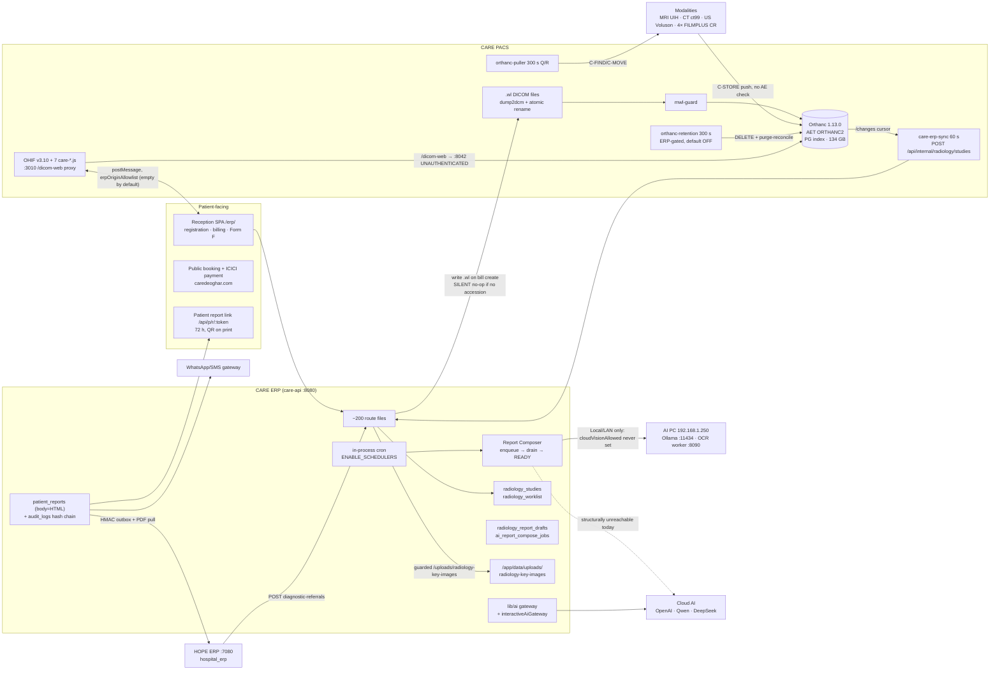

# System Architecture Audit
### CARE ERP · CARE PACS · HOPE ERP · AI Composer · Radiology Workspace
Audit date **2026-10-11**. **Read-only**: no code, config, database, container or deployment was modified; no PR created; no patient data extracted (probe outputs were counted, not read).

---

## A. How to read this document

Every statement is labelled by the **strongest evidence available**:

| Label | Means |
|---|---|
| **[IMPLEMENTED]** | the code exists and does what is claimed; cite proves it |
| **[CONFIGURED]** | a compose/env/deploy file asks for it at deployment |
| **[RUNNING]** | *measured this session* against the live system |
| **[TESTED]** | an automated test proves it (unit, or request-level against a real Postgres) |
| **[UNVERIFIED]** | code exists; no execution evidence; do not rely on it |
| **[UNKNOWN]** | cannot be decided from this box (NAS shell, scanner console, or a live DB needed) |

Two rules applied throughout, both learned the hard way in this repository: **`build.commit` and container labels can lie** (a Vite SPA must be proved by grepping the served chunks; a compose `-p` name is not the folder name), and **a merged PR is invisible at the clinic until someone runs `deploy-synology.sh`**, which hard-resets to `origin/main`.

---

## B. Repositories audited

| Repo | Branch checked out | HEAD | origin/main | Tree | Note |
|---|---|---|---|---|---|
| CARE ERP `care-on-synology1` | `feat/medgemma-local-vision` | `6dc1157b` | `8658be5e` (#913) | clean | local `main` ref is stale at `6387b130` |
| CARE PACS `care-pacs` | `fix/orthanc-mwl-housekeeper-crash` | `53588a0` | `15d92f92` | clean | **`origin/main` contains D2 viewer files; this checkout does not** |
| HOPE ERP `hope` | `failure-log-2026-10-08` | `32630e30` | `8dbf555f` | clean | |
| Also present, not audited | `usg-reports`, `mri-reports`, `ohif-pinned`, `care-d2-*`/`care-composer-*` (11 ERP worktrees) | | | | `ohif-pinned` is a vendored OHIF copy |

Eleven worktrees share this checkout's `node_modules`; a schema edit made in a worktree is invisible to its own tests because `@workspace/*` are absolute symlinks into the main tree. **Any PR design must therefore assume no schema change.**

---

## C. What is actually running — measured 2026-10-11

| Target | Observation | Label |
|---|---|---|
| `https://caredeoghar.com/` `/erp/` `/api/health` `/api/healthz` | **HTTP 502 on every path, `Server: cloudflare`, repeated over 3 rounds** — the clinic's staff ERP, patient portal and API are unreachable | **[RUNNING: DOWN]** |
| `192.168.1.137:8888` (documented `care-web` publish) | TCP refused | **[RUNNING: DOWN]** |
| `192.168.1.137:8042/system` | 200 · Orthanc **1.13.0** · API 31 · AET `ORTHANC2` · PostgreSQL index plugin | **[RUNNING]** |
| `192.168.1.137:8042/statistics` | 2,441 patients · 2,466 studies · 8,999 series · 216,624 instances · 134,921 MB | **[RUNNING]** aggregate only |
| `192.168.1.137:3010/healthz` | 200 — viewer up | **[RUNNING]** |
| `192.168.1.137:3010/care/build-info.json` | v3.10.0 @ `0b6e9cba`, `1.2.0-p2-radiologist`, **built 2026-10-10T05:14:48Z** | **[RUNNING]** |
| `…:3010/care/care-displayed-image.js` and `…/care/image/care-displayed-image-adapter.js` | **404 on both**, while `care-bridge/chrome/config/security` return 200 | **[RUNNING: D2 NOT DEPLOYED]** |
| `…:3010/dicom-web/studies?limit=3` with no credentials | **200 + JSON containing PatientName tags** | **[RUNNING: UNAUTHENTICATED PHI]** |
| `…:8042/dicom-web/studies?limit=3` | same, direct | **[RUNNING: UNAUTHENTICATED PHI]** |
| `192.168.1.137:8091` | staging ERP `{"build":{"commit":"f1a86940b3d6"}}` (that stamp is a documented liar) | **[RUNNING]** staging |
| `192.168.1.137:7080/api/health` | 200 `businessDate 2026-10-11` — **HOPE is live** | **[RUNNING]** |
| `192.168.1.250:11434/api/tags` | 200 · 7 models incl. `medgemma1.5:4b` 3.35 GB, `gemma3:12b` 8.16 GB | **[RUNNING]** |
| `192.168.1.250:8090/health` | 200 · `care-ocr-worker` paddle-ocr-v1 | **[RUNNING]** |
| `172.16.1.139:8042` | **no answer from this box** — yet `deploy/synology/care.env:60` sets `ORTHANC_URL=http://172.16.1.139:8042` | **[UNKNOWN]** |

**Consequences.** (1) **OPS-01** the production ERP is offline — imaging and the hospital ERP are not, so this is a CARE-side fault. (2) **ARCH-01** two different Orthanc addresses are in use (`192.168.1.137` measured alive; `care.env` points at `172.16.1.139`); until these are reconciled, every ERP-side PACS feature may be aimed at a host that does not answer — and the D2 `IMAGE_PACS_UNREACHABLE` class of failure is indistinguishable from that misconfiguration. (3) **ARCH-02** Orthanc REST + DICOMweb are open on the LAN with `AuthenticationEnabled:false`, `RemoteAccessAllowed:true`, `DicomAlwaysAllowStore:true`, `DicomCheckCalledAet:false`, `Access-Control-Allow-Origin:*` (`orthanc/config/orthanc.json:6-14,23-27`) — read **and write** access to the archive, browser CORS included.

---

## D. Application and service inventory

### D.1 CARE ERP ([`pnpm-workspace.yaml`](../../pnpm-workspace.yaml), [`docker-compose.yml`](../../docker-compose.yml))

| Package | Actual role | Stack | Port | Status |
|---|---|---|---|---|
| `artifacts/api-server` | the entire ERP backend: ~200 route files, AI gateway, PACS intake, cron | TS, Express 5, Drizzle, esbuild bundle | 8080 (unpublished) | [IMPLEMENTED][TESTED] · [RUNNING: DOWN] |
| `artifacts/diagnostic-erp` | staff SPA incl. radiology reporting workspace | Vite, React 19, TanStack Query | 80 → host 8888, mounted `/erp/` | [IMPLEMENTED] · [RUNNING: DOWN] |
| `artifacts/clinic-site` | public website, `/` with SPA fallback | Vite/React | inside `care-web` | [IMPLEMENTED] |
| `artifacts/diagno-booking-mobile` | Expo booking app | React Native | — | [IMPLEMENTED], no service |
| `artifacts/local-dicom-bridge` | DIMSE helper (dcmjs-dimse) | Node | — | [IMPLEMENTED], no service |
| `__super_admin_quarantine__/super-admin-portal` | source excluded from the workspace and never built — **but the route is live**: `app.ts:341` serves a bootstrap page, `docker/nginx.conf:189` proxies `/super-admin-portal/`, bundle read from USB (`SUPER_ADMIN_USB_KEY`/`_PIN`) | React | — | **[IMPLEMENTED-SURFACE, NOT-BUILT]** — a deliberate-looking asymmetry worth an owner decision |
| `lib/db` | ~90 Drizzle schema files, counters, migrations | TS/Drizzle | — | [IMPLEMENTED][TESTED] |
| `lib/ai-providers` | provider registry, capability tables, canonical local-AI constants, SSRF-safe transport | TS | — | [IMPLEMENTED][TESTED] |
| `lib/{pacs,measurements,report-quality,pathology,integrations-gemini-ai,…}` | shared domain packages | TS | — | [IMPLEMENTED] |

### D.2 CARE PACS ([`docker-compose.yml`](../../../care-pacs/docker-compose.yml))

| Service | Build vs image | Port | Storage | Role |
|---|---|---|---|---|
| `postgres` | image `postgres:16` | unpublished | host bind `care-pacs/postgres/data` | **Orthanc's index database** (not the ERP's) |
| `orthanc` | image `orthancteam/orthanc:26.9.1` (live 1.13.0) | 5680→4242 DICOM · 8042 REST | `orthanc/data`, `orthanc.json:ro`, **`worklists` rw** | archive + MWL SCP + DICOMweb |
| `mwl-guard` | **build** `./mwl-guard` (pydicom) | none | worklists rw + `worklists-bad` | quarantines crash-class `.wl`; fail-closed readiness gate that Orthanc `depends_on` |
| `orthanc-puller` | image `python:3.11-slim` + **`pip install` at container start** | none | `orthanc-puller:/app` | C-FIND/C-MOVE retrieval, MRI+CT |
| `care-erp-sync` | same pattern | none | own dir | **the working Orthanc→ERP intake** (60 s `/changes`) |
| `orthanc-retention` | same pattern | none | own dir | size cap + ERP purge-reconcile |
| `ohif` | **build** `./ohif/enterprise` (OHIF v3.10.0 @ `0b6e9cba`) | 3010→80 | `care-config.runtime.js:ro` (editable **without rebuilding**) | viewer + `/dicom-web` proxy |
| `tailscale-ohif` | image `tailscale/tailscale` | none | state + `serve.json:ro` | remote viewer access only |

`docker-compose.production.yml` and `orthanc/docker-compose.yml` are **abandoned duplicates of the same project name**; the former's own header says *"DO NOT DEPLOY THIS FILE"* and it omits postgres, mwl-guard, the worklists mount, retention and every `ORTHANC__POSTGRESQL__*` key while adding a `command:` that suppresses env configuration. **[CONFIGURED-BUT-DANGEROUS]** — one careless `up -f` silently changes the archive's index backend.

### D.3 HOPE ERP ([`hope/docker-compose.yml`](../../../hope/docker-compose.yml))

`postgres` (`hospital_erp`, volume `hope_erp_pgdata`) · `migrate` one-shot (`node /app/startup.mjs`, `SKIP_MIGRATIONS=1` in app) · **one** `app` container serving API + built `hms` SPA (host 7080) · `backup` sleep-loop `pg_dump`. No worker container; pollers run in-process. **[RUNNING]**.

---

## E. Databases and schema application

| | CARE ERP | HOPE | Orthanc |
|---|---|---|---|
| Database | `diagnostic_erp`, role `erp` | `hospital_erp`, role `postgres` | Orthanc's own PG index |
| Volume | **`external: true`, name `care_main_db_data`** — compose cannot create it | `hope_erp_pgdata` | host bind `postgres/data` |
| Migrations | `docker/db-patch-entrypoint.sh` via container `care-db-patch-v2`: DB-identity guard on `public.system_database_identity` → advisory lock → `lib/db/drizzle/` in `_journal.json` order (15 entries, **16 files present** — `voice_tables_migration.sql` is unjournaled and never applied) → `migrations/*.sql` alphabetically under a sha256 ledger (**189 files**) | `startup.mjs`, `0000_baseline.sql…0026_*` | Orthanc-managed |
| Verification | `care-schema-verify` (`scripts/db-schema-verify.cjs`), read-only unless `SCHEMA_REPAIR=true`; drift non-blocking unless `SCHEMA_VERIFY_STRICT=true`; **identity mismatch always blocks** | — | — |

**No shared database, no shared tables, no cross-DB FK** between CARE and HOPE — the only boundary is HTTP. Both define a table literally called `patients`: a name collision, not shared ownership.

Two structural facts that shape every other finding:

* **The radiology/reporting spine has essentially no enforced referential integrity.** `radiology_studies.bill_id/order_id/test_id/patient_id`, `radiology_worklist.study_id/patient_id/report_id`, `patient_reports.study_id/patient_id/order_test_id/bill_id`, `radiology_report_drafts.*`, `radiology_report_key_images.draft_id`, `ai_report_compose_jobs.{worklist_id,study_id,report_id,queue_job_id}` are bare integers with no `.references()`; the baseline DDL declares 33 FKs and **none** on those tables, while Drizzle declares 201 elsewhere — the model's FKs were never shipped for the money-and-reporting spine. `orders`/`bills`/`payments` do have real FKs, which is why financial joins behave and clinical joins do not.
* **Four model tables have no shipped DDL at all**: `purchase_invoices`, `purchase_invoice_line_items`, `conversations`, `messages` — invoice posting is dead on a migrated DB.

---

## F. Data-flow diagram

**Identifiers that actually cross each boundary:** bill→study `radiology_studies.bill_id` (soft); ERP↔PACS `StudyInstanceUID` then `AccessionNumber`; CARE↔HOPE `referralUuid` = `hope-opd-<entity>-<visit>`; patient↔patient across systems `patients.patient_id` UHID `P-#####` (HOPE `uhid`, matched in code by **phone+name, not UHID**).

---

## G. Background work

| Job | Trigger | Idempotent | Failure/retry | Where its result is visible |
|---|---|---|---|---|
| Overnight AI shadow drain | 8 s + `setInterval` 60 s + `* * * * *` — **runs without `ENABLE_SCHEDULERS`** | yes (`FOR UPDATE SKIP LOCKED`) | `decideFailure`: maxRetries→`abandoned` dead-letter; GPU_OOM/CONTEXT_BUDGET/PAUSED abandon immediately | `dicom_retry_queue`, `radiology_ops_checks` |
| AI report compose drain | 10 s + `* * * * *`, always-on | yes (`inputHash`) | bounded retry, non-retryable error list | `ai_report_compose_jobs`, worklist `ai_compose_status` |
| `care-erp-sync` sidecar | 60 s `/changes` cursor | upsert on UID | intake **500 = permanent drop**; cursor loss ⇒ replays everything | container log only |
| ERP in-process Orthanc poller | 20 s | same | **disabled by `care.env:73`** | — |
| `orthanc-puller` | 300 s, MRI+CT, 1-day lookback | dedup on tracked UID + `local_study_exists` | logged only | `puller_state.json` |
| `orthanc-retention` | 300 s, keep 500/trigger 520/min age 60 min | cursor | **sleeps unless ERP policy enables it**; `purge-reconcile` failure logged only | ERP + container log |
| `mwl-guard` | 2 s poll, quarantine | verdict cache on (mtime,size) | fail-closed readiness gate | `worklists-bad/` |
| Backups (DAILY/WEEKLY/MONTHLY) | `* * * * *` + in-code hour/minute match | minute-dedupe **in memory only** | failure email; retention `unlink` inside `catch {}` | `backup_job_logs` |
| Restore verification / dead-man | Mon 03:30 / `7 */6` | yes | alert email | `radiology_ops_checks` |
| WhatsApp reminders · recall · feedback | `* * * * *` exact-minute match + process-local `firedToday` Set | **NO** | one skipped tick loses the day; a restart inside that minute re-sends | `wa_outbox` |
| WhatsApp outbox dispatch | `*/2` | yes (`FOR UPDATE SKIP LOCKED`) | bounded retry, dead-letter | `wa_outbox` |
| DICOM auto-pull enqueue | `*/5`, peak-skipped | dedups pending/running | catch | `dicom_pull_jobs` — **nothing drains it** (below) |
| DIMSE in-process agent | `ENABLE_DICOM_PULL_AGENT` | job-row dedup | — | **cannot start: flag appears in no compose/env file**; and its C-MOVE destination defaults to `CONQUESTPACS`, not `ORTHANC2` |
| PACS puller stall watchdog | `*/10` | yes | email once per stall | **silently inert** — early-returns when the agent row is absent (`cron.ts:2003`) |
| Banking sync/recon, fraud, commissions, vouchers, audit archive, session sweep, ops anomaly, inventory alerts | various, all behind `ENABLE_SCHEDULERS` | mostly | per-account/per-row catch | `bank_transactions`, `fraud_alerts`, `audit_logs` |
| Integration outbox / reconciler / e-film | 1 min / 5 min / 2 min, `ff_hope_care_referrals` | claims | **unconfigured URL ⇒ infinite retry, never dead-lettered** | `integration_outbox` |
| `pruneComposeSnapshots` | **never scheduled** | — | — | PHI in `input_snapshot_json` accrues indefinitely |
| `src/worker.ts` | starts cron unconditionally | — | — | **no compose service runs it** |

Two deployment consequences: every cron job depends on `ENABLE_SCHEDULERS` inside `care-api` (`docker-compose.yml:280` passes it through; `deploy/synology/care.env:40` sets `=1`) — **there is no separate worker container**, so an API restart restarts the schedulers and vice-versa; and `MRI_WARM_CACHE` has no deployed off-switch because the gate tests the literal string `"false"` (`mriStudyWarmer.ts:376`) while the variable is absent everywhere.

---

## H. External surfaces

| Surface | Owner file | Config (names only) | Status |
|---|---|---|---|
| **ICICI "Orange Pay"** (the live gateway) | `lib/payments/IciciPaymentProvider.ts`, `routes/gateway-webhooks.ts` | `ICICI_BASE_URL`, `ICICI_URL_PREFIX`, `ICICI_MERCHANT_ID`, `ICICI_AGGREGATOR_ID`, `ICICI_SECRET_KEY` — compose `:?` **hard-required at boot**: unset ⇒ the API refuses to start | [IMPLEMENTED][CONFIGURED] |
| HDFC/CCAvenue, PhonePe, BharatPe, PayU, Razorpay, Cashfree | `lib/payments/*PaymentProvider.ts`, `PaymentEngine.ts:21-73` | DB-stored credentials via `resolveBillDeskCollectorFromDb` (reads `payment_logs.request_payload`) | [IMPLEMENTED] |
| **"BillDesk"** | — | — | **[NOT A GATEWAY]** — in this codebase *Billing Desk* is the in-house cash/UPI counter ledger (`routes/bills.ts`), the `BILLPAY-…` prefix and the studio's `resolveBillDeskForWorklistRows`. The prompt's assumption is a naming collision worth fixing before it misleads someone. |
| WhatsApp/SMS | `lib/notifications.ts`, `services/whatsapp/WhatsAppOutbox.ts`, `routes/internal-automations-whatsapp.ts` | `WHATSAPP_AUTOMATION_SECRET`; credentials in **Admin→Integrations DB settings** | [IMPLEMENTED][RUNNING?] |
| Email | `email.ts` (SMTP from DB), `lib/notify-templates.ts` | — | [IMPLEMENTED] |
| Object storage | `lib/objectStorage.ts` (lazy `@google-cloud/storage`) | `OBJECT_STORAGE_DIR`, `PUBLIC_OBJECT_SEARCH_PATHS`, `PRIVATE_OBJECT_DIR` | [IMPLEMENTED] |
| AI providers | `lib/ai-providers`, `lib/ai/*`, `lib/reportComposer/providers/*` | `OPENAI_API_KEY`, `QWEN_API_KEY`/`DASHSCOPE_API_KEY`, `DEEPSEEK_API_KEY`, `GEMINI_API_KEY`, `OLLAMA_*`, `AI_MODEL_*`, `AI_MODE` | see `AI-COMPOSER-AUDIT.md` |
| OCR worker | `ocr-worker/` | `OCR_ENGINE=paddle`, `OCR_WORKER_URL`, `OCR_WORKER_TOKEN`, fallbacks | **[RUNNING]** (`:8090/health` 200) |
| ABDM / NABH | `lib/abdmGateway.ts`, `migrations/add_abdm_abha_integration.sql` | `ABDM_*` (7 names) | [IMPLEMENTED] — **no ABDM search on the registration path** (`patients.ts:170` dedup is 5-minute phone+name only) |
| Cloudflare / Tailscale | `lib/networkDefaults.ts`, `radiologyDeploymentDiagnostics.ts:486` (LAN→TAILSCALE→CLOUDFLARE→PUBLIC), `tailscale-ohif/serve.json` | `PUBLIC_BASE_URL`, `TS_AUTHKEY` | [CONFIGURED] |
| HOPE bridge | `services/integration/*`, `lib/bootstrapHopeCareIntegration.ts`, `hope/lib/care-integration.ts` | `INTEGRATION_HOPE_CALLBACK_URL`/`_SIGNING_SECRET`, `HOPE_PARTNER_KEY`, `ENABLE_CARE_INTEGRATION`, `CARE_REFERRAL_URL`, `CARE_PARTNER_KEY`, `CARE_CALLBACK_SECRET` | **[IMPLEMENTED BOTH SIDES, DARK BY DEFAULT]** — see §J |
| Biometric/fingerprint, "boundary" API, Reporting Studio, USB super-admin | `FINGERPRINT_BRIDGE_SECRET`, `BOUNDARY_API_KEY`, `REPORTING_STUDIO_API_KEY`, `SUPER_ADMIN_USB_KEY/_PIN` | | [IMPLEMENTED] periphery |

---

## I. Duplicate sources of truth (all cited)

| Fact | Copies | Reader today |
|---|---|---|
| Study rows | `radiology_studies` (billing/commission), `radiology_worklist` (reporting/queue/composer), `dicom_studies` (self-described *"single source of truth"*), `canonical_study` (*"thin crosswalk"*, the only unique UID) | **split by screen** — which is why `patient_reports.study_id` means different things on different paths |
| Accession | `radiology_studies` NOT NULL + unique; `radiology_worklist` nullable, explicitly *"NOT globally unique"*, persists `""` when DICOM has none; `dicom_studies`; `radiology_report_key_images`; MWL `(0008,0050)` | billing writes it, PACS intake writes its own copy |
| Reporting status | `radiology_worklist.status` (UPPERCASE), `radiology_studies.status` (`reported_final/delivered`), `patient_reports.status` (`pending_verification/verified/delivered`), `dicom_studies.report_status`, plus `ai_draft_status`/`ai_compose_status` | **three vocabularies decide "finalized"** — `cron.ts:1389-1396` accepts either of two |
| Report text | `patient_reports.body` (authoritative HTML, **5 disagreeing writers** in `storedReportBody.ts:4-14`), `radiology_studies.final_report`, draft HTML/text/sections, `structured_json` cache, `structured_json_d1`, `ai_shadow_drafts.draft_json` | `body` on print; **structured path also writes it** |
| Key images | `radiology_report_key_images` + `usg_key_images` + `radiology_image_references` + `smartRadiology.keyImageIdsJson` | per-screen |
| Config | `pacs_settings` (k/v), `clinic_settings` (wide columns), `ai_scheduler_config.overnight_ops_json`, `feature_flags`, `ai_feature_policies`, `ai_modality_policies` | lock TTL in one, composer retention in another |
| Referring doctor / assignment | `radiology_studies.assigned_radiologist_id/_name`, `radiology_worklist.assigned_radiologist`(name)+`_id` ("mirrored for every pre-existing reader"), `radiology_study_locks` vs `radiology_worklist.lock_*` | mirrored by hand |

---

## J. CARE ↔ HOPE

Implemented on **both** sides, in the current trees:

| Direction | Endpoint | Auth | Counterpart? |
|---|---|---|---|
| HOPE→CARE referral | `POST /api/integration/v1/diagnostic-referrals` (from OPD `opd.ts:1119`, IPD `ipd_clinical.ts:460`, progress notes) | `Bearer CARE_PARTNER_KEY`, SHA-256 at rest, code-fixed allowlist | **yes** |
| CARE→HOPE result | `POST /api/integration/care-callback` — HMAC-SHA256 over `ts.body`, 300 s replay window, `eventId` unique dedupe | `CARE_CALLBACK_SECRET` ≡ `INTEGRATION_HOPE_SIGNING_SECRET` (one symmetric secret, no rotation path) | **yes** |
| CARE→HOPE PDF | HOPE pulls `GET {care}/api/p/r/{token}/pdf` and stores it in `patient_documents` (sha256-deduped) | public expiring token | **yes** |
| Critical ack | HOPE `POST …/:uuid/acknowledge` → `external_result_links.critical_ack_*` | partner key | **yes** |
| Study-ready + deep link | `diagnostic_study.completed` → `careRadiologyOpenUrl` | session | **yes** |
| Catalogue | CARE `GET /integration/v1/catalogue` | — | **dead** — HOPE instead round-trips a CSV (`care_test_catalog.ts` + `0024_care_test_catalog.sql`) |
| PUT/cancel/status | implemented in CARE `inbound.ts:167,190,212` | — | **no caller** |

**Dark in practice:** HOPE's working `.env` (25 lines) contains **no CARE variables**, so `ENABLE_CARE_INTEGRATION` defaults `0`; `deploy/synology/hope.env:41-42` still says `REPLACE_ME`; CARE's compose defaults both `INTEGRATION_HOPE_*` to empty; and the whole scheduler waits on `ff_hope_care_referrals` (seeded **false**). **Nothing crosses the boundary until four separate settings are turned on, and no code path proves they ever have been.**

**Two drift findings worth the owner's attention:** (a) CARE's `bootstrapHopeCareIntegration.ts:21-25` hardcodes a partner key + callback URL and runs **on every container start** (`index.ts:2974`), force-able by `HOPE_CARE_INTEGRATION_FORCE=1` — a committed default that can create a partner row on any host; `.env.example:245,247` carries real-looking values and must not be treated as inert. (b) CARE's docs still say the HOPE-side adapter "is a reference, not pushed" — that is **false**: HOPE has the full implementation. Patient matching also ignores UHID in favour of phone-suffix + name (`patientMatching.ts:148-171`), so the same person is two rows in two databases by design, with no delete or amendment propagation to HOPE's stored copy.

---

## K. What should be improved (architecture-level only; details in the other documents)

| ID | Finding | Evidence | Class |
|---|---|---|---|
| ARCH-01 | Two Orthanc addresses in use; the configured one does not answer from here | `deploy/synology/care.env:60` vs measured `192.168.1.137:8042` | blocking unknown |
| ARCH-02 | Orthanc REST/DICOMweb unauthenticated, any-AE C-STORE, CORS `*` | `orthanc.json:6-14,23-27` + live 200s | P1 privacy |
| ARCH-03 | `build.commit`, compose `-p` and image labels cannot be trusted; the deployed commit is derived, not recorded | `care-erp-sync`/`build-info` measured; `docker-compose.yml:184` viewer version unchanged by D2 | process |
| ARCH-04 | No worker container; `worker.ts` unwired; DIMSE agent flag absent; watchdog inert | §G | P2 reliability |
| ARCH-05 | Two live senders for the same intake job with divergent payloads | `orthancChangesPoller.ts` vs `care_erp_syncV3.py` ("Run ONE") | P2 |
| ARCH-06 | Four study tables, three status vocabularies, five report-text homes | §I | P1 integrity |
| ARCH-07 | No FK on the radiology/report/money spine; 4 tables with no DDL; 1 unjournaled migration | §E | P1 |
| ARCH-08 | Abandoned compose files share the live project name | `docker-compose.production.yml:1-13` | P2 |
| ARCH-09 | Quarantined super-admin portal is unbuilt while its route is live | `nginx.conf:189`, `app.ts:341` | UNKNOWN intent |
| ARCH-10 | `ERP_INTERNAL_API_KEY` defaults to the literal `1234` in compose and is hardcoded in the sync script | `care-pacs/docker-compose.yml:165`, `care_erp_sync.py:46` | P1 |
| ARCH-11 | ICICI vars are `:?`-required, so a missing gateway secret stops the whole ERP — not just payments | compose | P2 blast radius |
| ARCH-12 | Backups: `pg_dump` only; the uploads volume (frozen key images = clinical evidence) is **not** in it, and retention unlink is inside `catch {}` | `docker-compose.yml:419-423`, `cron.ts:744-760` | P1 durability |

## L. Limitations of this audit

No NAS shell (SSH from this box is refused — no key), so **container state, env values, `.wl` folder contents, cursor freshness, backup files and every row count are unknown**; the probe list in `MASTER-FINDINGS-AND-ROADMAP.md` resolves them. The `172.16.1.x` modality network is unroutable from here, so scanner behaviour is code-and-config only. No payment transaction was exercised and no provider API was called. The ERP's own test suite was not re-run for this audit; prior runs this week are cited as historical evidence with their commit and result set.
