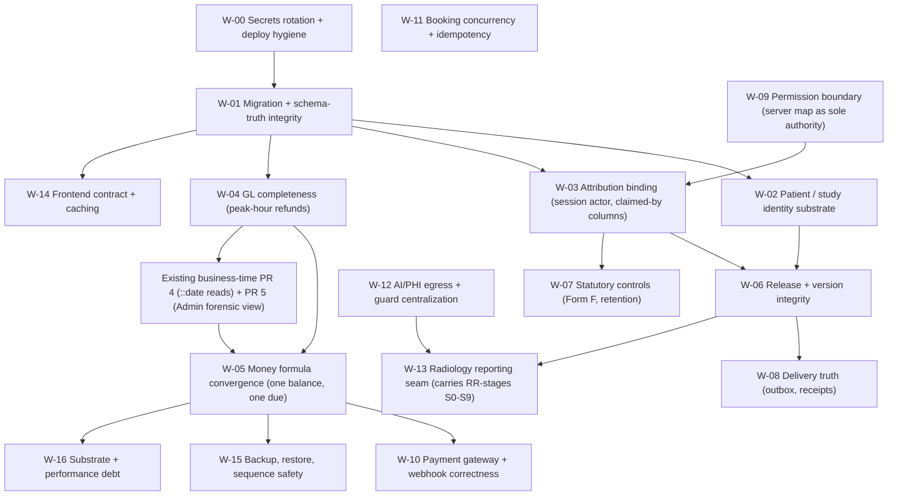

# CARE ERP — Master Remediation Plan

**Companion to:** `care-erp-whole-system-deep-audit-2026-09-30.md` (findings `CA-01 … CA-105`, seams `CF-01 … CF-20`) and `radiology-reporting-workspace-deep-audit-2026-09-30.md` (findings `RR-01 … RR-64`, merged as `ee897099` / PR #796).
**Status:** **PROPOSAL ONLY — nothing in this plan is implemented, scheduled, merged or deployed.** No file, migration, schema or configuration change is made by this document.
**Audited tree:** `origin/main` = `ee897099`. Citations re-pinned against that commit (see the audit's §8 R-08).
**Purpose:** order the work so that fixing one subsystem cannot destabilize another. The organising rule is **dependency, then risk** — not ease, and not the order the findings were discovered.

---

## 1. Ordering principles (why the sequence is this shape)

1. **Credential exposure before correctness.** A committed secret invalidates every downstream control. Nothing else is worth hardening until rotation is done, because an attacker with the repo already owns the database.
2. **Truth about the substrate before new controls.** Twelve of the remaining findings depend on *adding* a constraint, index or column. If migrations are still recorded as applied when they failed, and boot code still swallows DDL errors, then every new control added on top of that is unverifiable. **W-01 exists so that later constraints are provably present.**
3. **Census before constraint.** Adding `UNIQUE` to `patients.patient_id`, `radiology_worklist.study_instance_uid`, `vouchers.voucher_number` or `booking_ref` is safe only after the live duplicate count is known. Per the ratified forward-only rule, a `NOT NULL`/`CHECK`/`UNIQUE` on an existing column **validates retroactively** — so the mechanism must be `NOT VALID` + a period-scoped `VALIDATE`, or a write-path rule, not a blunt `ADD CONSTRAINT`.
4. **Never change both sides of a seam in one PR.** Money has nine balance formulas. A PR that changes the server formula *and* the client formula *and* the report SQL simultaneously cannot be reviewed, reverted or proven. Each seam gets its own stage with the other side pinned by a characterization test first.
5. **Evidence before enforcement.** A control that blocks a clinical or financial action needs the data to say it will not block legitimate work. This is the same sequencing the business-time programme used (Stage 0 characterization → Stage 1 defaults → enforcement gated on decisions), and it is why W-03/W-04/W-05 are *observation-first*.
6. **Characterization tests go in green, and are never "fixed" by editing application code.** If a characterization test turns red, the application changed behaviour and that change is the thing under review.
7. **One stage = one PR = one revert.** Every stage names its rollback. Anything that cannot be reverted by reverting a commit is split.
8. **No production-changing command appears in this plan.** Verification uses read-only queries and a throwaway database (Appendix B). The NAS is not touched from a workstation session.
9. **Legitimate behaviour is preserved.** No stage introduces a blanket ban on prior-dated entry, on admin overrides, or on in-place corrections where management has not decided to forbid them. Where the fix would change product semantics, it appears in §5 as a decision, not as code.

---

## 2. Dependency graph of the work



**Two edges that are easy to get wrong.**
- `W-05 → BT(PR 4)` and `BT → W-05`: the 14 `::date` read sites and the nine balance formulas **live in the same queries**. Doing them in either order without coordination means rewriting the same SQL twice. Recommendation: **PR 4 first, then W-05**, so W-05 converges formulas on a single day-boundary convention instead of fighting two.
- `W-09 → W-03`: binding attribution to the session is worthless if half the routes still accept a body actor because no permission check rejects the caller. The permission mount audit and the actor change should be reviewed as adjacent stages, not merged.

---

## 3. Stages

Format: **closes** (finding IDs) · **depends** · **decision gate** · **must not break** · **proof** (how to show it works without touching clinic data) · **revert**.

### W-00 — Rotate the committed secrets, and stop re-writing them on deploy
**Closes** CA-01, CA-45 (Orthanc auth/CORS), CA-48 (fallback partner key), CA-78 (rw mount), partial CA-74.
**Depends** nothing. **Do this first, alone.**
**Scope.** (a) Treat every value in `deploy/synology/care.env`, `hope.env`, `NAS_OVERNIGHT_ENV_PATCH.env` as disclosed: JWT/session/backup/cron secrets, `SUPER_ADMIN_USB_PIN`, ICICI secret, `INTERNAL_API_KEY`, `OCR_WORKER_TOKEN`, HOPE partner key. (b) Remove the files from tracking and replace with `.example` templates carrying no values. (c) Delete the re-append step in `deploy-synology.sh:118,120` — rotation currently does not survive the next deploy. (d) Add `care.env`/`hope.env`/`*.env` to `.dockerignore` so `COPY . .` at `Dockerfile:30` stops baking them into `base`→`migrate`/`schema-verify`. (e) Enable Orthanc authentication and stop `DicomAlwaysAllowStore` for unauthenticated AETs. (f) Give every internal caller its own hashed credential, copying the existing `aiCallerCredentials` model, and drop the shared static key. (g) Purge the values from git history is **management's call** — the plan flags it, does not perform it.
**Decision gate** none to start; the history-rewrite question and the credential-per-caller rollout window are operational decisions for the owner.
**Must not break** every bridge, the Windows emergency station, the OCR PC, the Orthanc notify hook and HOPE callbacks — all of which read the values being rotated. Sequence the rotation with a dual-key window.
**Proof** `grep -rlE '^(JWT_SECRET|SESSION_SECRET|BACKUP_PASSPHRASE|ICICI_SECRET_KEY|INTERNAL_API_KEY)=' $(git ls-files)` returns only `.example` files; `docker compose config` still resolves; smoke: login, one cash bill, one report print, one HOPE ping, on a **test** dataset.
**Revert** configuration is externalized; rollback is restoring env files, not code.
**Note** this stage has no code dependency on anything else, so it must not be bundled with anything.

### W-01 — Make schema truth honest before adding any control
**Closes** CA-07, CA-08, CA-09, CA-42 (boot history rewrite), CA-104; makes CA-02/CA-10/CA-11 fixable.
**Depends** W-00 (rotation first, because `schema-verify` mounts the deployment directory `rw`).
**Scope.** (a) `docker/db-patch-entrypoint.sh`: stop recording a Drizzle file as applied when it errored — `ON_ERROR_STOP=1` or a post-run error grep, with the two known-benign filters kept explicit and asserted. (b) `api-server/src/index.ts`: report boot-DDL failure truthfully — the existing `markStartupMigrationsSettled(true)` must not fire on the swallowed path (`:2806-2807,2911`), and `/api/health` must degrade. (c) Move the six `CREATE UNIQUE INDEX` statements and the constraint-bearing DDL out of boot code into migrations, keeping the boot code as an idempotent repair only. (d) Stop the boot `UPDATE bills SET ledger_id …` history rewrite, or gate it behind an explicit one-time flag with an audit row — it conflicts with the ratified FORWARD-ONLY rule. (e) Decide `SCHEMA_VERIFY_STRICT`: either make drift block the deploy, or rename the step so nobody reads it as a gate. (f) Publish the fresh-vs-restored schema diff as a test, not a document.
**Decision gate** **E-11 (new)**: is a schema mismatch allowed to stop a deploy? Today it silently does not.
**Must not break** the CI fresh-boot path and the restore path — both currently depend on error-swallowing to come up.
**Proof** the repo's own recipe: throwaway `postgres:16-alpine`, apply every migration, assert the constraint set with `pg_indexes`/`pg_constraint`, then re-apply for idempotency (Appendix B). No NAS access required.
**Revert** each of (a)–(f) is an independent commit; all are revertible without data effect.

### W-02 — Identity substrate: one human, one chart; one study, one UID
**Closes** CA-02, CA-10, CA-11, CA-67, CA-68, CF-01, CF-02, CF-03; enables CA-25/CA-28.
**Depends** W-01 (constraints must be provably present).
**Scope, in this order.** (1) **Census only** — V-01, V-02, V-05 from the audit; publish the duplicate UHID / empty UHID / numeric-UHID / duplicate-UID counts as a written artefact. (2) Fix the **generator**, not the data: stop using the integer PK as a DICOM PatientID (`publishRadiologyStudyToMwl.ts:117,146`, `pacsArchive.ts:82`, `normalizeWorkspaceStudy.ts:73`), and stop writing `"0000000000"` as a real phone (`dicomPatientCreator.ts:135`, `emergencyReconcile.ts:456`). (3) Add the missing UNIQUE **with the retroactive-validation problem solved** — `CREATE UNIQUE INDEX … NOT VALID` is not available for indexes, so the practical options are: a period-scoped guard in the write path first (new rows only), then a validated constraint once the census is clean; or a partial unique on rows created after a cutover instant, mirroring the ratified `care_time_integrity_policy` pattern. **Choose deliberately; do not let a migration silently lock out a clinic that has duplicate UHIDs today.** (4) Make the resolvers fail closed: `eq(patientId).limit(1)` sites must refuse when more than one row matches, and `canHydrateDraftForPatient` must not return `true` for a null patient. (5) One phone normalizer, adopted everywhere. (6) Merge/re-parent tooling is the **only** remaining path to fix duplicates — and it must be designed before any constraint blocks new ones.
**Decision gates** **E-9** (single-site forever?) and whether a duplicate-UHID state should hard-block registration at the desk.
**Must not break** legacy charts: an existing duplicate must not make the clinic unable to bill or report. Constraint scope must be forward-only.
**Proof** characterization tests on the resolvers; a synthetic DB with two patients sharing a UHID, asserting refusal; no NAS data touched.
**Revert** (2) is code-only; (3) needs `DROP INDEX` and the write-path rule removed; both stated before merge.

### W-03 — Attribution: the session is the only actor
**Closes** CA-13, CA-41, CA-22's authorization component, CA-55's audit aspect; the RR-03 half of the radiology audit.
**Depends** W-09 review adjacency (see graph), W-01 for audit-column safety.
**Scope.** Every write path stores the **session subject id** as the actor and keeps any caller-supplied name in a **separately named, clearly-untrusted column** (`claimed_by`). Applies to: `POST/PATCH /vouchers` (`accounting.ts:266,320,407`), `expenses` `approvedBy` (default `?? true` → require an explicit subject id, and make self-approval an audited privilege, not a default), `bills` cancel-test/swap-test/cancel-refund (`:2557,2656,2995`), `reprintedBy` (`:1619-1635`, and delete the localStorage pre-fill), `acknowledge-critical` (`patient-reports.ts:2450-2467`), `internal-reporting-studio.ts:811-816`, `internal-radiology.ts:1256`. Add audit rows where there are none (`expenses` create/payment/void/retry; `waChatbot.ts:152` hardcoded `"staff"`).
**Decision gate** **E-1** for the clinical record; for the financial record management has already decided **reject-only, no correction workflow** — this stage must **not** reintroduce an override path.
**Must not break** legitimate admin overrides (they remain allowed, but attributed to the admin who performed them, with the claimed value retained alongside) and the existing `voucher_audits` before/after contract.
**Proof** request-level tests that post a body actor and assert the stored actor is the session subject; characterization of the current behaviour first.
**Revert** column-additive; code revertible.

### W-04 — General-ledger completeness for refunds and reversals
**Closes** CA-06, CF-05; CA-32 (no cash-variance voucher), CA-57 (ledger reset orphans), CA-62 (inventory/payables never in GL) as follow-on sub-stages.
**Depends** W-01; sequenced **before** W-05 because GL correctness constrains what "balance" can mean.
**Scope.** (1) Decide the deferral policy for money leaving the clinic: either post refunds/reversals immediately (they are low-volume, which is exactly the argument the accounting audit accepted for expense vouchers) or add a persisted `accounting_status` on `payments` with a backfill that **includes negative rows**. Today both recovery queries exclude them — `auto-voucher.ts` defers 08:00–16:00 IST and `accounting.ts:1349` skips `amount <= 0` with the comment "refunds/reversals not synced here". (2) Extend `books-sanity` to inspect negatives, so the omission becomes detectable. (3) Make post-commit voucher firing either transactional or explicitly queued with a visible backlog. (4) Day-close cash variance produces a voucher. (5) `ledgers/:id/reset` must not leave orphan vouchers, and must stop deleting `bill_audits`. (6) Purchase-invoice posting produces Dr Inventory / Cr Creditors, and payables stop being counted twice.
**Decision gate** whether revenue recognition stays cash-basis (the accounting audit found GL-cash vs billing-bill-basis) — that is a management/accounting policy, not a fix.
**Must not break** the LOCKED closed-period rule (a correction must not become impossible); no gate on post-close refunds.
**Proof** throwaway DB, apply-all-migrations, run a refund inside simulated peak hours, assert a voucher exists or a backlog row exists and is visible.
**Revert** each numbered item is a separate commit; the `accounting_status` column is additive and unused on revert.

### W-05 — Money formula convergence
**Closes** CA-05, CA-30, CA-31, CA-44, CA-82, CA-83, CF-04; plus the nine-formula table in Map 2.
**Depends** W-04, and **business-time PR 4 (the 14 `::date` reads) should land first** so there is one day convention to converge onto.
**Scope.** (1) Fix the refund semantics **once**: `paidAmount` means gross money received, or net of refunds — pick one, write it into the schema comment, and make `billBalanceFromParts` and every consumer agree. Today `bills.ts:2022-2032` mutates both fields, `money.ts:90-91` subtracts both, and `commissionCalc.ts:437` documents the opposite. (2) One `outstanding` function used by the desk, the dues screen, the reminder SMS, day-close, reports and the receipt. (3) Remove the client re-derivation at the point of sale (single shared money module used by the frontends — today `lib/money.ts` has nine server importers and **zero** frontend importers). (4) Stop `super-edit` re-scaling `order_tests` to a client subtotal; the line items are the source of truth. (5) Raise or remove the `.limit(500)` on `daily-summary` and make any cap explicit on the screen. (6) `originalTotal` stops being frozen at create. (7) A one-time **forward-only** reconciliation rule for any already-inconsistent row: leave the historical value, and let the fix apply to new writes. Do **not** run a restatement.
**Decision gates** **E-6** (is desk undercharge latitude intentional? should a line-level price change require a reason like bill discount does?) and the refund-semantics choice itself.
**Must not break** commission qualification (`commissionCalc` is single-sourced and correct against one convention), day-close windows, and any test that pins current balances — those tests must be **named and changed deliberately in this PR**.
**Proof** property test: for random sequences of pay/refund/cancel/supersede, assert `total = paid + balance + refund` under the chosen convention, and assert every consumer returns the same number.
**Revert** single semantic change; revertible but leaves the convention question open.

### W-06 — Release and version integrity
**Closes** CA-03, CA-14, CA-20, CA-23, CA-87, CF-08, CF-10 (the release half).
**Depends** W-02 (identity) and W-03 (attribution).
**Scope.** (1) The legacy `/verify` path gets `canStructuredVerify` — a real permission and a session-derived verifier; the distinctness check compares identities, not two client strings. (2) `pending_verification` is either a released state or it is not: unify the three status sets (`patient-reports.ts:2912/2926/2989/3007` vs `patientPortal.ts:49` vs `teleradiology.ts:57`) and stop `barcode-resolver.ts:305` stamping `delivered` from any status. (3) Content edits after signature require the amendment path, for every status; no silent `PATCH`. (4) Every delivery ledger records **which version** was delivered, joined to the amendment chain. (5) Cancel/refund revokes outstanding links and tokens; today `publicToken` is nulled only in a startup backfill. (6) The lab report gets its specimen linkage restored (`patient_reports` ↔ sample/order) or the free-dropdown creation path is closed for clinical types.
**Decision gates** **E-1** (in-place edit policy), **E-2** (which artifact is legal), and whether the amendment flow is mandatory for lab as it is for radiology.
**Must not break** the counter-sign workflow for genuinely urgent releases, and the existing version resolver's fail-safe behaviour.
**Proof** request-level tests on a throwaway DB: attempt verify as each role; attempt PATCH at each status; deliver a superseded version and assert refusal.
**Revert** permission and status-set changes are behavioural and revertible; the delivery-version column is additive.

### W-07 — Statutory controls
**Closes** CA-04, CA-36, CA-43 (Form F linkage aspect), CA-76.
**Depends** W-03.
**Scope.** (1) `PATCH /form-f/verify-id-data/:id` requires the ID artefact to exist, requires a permission, and is audited; the gate's own inputs stop being freely settable. (2) `consentDate` cannot default to `""` alongside a required `procedureDate`: either both are required or the gate requires the one that matters — and the registry file that claims "Form F rows are insert-only" must match the code that updates them. (3) The gate is not scoped by a client-chosen `type`; the obstetric check runs on the study/test, not on a dropdown. (4) Retention: reconcile the 730-day `audit_logs` purge against the documented ≥7-year window. (5) `bill` deletion stops nulling `form_f_records.bill_id` without an audit row.
**Decision gate** **E-8** (actual retention requirement).
**Must not break** legitimate late Form F completion for a prior study — that is a statutory reality; the control is *evidence and attribution*, not a time gate. This is exactly the distinction the business-time programme drew and it applies here unchanged.
**Revert** code-only, plus one audit-column addition.

### W-08 — Delivery truth
**Closes** CA-18, CA-19, CA-09-family, and the "asserts things that did not happen" class.
**Depends** W-06.
**Scope.** Delete or implement — never leave a `ok:true` next to a comment saying "Integrate with WhatsApp/email API for actual delivery". (1) `fetalUsgLevel4.ts:741-786` returns real results or reports `queued`. (2) `reportDelivery.ts:118,200` stops counting `pending` as success. (3) Every channel goes through one outbox with attempts, receipts and a visible failure state. (4) Consent: `marketingMessagesAllowed` is read by the send paths or deleted; transactional vs marketing distinguished; NDNC respected. (5) `my-daily-summary.ts:36 /send-email` (arbitrary `to/subject/htmlBody` from any staff, no ledger) is closed or made an audited template send.
**Decision gate** none to stop the fabrication; E-2 for receipts.
**Revert** per-channel, all behavioural.

### W-09 — Permission boundary: one map, enforced where it counts
**Closes** CA-12, CA-52, CA-61, CA-71, CA-72, CA-73, CA-74 (auth aspect), CF-06.
**Depends** none for the audit; W-03 review-adjacent.
**Scope.** (1) Generate the client permission map from the server route table, so the two cannot drift. (2) `canAccess` fails **closed** for unlisted paths, with the 95 ungated route paths explicitly classified. (3) The 35 auth-only mounts get module permissions — starting with `/ai-reporting` (73 handlers touching patients and reports), `/samples`, `/appointments`, `/accounting` voucher writes, `/day-close`, `/gateway/reconcile`. (4) Add refund-grade sub-permissions where refund money moves through `cancel?autoRefund`. (5) Log denials. (6) Stop rendering a 403/failed read as "no data / ₹0": ~146 silent-empty defaults, 19 `isError` checks today. (7) Per-caller credentials replace the remaining shared keys (finishes W-00).
**Revert** per-mount; the client map generation is a build artefact.

### W-10 — Payment gateway and webhook correctness
**Closes** CA-15, CA-16, CA-17, CA-24, CA-25, CA-27, CA-53.
**Depends** W-05 (the clamp needs the balance convention settled).
**Scope.** `express.raw()` + verified-signature-over-bytes for every provider; constant-time compares with a length-and-separator-safe canonical string; **ack after settlement succeeds**, and `settleBill` inside a try with a dead-letter on failure; an outstanding clamp in `settleBill` (`:178`) so `paidAmount` cannot exceed the total; payment links get single-use and enforced expiry (`expiresAt` is written and never read); `bookingRef` entropy raised and made unique in the schema; the keyless FNV-1a bill-verify endpoint gets a server secret or stops returning identity fields; a stored event id for replay prevention.
**Revert** provider-by-provider; each webhook is independent.

### W-11 — Booking concurrency and idempotency
**Closes** CA-26, CA-28, CA-29, CF-20, plus the `selectedDate` string-format hole.
**Depends** W-02 (patient identity) for the kiosk path.
**Scope.** Bring the website's `pg_advisory_xact_lock` + recount model to `POST /appointments` and kiosk; add an idempotency key (client-generated request id with a unique index) to every create-from-public-origin path; stop the public `/qr-confirm` route resurrecting `cancelled`; make kiosk/walk-in consume capacity in the same model the website uses, or state in the product that they do not; validate `selectedDate` to one format; require the referring-doctor id to exist.
**Revert** lock/idempotency are additive; the status-transition guard is behavioural.

### W-12 — AI boundary and PHI egress
**Closes** CA-33, CA-34, CA-35, CA-96, CA-97, CA-98, CA-99, CF-16.
**Depends** W-09.
**Scope.** (1) The request body stops authorizing image egress (`reportComposer.ts:616-624`). (2) One egress policy enforced at the provider client, with a field allow-list, not per-route goodwill. (3) Move the guard spine (`rulesBeforeAi`, trust gauntlet, manifest, provisional versioning, evidence) out of `shadowPipeline.ts` into the shared call path so the other ten routes inherit it. (4) Extend `aiIsolation.test.ts` to all AI source directories — the current three-directory scan makes a green result meaningless. (5) Record provider/model/version next to every AI output, so "which model wrote this draft" is answerable. (6) Delete or fix the fabricated enhancement values (`aiReportEnhancer.ts:59-68`). (7) Patient-facing bot: human gate before free-text AI answers reach patients, and no appointment writes without one. (8) Cost/token metering columns if the owner wants spend visible.
**Decision gate** **E-4** (disclosure), and whether cloud providers are permitted at all.
**Revert** guard centralization is refactor-shaped; do it as its own PR before behaviour changes.

### W-13 — Radiology reporting seam (carry-over, not a duplicate)
The workspace audit's own staging (S0–S9) already exists; **adopt it as W-13 unchanged**, with three corrections imposed by the whole-system view:
- its **S1** (record integrity + session-bound identity) merges with W-03 rather than repeating it;
- its **S7** (print artifact) merges with W-06/W-08 because the same client-rendering class also emits **bills, receipts, Form 3C and labels** (13 jsPDF sites) — fixing only the radiology print path leaves the financial documents wrong;
- its **S4** (provenance across the boundary) must use the same actor/`claimed_by` vocabulary W-03 establishes, or the clinical and financial trails will not join.
**Closes** CA-37 … CA-40, CA-88 … CA-94 and the RR register.
**Depends** W-01, W-02, W-03, W-06, W-12.

### W-14 — Frontend contract and caching
**Closes** CA-79, CA-80, CA-81, CA-84 (client half), CA-100.
**Depends** W-01 (build artefacts), W-05 (money helper shared).
**Scope.** Raise the OpenAPI coverage from 17% for the endpoints the money and release screens use, and generate hooks for those; adopt one query-key family per resource so invalidations cross; drop `staleTime: Infinity` on the price catalogue at point of sale; bump service-worker cache names per deploy and fix the 5xx-fallback bug; move offline bill replay to server-side repricing; stop persisting a signatory name in localStorage.
**Revert** per-file; the codegen artefact is build-time.

### W-15 — Backup, restore and counter safety
**Closes** CA-11, CA-46, CA-75, CA-76, CA-77, CF-14.
**Depends** W-01, W-04 (GL state is what a restore must prove).
**Scope.** Put `ENABLE_SCHEDULERS` into the deployed env so backup, restore-verification and the dead-man alert actually run; extend backup coverage to uploads, object storage, Orthanc/Conquest databases and the env file itself (out of git, into a protected store); persist `/app/data/reports` and `/app/data/archives`; decide WAL archiving (PITR) vs dumps; make post-restore sequence reseed **unconditional** rather than violation-triggered; fix the deploy script's verification probe (it checks a port no container publishes); make the SOP recovery compose file either match production or be marked non-production (it currently republishes `5400` and uses a fresh non-external volume).
**Decision gate** retention objective, and RPO/RTO in hours, which is management's to set.
**Proof** restore a dump into a throwaway container, assert sequences are ahead of `max(id)`, assert every clinical table is present, and count duplicates — all without touching the NAS.

### W-16 — Substrate and performance debt
**Closes** CA-50, CA-51, CA-86, CA-95, CA-101, CA-102, CA-103, CA-105, and the FK/CHECK programme.
**Depends** W-01.
**Scope.** Index `payments.created_at` standalone (every money filter keys on it, only `(bill_id, created_at)` exists); make `/worklist` bounded and pushed into SQL; give `nextAccessionNumber` a real sequence with tests; retire the 58 writerless tables or document why they exist; convert the highest-value `readFileSync` assertions into behaviour tests; add a browser smoke test for billing and reporting screens (currently zero `.test.tsx`); the two `@ts-nocheck` shells; unbounded `observationLedger` in the autosave payload; the fake next-study prefetch and the AI-draft POST for an unopened study.

---

## 4. Sequenced release calendar (one PR each, reviewable individually)

| Order | Stage | Why here | Clinic risk while waiting |
|---|---|---|---|
| 1 | W-00 secrets | Everything else is moot until rotated | **High** — repo read = full access |
| 2 | W-01 schema truth | Prerequisite for every later constraint | Medium — drift invisible today |
| 3 | W-09 permission boundary | Stops unauthenticated/under-authorized writes being added | Medium |
| 4 | W-03 attribution | Cheap, additive, unblocks evidence for W-06/W-07 | High for defensibility |
| 5 | W-15 backup/recovery | The clinic currently has unproven restores | **High** — unquantified |
| 6 | business-time PR 4 (`::date`) | Prepares a single day convention | Low |
| 7 | W-04 GL completeness | Money currently vanishes from GL at peak hours | **High** — silent |
| 8 | W-05 money convergence | Needs W-04 + PR 4 settled | Medium-High |
| 9 | W-02 identity substrate | Needs census from W-01, blocks W-06 | **High** — patient safety |
| 10 | W-06 release/version | Needs W-02, W-03 | Medium-High |
| 11 | W-07 statutory | Needs W-03 | **High** — PCPNDT |
| 12 | W-08 delivery truth | Needs W-06 | Medium |
| 13 | W-10 gateways | Needs W-05 | Medium |
| 14 | W-11 booking | Independent-ish, late to avoid disturbing front desk twice | Low-Medium |
| 15 | W-12 AI/PHI | Needs W-09 | Medium |
| 16 | W-13 radiology seam | Needs almost everything | Medium |
| 17 | W-14 frontend contract | Needs W-05 | Low |
| 18 | W-16 substrate/perf | Last: it is where the remaining risk is cosmetic | Low |

**Bundling is forbidden** except where a stage is split into sub-commits inside one PR. A reviewer must be able to revert one line item without collateral damage.

---

## 5. Decision register (blocking, and not engineering's to decide)

| ID | Decision | Blocks | Notes carried from earlier programmes |
|---|---|---|---|
| E-1 | May a **released clinical record** ever be edited in place, and with what authorization/reason/evidence? | W-06, W-07 | For **financial** records management already decided **reject-only with no correction workflow**; do not build a correction path. Extending the same stance to clinical is a decision, not an inference |
| E-2 | Which artifact is the legal document (server PDF, portal link, client print)? May client renderers emit documents at all? | W-06, W-08, W-13 | |
| E-3 | Must Findings↔Impression agreement **block**, or stay warn-and-record? | W-13 | Warn-only is currently written into the code as intent |
| E-4 | Must AI/dictation contribution be disclosed on the delivered report? | W-12, W-13 | |
| E-5 | Is a study-less radiology report legitimate (outsourced reads)? | W-06 | |
| E-6 | Is desk line-price undercharge a deliberate latitude, or must it carry a reason? | W-05 | Documented as intentional for package splits; unbounded for every line |
| E-7 | Adopt per-caller credentials everywhere, ending shared static keys? | W-00, W-09, W-12 | `aiCallerCredentials` is the working model to copy |
| E-8 | Actual retention: 730 days as coded, or ≥7 years as documented? | W-07, W-15 | Two repo documents currently disagree |
| E-9 | Single-site forever, or multi-clinic? | W-02, W-16 | 0 clinic/org columns; retrofit is a programme |
| E-10 | `patient_reports` immutability: DB trigger (copy the AI-evidence pattern) or app convention? | W-06 | In-place corrections are sometimes legitimate; decide knowingly |
| E-11 | Should a schema mismatch stop a deploy? | W-01 | Today it does not, and the committed verification report says FAIL |
| E-12 | Is revenue recognition cash-basis (GL) or bill-basis (billing)? | W-04, W-05 | The two currently differ by construction, which is a policy choice |
| E-13 | Do the deferred feature flags (`ff_radiology_structured_final`, `_core`) ship ON, and in what order? | W-06, W-13 | Several findings flip between live and latent purely on these |
| E-14 | Rewrite git history to remove committed secrets? | W-00 | Cost/benefit is the owner's; the plan flags it and does not act |

---

## 6. Anti-goals — explicitly not part of any stage

- Do **not** replace `new Date()` with a clinic-time helper wholesale (ratified in the business-time programme; it creates false confidence and hides intent).
- Do **not** add a business/effective date to `bills` or `payments`; the instant-only design is correct as decided (D-5).
- Do **not** build a privileged correction/override workflow; the decision is reject-only.
- Do **not** run any restatement, cleanup, re-dating or reclassification migration over historical data — FORWARD-ONLY. Post-cutover *new actions on old records* are the thing that gets evidence, not a rewrite of the old values.
- Do **not** "fix" a red characterization test by editing application code.
- Do **not** invent the D-2 window, retention durations, or price floors in a remediation PR.
- Do **not** add `REVOKE`/role separation as a side effect of an unrelated fix; it is D-8, still deferred.
- Do **not** verify report-canvas UI by opening a live study — the workspace autosaves into the clinic database. Use the isolated Vite harness and Playwright against a synthetic store.

---

## Appendix A — finding-to-stage coverage

Every `CA-##` maps to exactly one stage (105 findings): W-00 → 01,45,48,74*,78 · W-01 → 07,08,09,42,104 · W-02 → 02,10,11*,67,68 · W-03 → 13,41,55*,70* · W-04 → 06,32,57,62,110-range · W-05 → 05,30,31,44,82,83,85 · W-06 → 03,14,20,23,87 · W-07 → 04,36,43,76 · W-08 → 18,19 · W-09 → 12,52,61,71,72,73 · W-10 → 15,16,17,24,25,27,53 · W-11 → 26,28,29 · W-12 → 33,34,35,96,97,98,99 · W-13 → 37–40,88–94 · W-14 → 79,80,81,100 · W-15 → 46,75,77 · W-16 → 50,51,86,95,101,102,103,105. `*` = shared with an earlier stage; the primary owner is the stage that closes it. **No finding is left unmapped, and no stage closes a finding it cannot test.**

## Appendix B — verification without touching clinic data

```bash
# 1. Isolated worktree for any stage (never stash/checkout the shared tree)
git worktree add -b <stage-branch> ../care-worktrees/<name> origin/main

# 2. Throwaway database: real migrations, real constraints, zero clinic data
docker run -d --name audit-db -e POSTGRES_USER=erp -e POSTGRES_PASSWORD=erp \
  -e POSTGRES_DB=diagnostic_erp -p 5499:5432 postgres:16-alpine
# apply every migration in order, then assert the constraint set:
psql "$TEST_URL" -c "SELECT conname, contype FROM pg_constraint WHERE connamespace='public' ORDER BY 1;"
psql "$TEST_URL" -c "SELECT indexname, indexdef FROM pg_indexes WHERE tablename IN
  ('patients','radiology_worklist','vouchers','payments','bills','patient_reports');"

# 3. The tests that prove each stage (read-only against a throwaway DB)
node scripts/check-migration-order.cjs && node scripts/grounding-check.cjs
pnpm --filter @workspace/api-server run vitest run src/routes/<stage>.request.test.ts

# 4. NAS questions that must NOT be guessed — run on the NAS, read-only, by the owner
docker exec care-db psql -U erp -d diagnostic_erp -c "\d patients"
docker exec care-db psql -U erp -d diagnostic_erp -c "SELECT count(*) FROM (SELECT patient_id FROM patients GROUP BY 1 HAVING count(*)>1) d;"
grep -c ENABLE_SCHEDULERS /volume1/docker/care/.env
```

Nothing above connects to the clinic database. The three NAS commands are read-only and are the owner's to run — they close V-01, V-02 and V-07 respectively.

## Appendix C — numbers this plan inherits rather than re-measures

455 tables / 180 schema files; 182 migrations with **0 CHECK, 0 FK, 0 GRANT/REVOKE** in the DDL of record; **363** DDL statements in boot code; **295** route files with **38** unguarded mounts and **47** files containing no auth call; **17%** OpenAPI coverage with **1,622** hand-rolled client calls and **0** response validations; **19.6%** of test files asserting source text and **0** React render tests; **nine** balance formulas; **five** phone normalizers; **five** day-boundary conventions; **13** client jsPDF sites. All reproducible from the audit's Appendix A commands; none of them moved a severity, and any that move later must be re-stated with the command that moved it.

*End of plan. Nothing here is implemented, scheduled, merged or deployed.*
