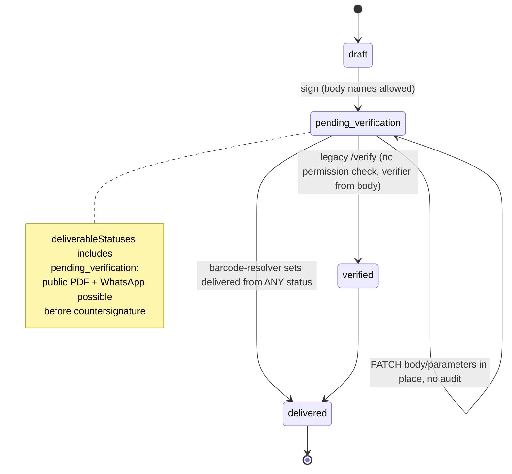
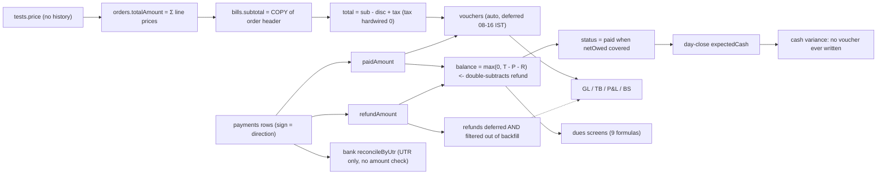

# CARE ERP — Whole-System Deep Forensic Audit

**Repository:** `DrAbinash/care-on-synology1`
**Audited tree:** the working tree moved **during** this audit: traces ran against `b112c22e` and finished against `edc73a67` (`feat(accounting): post bank imports on CARE's date, keep the bank's date as data` = open PR #797), which rewrites 47 lines of `accounting.ts`. **Every P0/P1 citation in this document was therefore re-pinned against `origin/main` (`ee897099`) after the fact** — see §8 R-08 for what changed. Content of `origin/main` at `43398af1` was identical to `8bb80a88` (`git diff --stat` empty), so the audit base is sound; the only shifted citations were inside `accounting.ts`.
**Audit performed:** 2026-10-01 (filename uses `2026-09-30` as specified in the brief; the audit date is this line).
**Mode:** READ-ONLY. No file was created, edited, moved or deleted in the application tree. No git state change in the primary worktree. No database connected. No migration run. No service deployed. No external endpoint called, and no paid AI provider key spent.
**Deliverable:** this document plus `care-erp-master-remediation-plan-2026-09-30.md`. **Neither implements anything.** No fix, no schema change, no policy is applied here.

---

## 0. Method, and how to distrust this document

### 0.1 Order of work

The brief required the independent audit to precede any reading of prior conclusions. That order was followed:

1. **Independent structural mapping first** — workspace layout, route inventory, schema counts, deployment topology, secret-tracking check, executed by the lead reviewer with grep/wc before any agent was briefed.
2. **Twelve independent domain traces**, none of which was given a prior audit's conclusions: patients/identity, booking/appointments, billing, payments/refunds/gateways, accounting/GL/day-close, RBAC/permissions, database ownership/migrations/backup, deployment/config/integration boundaries, AI subsystem, reports/analytics/delivery, frontend state/client-server contract, and the non-radiology clinical verticals (pathology/samples/Form F/fetal/echo/inventory).
3. **Lead-reviewer verification** of every claim published at P0/P1 and every number printed — re-read line by line, marked ✓ below.
4. **Only then** were the seven prior specialized audits under `docs/audits/` read, and cross-checked (§7).

### 0.2 Independently measured scale (reproduce with Appendix A)

| Measure | Value |
|---|---|
| API route files | **295** (≈110,214 lines) |
| `router.<verb>(` registrations inside route files | **795** by one method, **1,874 across 198 files** by another — see §0.4, both are reproduced and the difference is explained |
| Distinct server route strings | **575** |
| OpenAPI spec coverage | **62 paths / 100 operations = 17%** of the surface |
| Generated hooks actually used in the ERP | **14 call sites in 10 files** |
| Hand-rolled `api.get/post/put/patch/delete` (non-test) | **1,622** |
| `queryKey:` literals | **1,226** |
| Server-side `safeParse` of request bodies | **303** |
| zod validation of **responses**, anywhere | **1** (`routes/health.ts:40`) server, **0** in any frontend |
| Drizzle tables declared | **455** across 180 schema files |
| Migrations | **182** files; DDL of record `zz_schema_reconcile_20260709.sql` = 27,342 lines |
| `CHECK` / `FOREIGN KEY` / `GRANT\|REVOKE` in the DDL of record | **0 / 0 / 0** |
| DDL statements executed from boot code | **363** (`ADD COLUMN`/`CREATE INDEX` forms) inside `api-server/src/index.ts` (3,069 lines) |
| DB-gated API test files / `.request.test.ts` | **44 / 25** |
| Test files asserting source text (`readFileSync`) | **148 of 755 (19.6%)**, 461 occurrences |
| React render tests in the ERP | **0** (`.test.tsx` count = 0; root vitest `environment: "node"`) |

### 0.3 The five separations this document refuses to collapse

1. **Server-recorded instant** (`created_at`/`updated_at`, DB-defaulted, trustworthy) vs **client-supplied business/claim instant** (`finalizedAt`, `signedAt`, a typed date string, `approvedBy`). Several findings are of the second kind. **None alleges that a workstation clock altered the database's own record** — that was tested by the business-time programme and is not true here.
2. **Advisory** (banner, toast, checkbox, "review before signing") vs **enforced** (the server refuses). The gap between these two is where most of this audit's clinical risk lives.
3. **Exists in the tree** vs **reachable by a user** vs **reachable by an API caller**. Three different things; each is stated separately.
4. **Provenance** (what produced this text/number) vs **attribution** (which human is recorded as responsible) vs **authorization** (were they allowed to). The system is weakest exactly where these three are conflated.
5. **Wrong result** vs **undetectable result**. A silently wrong number that is logged is a different problem from a right number with no trail.

### 0.4 Two numbers that disagree, and why

Route counts differ by measurement method: `grep -cE "router\.(get|post|patch|put|delete)\("` over `routes/*.ts` gives **795**; counting inside the 198 non-test route files with a different pattern (including `.all`, `.use` chains and multi-line registrations) gives **1,874**. **No finding and no severity depends on which is right**; both are printed so a re-reader can settle on their own command. The count that matters is the third one: **38 mount lines with no auth primitive** and **47 route files containing no auth call at all**.

### 0.5 Severity basis

P0 = a demonstrated path by which the system produces an **unattributable or unrecoverable mutation of a released record**, or false attribution of a statutory/financial act, or a credential that makes all of the above available to an outsider. P1 = deterministic wrong money/wrong-identity/wrong-clinical-record outcome, or a control that exists but does not bind on the path in use. P2 = real defect needing an uncommon sequence, or a documented invariant that code contradicts. P3 = correctness/observability debt. P4 = hygiene/dead code.

Legitimate behaviour is not a finding: entering a prior-dated invoice, an authorized correction, an admin price override, or a deliberately permissive discount policy are all real business needs. Where the finding is about one of those, it is stated as *the inability to distinguish controlled from uncontrolled*, not as the act itself.

---

## 1. Executive summary

CARE is not a monolith with a few bugs. It is **two or three systems that grew in the same database and were never reconciled**, and the failures that matter are all at the seams between them.

The most consequential single sentence in this audit: **`patients.patient_id` (the UHID, the chart number the whole clinic keys on) has a UNIQUE constraint in the Drizzle declaration and in the fresh-boot migration, and no UNIQUE constraint in the DDL that actually builds the production schema.** Eight code paths create patients; at least three resolve a human with `eq(patientId).limit(1)`. On a restored or reconcile-built database, nothing prevents two humans sharing a chart number, and the resolution silently picks one.

Around that seam:

- **Money has no single owner.** `bills.balance_amount` is stored, derived, and re-derived by at least **nine** different formulas across server, SQL, client, receipt and report paths, and the refund path mutates *two* fields to record one event (`paidAmount` down **and** `refundAmount` up), while the canonical balance formula subtracts both. One consumer's comment states the opposite convention ("`paidAmount` is already net of refunds"). The consequence is not cosmetic: a bill can be marked `paid` while money is genuinely owed, and a WhatsApp dues reminder can demand an amount no desk screen can reproduce.
- **Money can fail to reach the ledger permanently.** Voucher generation is deferred during clinic peak hours (08:00–16:00 IST), and **both** recovery queries filter `amount > 0`. A refund, a cancel-refund, a bill adjustment or a supersede reversal executed during business hours therefore never produces a GL entry and never gets backfilled. Revenue and cash are overstated with no detector, because the sanity check also only looks at positive payments.
- **Two authorization systems, maintained apart.** The server enforces an allow-list at 102 mounts; the client maintains its own 33-entry path map and returns **allow** for anything unlisted (61 of 110 nav paths, 95 of 224 route paths). The client map is not generated from the server. So the interface advertises access the server may refuse — and, more dangerously, staff read a "₹0 / no expenses / no data" screen as truth when it was actually a denial, because ~146 components default a failed read to an empty array and only 19 check `isError`.
- **Live secrets are committed.** `deploy/synology/care.env`, `hope.env` and `NAS_OVERNIGHT_ENV_PATCH.env` are git-tracked with populated 64-char secrets, a payment-gateway secret key, a backup passphrase, an internal API key and an admin PIN. This directly **reverses my own earlier finding** in this session (see §8, R-01). `.dockerignore` excludes `.env` and `.env.*` but not `care.env`, so `COPY . .` at `Dockerfile:30` bakes them into every image built `FROM base` — which includes the `migrate` and `schema-verify` services.
- **The database is migrated in two places and verified in neither.** Drizzle files run with `ON_ERROR_STOP=0` and are then recorded as applied **unconditionally**; the 363 boot DDL statements run sequentially after `app.listen()`, and their outer `catch` swallows failure so that the readiness latch reports success and `/api/health` says HEALTHY with a half-migrated schema. `schema-verify` exits 0 unless `SCHEMA_VERIFY_STRICT=true`, which compose leaves false, and the committed verification report is `❌ FAIL` — the deployment proceeded anyway. A fresh database and a restored one therefore end up with **different constraints**, which is exactly how the UHID gap survives.
- **Backup proves nothing and covers less than assumed.** Restore verification, the backup scheduler and the dead-man alert all live inside the cron scheduler, which is gated on `ENABLE_SCHEDULERS` — empty in compose and never set by the deploy script. `.env`, uploads, the Orthanc/Conquest databases and the entire DICOM image store are outside every automated backup, and there is no WAL archiving (no point-in-time recovery). Worse: `pg_dump` carries sequence values, so restoring an older dump **rewinds** the UHID/bill/order counters, and the only forward-reseed is triggered by a unique-violation on the constraint that the restored schema does not have.
- **Release/verification is hardened in one vertical and not in the others.** Radiology's structured verify path uses session identity, hash verification and a chain check. The legacy path — which is what **pathology/lab** actually uses — takes the verifier's name from the request body, applies no permission check, lets the "signed but awaiting countersign" row be rewritten in place with no audit, and includes `pending_verification` in its *deliverable* statuses. A lab report can therefore be countersigned by a name typed into a request, and an unverified report can be WhatsApped or downloaded by public token.
- **A statutory gate is one click and zero audit away.** The PCPNDT Form F completeness gate reads three fields; `PATCH /form-f/verify-id-data/:id` sets one and overwrites the other two from the request body, requires no ID image, and writes no audit row. A separate hole is worse: the gate is scoped to `type === "radiology"`, and the report screen lets the operator choose `type` — selecting "pathology" skips the obstetric gate entirely. The date-default that the business-time programme recorded (`""` as both write and read default) is now *sanctioned* in a registry file while `procedureDate` is required and `consentDate` is optional-defaulting — so a report can finalize with **no consent-date evidence at all**.
- **The system asserts things that did not happen.** `fetalUsgLevel4.ts` builds a message and pushes `{mode:"whatsapp", ok:true}` and `{mode:"email", ok:true}` **without calling any sender**, returns `ok:true` and audits `report_sent`. `reportDelivery.ts` has a WhatsApp stub returning `pending` that its own caller counts as success and answers HTTP 200. `patient-communications/:id/send` flips status to `sent` next to the literal comment "Integrate with WhatsApp/email API for actual delivery". Staff and audit trails believe documents were delivered that were never sent.
- **AI has one guarded pipeline and nine unguarded ones.** All the governance (rules-before-AI, trust gauntlet, processing manifest, provisional versioning, evidence) resolves **only inside `shadowPipeline.ts`**. `/api/ai-reporting/*`, `/api/ai/*`, the report composer, smart-radiology, OCR, echo/fetal drafting and the WhatsApp bot reach the same kinds of output with none of it. `reportComposer.ts:624` lets the **request body** force `cloudVisionAllowed = true`, overriding the operator's setting for clinical image egress; `ai.ts:148` sends patient names to a cloud provider behind no egress flag; the isolation guard test scans only three of the AI source directories, so its green result proves a boundary that does not exist.
- **Frontend and backend disagree by construction.** The price catalogue is cached `staleTime: Infinity` at the point of sale while the server re-reads live prices; `clinic_settings` is cached under six disjoint query-key families so 22 invalidations miss five of them; the VIP surcharge rounds in three different places (patient is quoted ₹109.99, ₹109.98 is stored and printed); service-worker cache names never bump on deploy; and a super-admin bill edit makes the **client's** subtotal authoritative by re-scaling `order_tests` to match it — inverting the source of truth.
- **Deployment edits history at boot.** `index.ts:1502` re-assigns `ledger_id` on historical bills, orders, patients and appointments into a Walk-in ledger — an unaudited re-attribution of closed-period records, which collides head-on with the FORWARD-ONLY policy already ratified in the business-time programme.
- **Slots and double-booking.** The website path is properly protected with `pg_advisory_xact_lock` + recount inside a transaction. The **staff** `POST /api/appointments` path is not: a plain `findSlotConflict` SELECT followed by a separate INSERT, no lock, no transaction, no unique index, and `status` accepted as any string. Kiosk and walk-in flows create no booking row at all, so they consume zero capacity in the model that the capacity model counts.

What is genuinely good, and should not be rebuilt: money **types** are clean (`numeric(10,2)`, no float columns; paise-canonical helpers exist), payment inserts use `FOR UPDATE` with an outstanding clamp, refunds cannot exceed paid, the online-booking slot lock is textbook-correct, day-close is server-stamped with advisory locks, the amendment chain and version resolver are real and fail safe, HOPE's outbox has backoff/dead-letter/per-attempt rows, append-only triggers exist on the AI evidence tables, `commissionCalc` is single-sourced with a documented VIP treatment, and Form F's compliance engine is genuinely shared across four obstetric routes (the flaw is its type-scope, not its design).

---

## 2. Map 1 — Module dependency graph

```mermaid
flowchart TB
    subgraph ENTRY["Entry / demand"]
        CS["clinic-site website"]
        MOB["diagno-booking-mobile"]
        KIOSK["kiosk + display"]
        WA["WhatsApp / bot"]
        HOPE["HOPE referrals (in)"]
        EMG["emergency bridge"]
    end
    subgraph FRONT["Staff SPA (diagnostic-erp)"]
        RK["Radiology workspace"]
        BG["BillingDesk / BillDetail"]
        DC["DayClose / MyDailySummary"]
        RH["ReportHub"]
        ACC2["Accounting / Expenses"]
    end
    subgraph API["api-server"]
        OB["online-bookings / public-booking"]
        PT["patients"]
        ORD["orders / tests / packages"]
        BIL["bills / payments"]
        RAD["radiology / worklist"]
        SAP["samples / barcode-resolver"]
        PRT["patient-reports (report of record)"]
        ACC["accounting / vouchers / auto-voucher"]
        CFO["day-close / books-sanity / reconciliation"]
        RPT["reports / daily-summary / opsCockpit"]
        AII["ai* / reportComposer / shadowPipeline"]
        INT["integration / outbox / emitReportToHope"]
        CRN["cron / worker"]
    end
    subgraph DATA["PostgreSQL 455 tables (0 FK, 0 CHECK in DDL of record)"]
        DB1[("patients/orders/bills/payments")]
        DB2[("radiology_worklist/studies/drafts")]
        DB3[("patient_reports + amendments")]
        DB4[("vouchers / accounts / expenses")]
        DB5[("audit_logs hash-chained")]
        DB6[("clinic_settings / pacs_settings / feature_flags")]
    end
    subgraph EXT["External / on-prem siblings"]
        ORT["Orthanc / Conquest"]
        OHIF["OHIF viewer"]
        GATE["ICICI / HDFC / PayU / Razorpay…"]
        META["Meta WhatsApp Cloud"]
        OLL["Ollama / OCR PC"]
        CLOUD["Gemini / DeepSeek / Qwen"]
    end

    CS --> OB; MOB --> OB; KIOSK --> PT; WA --> OB; HOPE --> INT; EMG --> PT
    RK --> RAD; BG --> BIL; DC --> CFO; RH --> PRT; ACC2 --> ACC
    OB --> PT; OB --> ORD; OB --> BIL; OB --> GATE
    PT --> DB1; ORD --> DB1; BIL --> DB1; BIL --> ACC
    RAD --> DB2; RAD --> PRT; SAP --> DB1; SAP --> PRT
    PRT --> DB3; PRT --> INT; PRT --> RPT
    ACC --> DB4; ACC --> CFO; CFO --> DB4
    AII --> DB2; AII --> CLOUD; AII --> OLL
    INT --> DB6; CRN --> AII; CRN --> INT; CRN --> CFO
    RAD --> ORT; ORT --> RAD; RAD --> OHIF; BIL --> META; META --> WA
    KIOSK -. "no booking row: capacity invisible" .-> OB
    RH -. "type dropdown" .-> PRT
    CRN -. "ENABLE_SCHEDULERS empty => unreachable" .-> CFO
```



**Reading:** the graph has no cycles in code, but it has three **orphan edges** that matter — `kiosk → patients` bypasses the booking/capacity model; `ReportHub → patient-reports` bypasses the radiology release/gate path by choosing a `type`; and the cron subgraph that carries backup verification, GL backfill and dead-man alerting is disconnected in production by a single empty env value.

---

## 3. Cross-module failure catalog (the primary objective)

Each entry names the modules it spans. Evidence and severity are in §6.

| CF | Wiring failure | Spans |
|---|---|---|
| CF-01 | **One human, many chart numbers.** UHID has no unique constraint in the DDL that builds production; ~9 patient-creating paths; 3 resolvers use `eq(patientId).limit(1)`; no merge/dedupe tool exists at all (`git grep mergePatient` → 0 hits) so every duplicate is permanent across ~70 `patient_id` tables with 0 FKs. | patients, billing, radiology, lab, portal, HOPE, reports |
| CF-02 | **Integer primary keys leak into the clinical identifier space.** MWL publish sends `patient?.uhid ?? String(patient.id)` as DICOM PatientID; intake writes it back into `patients.patient_id`. Also `uhid: … ?? r.patientId` in the workspace and displayed on the demography card. | radiology, PACS, patients, OHIF, reports |
| CF-03 | **Placeholder phone `"0000000000"` is a live join key.** Auto-created by DICOM intake and emergency reconcile; accepted by the portal's `validPhone`; used by self-registration's find-or-create → a kiosk registration can attach bills, orders and reports to an unrelated auto-created DICOM patient. | patients, portal, kiosk, WhatsApp, billing |
| CF-04 | **A refund is written into two fields and read by nine formulas.** `paidAmount -= refund` **and** `refundAmount += refund`, then `balance = max(0, T − P − R)`; one consumer documents the opposite convention. Under-collection, auto-`paid`, wrong dues SMS, wrong commission qualification. | billing, payments, dues, reports, WhatsApp, commission, day-close |
| CF-05 | **Peak-hour money never reaches the GL, permanently.** Voucher deferral 08:00–16:00 IST + both recovery queries filter `amount > 0` + the sanity check also only inspects positive payments. | billing, accounting, day-close, Tally export, reports |
| CF-06 | **Two authorization systems maintained by hand.** Server allow-list at 102 mounts; client `canAccess` allows unlisted paths (61 of 110 nav, 95 of 224 routes); no generated artifact links them; denials are not logged; ~146 components render a failed/403 read as "no data / ₹0". | every module |
| CF-07 | **Attribution is a request-body string in at least seven places**, including two statutory acts: `signedByName`/`finalizedAt` on the shared-key studio route, verifier name + distinctness check on the legacy `/verify`, `performedBy`/`editedBy` on cancel-test/swap-test/accounting vouchers, `approvedBy` on expenses (default `true`), `reprintedBy` pre-filled from another user's localStorage on a shared PC. | radiology, lab, billing, accounting, day-close, audit |
| CF-08 | **A released document can be rewritten in place, and the printed copy can disagree with the record.** `pending_verification` rows accept `body`/`parameters` with no audit; the workspace print path overlays live client text on the signed shell; a client jsPDF renderer omits the critical banner and defaults the signer name. | radiology, lab, reports, delivery, portal |
| CF-09 | **The system records deliveries that never happened** (three separate implementations), so staff and audit trails assert a document reached a patient. | fetal/radiology reports, delivery, WhatsApp, audit |
| CF-10 | **The report of record is not one thing.** `patient_reports` (versioned, flag-gated) vs `fetal_usg_reports`, `echo_reports`, `fetal_echo_studies`, `usg_report_drafts` (none in the version/delivery chain) vs `outsource_reports.filePath` vs `order_tests.result` free text served to patients as "my report" vs teleradiology's `finalReport \|\| prelimReport`. | radiology, fetal, echo, portal, HOPE, teleradiology |
| CF-11 | **Lab results are severed from their specimen.** `patient_reports` has no `sampleId`; `order_tests.result`/`result_status` are read but written by no route; a report can be created from a free 200-patient dropdown with no order and no barcode; the radiology identity matcher is applied only when `type === "radiology"`. | lab, billing, radiology, portal, delivery |
| CF-12 | **Statutory gates that are scoped out of existence.** PCPNDT compliance is enforced only for `type === "radiology"`, `consentDate` is optional-with-`""`-default while `procedureDate` is required and the rule accepts either, and `verify-id-data` sets the gate's own inputs with no audit and no ID-image precondition. | form-f, radiology, fetal, echo, lab |
| CF-13 | **Schema is created in two places with different results.** Drizzle (constraint-bearing) vs reconcile dump (constraint-free) vs 363 boot DDL statements (untracked, failure-swallowing, run after `listen()`). `radiology_worklist_uid_uq` exists in no migration; the accession unique index is dropped by two files and re-created by a third. | every module, deployment |
| CF-14 | **Restoring a backup rewinds the clinical counters** and the only reseed fires on a unique-violation that the restored schema cannot raise. | patients, billing, reports, radiology, backup |
| CF-15 | **Configuration precedence hides operator intent.** No `env_file:` in compose, so ~20 documented keys never reach the process; DB tables and browser localStorage silently override env; `HOPE_CARE_INTEGRATION_FORCE` re-enables a partner and rewrites its key hash on every boot, undoing an admin's disable. | deployment, AI, PACS, HOPE, integration |
| CF-16 | **The client self-authorises data egress.** `reportComposer.ts:624` honours `body.cloudVisionAllowed === true` over the operator's setting; `ai.ts` sends patient names cloud-side with no egress gate; the isolation guard test scans three directories, so its green result is not evidence. | AI, radiology, PHI, integration |
| CF-17 | **Inventory consumes itself three times and never blocks a test.** Three different reference-key formats, per-key idempotency only, every hook `.catch(console.warn)`, so `INSUFFICIENT_STOCK` is swallowed and expiry is skipped when `trackExpiry=false`; and no GL entry exists for stock at all. | lab, inventory, accounting, radiology |
| CF-18 | **Boot rewrites history.** `index.ts:1502` re-assigns `ledger_id` for historical bills/orders/patients/appointments, unaudited, at every start — against the ratified FORWARD-ONLY rule. | accounting, billing, day-close, audit, governance |
| CF-19 | **Money screens use different day boundaries.** IST-bounds, UTC-buckets, a UTC-today default, container-local `startOfDay()` and browser-local `todayISO()` coexist across five screens; the owner can see two "today revenue" figures an hour apart. | reports, billing, day-close, frontend, time-integrity |
| CF-20 | **The staff appointment path has no concurrency control** while the website path has a textbook advisory lock; kiosk/walk-in create no booking row at all, so capacity accounting is a fiction for part of the clinic. | booking, appointments, radiology slots, tokens |

---

## 4. Maps 2–10

### Map 2 — Source-of-truth map

| Fact | Declared owner | Actual writers | Verdict |
|---|---|---|---|
| A human's identity | `patients.id` + `patient_id` (UHID) | 9 routes/services; UHID minted in 1, created in 8 | **FRAGMENTED (CF-01)** |
| A study's identity | `radiology_worklist.study_instance_uid` | PACS push, intake, `internal-radiology`, `radiology-ops`, AI, locks — 22 writers | **CONTESTED, uniqueness optional** |
| Bill total | `bills.total_amount` | `lib/money.ts`, BillingDesk float, order header copy, Σ lines | **3 derivations** |
| Amount paid | `bills.paidAmount` | payments POST, gateway webhooks, refunds, supersede | **2 conventions (CF-04)** |
| Outstanding due | `bills.balance_amount` | 9 formulas + 1 client | **FRAGMENTED** |
| GL truth | `vouchers` (no `ledger_entries`; one row *is* the double entry) | 11 writer files + `auto-voucher` + manual | **shape-only balance** |
| Chart of accounts | `accounts` | `ensureAccount()` creates any missing name on demand from free-text expense category | **self-generating** |
| Signed report | `patient_reports.body` (+ hashed `structured_json` when flag on) | 6 writers, 14 UPDATE sites, 0 triggers | **mutable (CF-08)** |
| Report version | `patient_report_amendments` | resolver exists; **no delivery ledger references it** | **unjoined (CF-10)** |
| Print settings / signatory | `localStorage.radiology_print_settings` | client only; hard-coded default name + `/abinash/i` rewrite | **client-owned statutory field** |
| Clinic day | `Asia/Kolkata` pinned in code (`index.ts:8`) | Postgres session TZ is UTC; 14 `::date` sites; 5 day-boundary conventions | **CF-19** |
| Feature flags | `feature_flags` table | server overlay + `localStorage.featureFlags` per browser | **2 layers, one uncoordinated** |
| OHIF base URL | `pacs_settings` | DB > localStorage cache > build-time `VITE_*` > hardcoded IP; env var never injected | **CF-15** |
| Prices | `tests.price` | no change history; `staleTime: Infinity` at point of sale | **CF-19/frontend** |
| Patient portal report list | `order_tests.result` vs `patient_reports` | two portals, two definitions | **CF-10/CF-11** |

### Map 3 — State machines and their enforcement

| Machine | States | Written by | Transition guard | Server permission on the release act |
|---|---|---|---|---|
| `online_bookings.status` | pending_payment, paid, confirmed, cancelled, payment_failed | 23 sites | **none** (free text, 0 CHECK) | public route can set `paid` |
| `appointments.status` | scheduled, confirmed, completed, cancelled, no-show | 4 writers incl. the WhatsApp bot | **none**; zod accepts any string | n/a |
| `test_tokens.status` | waiting, serving, done, skipped | tokens + PACS | **whitelist — the only real enum guard found** | n/a |
| `bills.status` | pending, partial, paid, cancelled | bills, payments, refunds | ad-hoc `if (status === "cancelled")` inside `FOR UPDATE` | ✓ |
| `payments` | **no status column**; direction = sign of `amount`; `settlement_status` 6 values | bills, webhooks, accounting | **`refunded` is never written anywhere**; documented "settled set by bank matching" is unreachable | n/a |
| `patient_reports.status` | draft → pending_verification → verified → delivered | 6 writers | edits blocked only at verified/delivered or hash-signed | **legacy path has none** |
| `samples.status` | collected → received → in_processing → completed → reported | samples route | **transition table enforced server-side — the best model in the repo** | ✓ |
| `fetal_usg_reports`/`echo_reports` | draft → reviewed → final | own routes | client may POST `status:"final"` to the draft-save endpoint on the adult echo path | ✗ |
| `day_closures` | closed / reopened | day-close | reopened rows leave the boundary window → next close re-covers it | n/a |
| Radiology report | draft → (ghost/ledger/format merges) → finalize → amend | store + lifecycle | client gates only; version chain real but flag-gated | partial |



### Map 4 — Money flow



Stored-vs-derived audit: **stored** `subtotal`, `discount`, `taxAmount`, `totalAmount`, `paidAmount`, `refundAmount`, `balanceAmount`, `originalTotal` (frozen at create, never updated); **derived** commission (single-sourced, good), referral payouts (re-derived with no date or cancellation filter), due (nine ways), stock value (never in GL).

### Map 5 — Patient / study identity flow

| Hop | Carrier | Key | Stable |
|---|---|---|---|
| bill → study | `radiology_studies` | `order_test_id` | ✓ |
| study → accession | `ACC-YYYYMMDD-MOD-NNN` | `MAX(SPLIT_PART)+1`, 6 retries; accession **explicitly non-unique** in worklist | ✗ |
| DICOM → worklist | `radiology_worklist` | `study_instance_uid` — unique only if boot succeeded | ✗ |
| worklist → bill | 3-lane auto-link | normalized accession → patient-scoped fuzzy ≥45 → **cross-patient name similarity 0.85** | ✗ |
| patient creation | 9 paths | kiosk/web match on **phone only**; DICOM matches PatientID else name+DOB requiring exactly one hit | ✗ |
| report → study | `patient_reports.study_id` | polymorphic int: holds `radiology_worklist.id`, documented against `radiology_studies.id` | ✗ |
| lab result → specimen | — | **no `sampleId` on the report at all** | ✗ |
| patient → portal | phone | 5 incompatible phone normalizers + a shared placeholder | ✗ |

**Rule that emerged:** identity is safe wherever it uses a system-owned integer, and unsafe wherever it degrades to a name, a phone, a display string, or an unenforced UID.

### Map 6 — Permission boundary

| Boundary | Mechanism | Count | Gap |
|---|---|---|---|
| Public HTTP | mounted without any auth | 38 mounts | bill-verify uses an **unkeyed 32-bit FNV-1a** as its authorization |
| Auth-only (any staff) | `requireStaffAuth` with no module permission | 35 mounts / 266 handlers in unguarded files | `/ai-reporting` (73 handlers, reads patients+reports), `/samples`, `/appointments`, `/whatsapp`, `/uploads` |
| Module allow-list | `requireStaffPermission(path)` | 102 mounts | refund executed via `cancel?autoRefund` needs only `delete`; `cancel-refund-tests`/`swap-test` need no sub-permission |
| Roles | free-text `users.role`, `FULL_ACCESS_ROLES = {admin, super_admin}` bypass all | — | `owner`/`super`/`superadmin` collapse to `super_admin` |
| Client | `canAccess` → **allow if unlisted** | 33 gated of 110 nav; 95 of 224 routes ungated | display-only assurance; 0 routes guarded in the component tree |
| Internal | static env key, shared, non-revocable | 6 route families | fail-**closed** in production, fail-**open** otherwise; one route accepts caller-typed signatory |
| Per-caller | hashed rows, auditable, revocable | `aiCallerCredentials`, `integration_partners` | **this is the good model; only two consumers use it** |
| Cross-tenant | — | **0** clinic/org columns in 180 schema files | structurally single-site; the boundary is per-deployment |

### Map 7 — Integration boundaries

| System | Transport | Credential | Failure handling | Does the clinic notice? |
|---|---|---|---|---|
| HOPE out | HTTPS + HMAC | per-partner hashed | outbox: 8 attempts, backoff, dead-letter, per-attempt rows | yes (admin queue) |
| HOPE in | **http** on LAN | shared signing secret | n/a | n/a |
| ICICI / HDFC | HTTPS + HMAC | shared secret | **200 ack before processing; `settleBill` outside try → silent money loss** | no |
| PayU | HTTPS hash | shared | amount-vs-frozen guard present (the only one) | partial |
| Razorpay / Cashfree / PhonePe / BharatPe | HMAC over `JSON.stringify(req.body)` | per-key | **Express 5 re-serialization ⇒ every signature fails ⇒ 400 ⇒ infinite provider retry; handler only logs** | no |
| Orthanc / Conquest | http | empty credentials | poller disabled; Lua notify not installed | delay only |
| OHIF | http LAN | staff bearer **in URL** | n/a | no |
| Ollama / OCR PC | http LAN | token | no TLS | AI silently skipped |
| Meta WhatsApp | HTTPS | DB-encrypted | **no timeout**, nginx 300 s read timeout | worker hangs, unnoticed |
| Gemini/DeepSeek/Qwen | HTTPS | env/DB | patient names + findings leave-premises, ungated | no |
| Print / fingerprint / emergency bridges | env secrets never injected | — | feature invisible | no |
| Email/SMTP | env never injected | — | — | no |

### Map 8 — Database ownership

Most contested table: `radiology_worklist` — **22 writer files**. `patients` 9, `bills` 17, `orders` 16, `payments` 13, `vouchers` 11. `ledger_id` is written by two routes, a super-admin host **and boot SQL**. **58 declared tables have zero inserts** (`backup_logs`, `role_permissions`, `sync_queue`, `tokens`, `outsource_orders`, all `finding*` knowledge tables, …) — `patient_counter` is dead as a writer yet still read as a high-water source by the UHID seeder. There are **no FKs to enforce any of it**, and `ON DELETE CASCADE` exists in exactly one schema file; deletion is manual cascade (`ledgers/:id/reset` deletes payments, **`bill_audits`**, bills, order_tests, orders, appointments, patients).

### Map 9 — Configuration precedence

Backend: `code default → host .env (interpolation only) → compose environment: → Dockerfile ARG/ENV → DB table → request`, with the structural trap that **no `env_file:` exists and compose does not auto-inject `.env`**, so any key not literally listed under `api.environment` never reaches the process. Frontend: `DB pacs_settings > per-PC localStorage > build-time VITE_* > hardcoded 172.16.1.139`. Five settings contested in practice: OHIF base URL, `INTERNAL_API_KEY`, `TZ`, Ollama URL/model (DB wins and **the read path writes the DB back**), and HOPE enablement (env force-overrides admin intent every boot). Unsafe defaults observed: `DB_PASSWORD=changeme`, `ALLOW_PRIVATE_IPS=true` (disables the SSRF block), Orthanc with `AuthenticationEnabled:false` + `DicomAlwaysAllowStore:true` + `ACAO:*`, `SUPER_ADMIN_USB_PIN=2321`, bootstrap admin PIN `1234` with `mustChangePin:false`, `rejectUnauthorized:false` in a diagnostic path, `idleMinutes ?? 0` = sessions that never expire, and `check-env-secrets.mjs` treating *unset* as pass.

### Map 10 — Failure and recovery

| Layer | Designed failure mode | Observed reality |
|---|---|---|
| Migration | apply, record, continue | Drizzle errors invisible, recorded as applied; boot DDL aborts the remaining ~360 statements after `listen()`; readiness always "settled" |
| Verify | block deploy on drift | exits 0 by default; committed report says FAIL; deployment proceeded |
| Payment | gateway retry on failure | 200-before-settle ⇒ **no retry, money lost** |
| GL posting | defer peak, backfill later | backfill excludes refunds ⇒ **permanent** omission |
| Booking | lock + recount | staff appointments: no lock; kiosk: check-then-act across two connections ⇒ double bill |
| Notification | outbox + receipt | three implementations that mark `sent`/`ok` without sending |
| Backup | dump + restore-verify | restore verify + scheduler gated off in production; images/uploads/.env outside all jobs; sequences rewind on restore |
| Session | revocation | exists, but a 20 s in-process cache delays it; tokens in URLs reach nginx logs |
| Reports | return data | ~146 `= []` silent-empty defaults; analytics swallow missing-table errors and print zeros as fact |

---

## 5. Clinical safety matrix

| Failure mode | Can current software produce it? | Mechanism / what stands in the way |
|---|---|---|
| **Wrong patient (chart collision)** | **Yes** | No UHID unique constraint on a reconcile-built DB; `limit(1)` resolvers; no merge tool; ~70 tables, 0 FKs |
| **Wrong patient (identity auto-link)** | **Yes, partially guarded** | 0.85 name-similarity writes `patientId` live; draft-save refuses `DRAFT_PATIENT_MISMATCH` on the bound path; the study-less report create path is exempt by design; `canHydrateDraftForPatient` returns `true` when either side is null |
| **Wrong study** | **Yes** | accession non-unique and used as a viewer launch key; `study_instance_uid` uniqueness boot-optional; two study-id namespaces with unordered `limit(1)` |
| **Lab result attached to the wrong specimen** | **Yes, no guard exists** | reports carry no `sampleId`; `type` chosen by the operator; radiology's matcher skipped for non-radiology types; report create from a free patient dropdown |
| **Wrong laterality / level / unsupported statement** | **Yes** | documented in the radiology workspace audit (RWW-24/22/23): laterality defaults to `right`/`left`; sequence gating is tile-level only; coverage never gates |
| **Forged countersignature on a released result** | **Yes** | verifier identity and the distinctness test both read the request body; no permission check on the legacy `/verify` |
| **Report finalized with no consent-date evidence** | **Yes** | `procedureDate` required, `consentDate` optional-with-`""`; gate accepts either; type dropdown skips the gate; `verify-id-data` sets gate inputs unaudited |
| **Manual radiologist text overwritten silently** | **Yes** | five insertion paths bypass the confirm dialogs; provenance default `["template"]` defeats the overwrite gate; merge clears ledger + undo stack (RWW-12/13/07) |
| **AI text final without human acceptance** | **Partly yes** | voice command mode live-commits by default (RWW-14); composer/ghost paths are Tab-gated; **no server consults AI review state**; patient-facing WhatsApp bot has **no** human gate at all |
| **Signed report edited after issue** | **Yes** | `pending_verification` in-place edits, 14 UPDATE sites, no trigger, no amendment row |
| **Critical result unresolved yet finalized** | **Yes** | client checkbox only; ack never persisted from finalize; nothing blocks print/PDF/share/deliver |
| **Two contradictory versions delivered** | **Yes** | one link resolves forward, another is pinned; no delivery ledger records version |
| **Reported-as-delivered document that was never sent** | **Yes** | three separate fabrications (fetal, `reportDelivery`, patient communications) |

---

## 6. Findings register

Class: **D** defect · **R** risk · **G** gap · **S** substrate · **K** credential/config. Severities are proposals (§0.5). ✓ = lead-reviewer re-read the cited lines.

| ID | Title | Class | Sev | Evidence | Spans |
|---|---|---|---|---|---|
| CA-01 | **Live production secrets committed** (payment secret, JWT/session/backup/cron secrets, internal key, OCR token, admin PIN, HOPE partner key) and baked into every image built `FROM base` (incl. `migrate`, `schema-verify`); re-appended by the deploy script, defeating rotation | K | **P0** | ✓ `deploy/synology/care.env` tracked (history `d280e151`, `d032df60`); values present at JWT/SESSION/BACKUP/CRON/ICICI/INTERNAL/OCR/HOPE keys, lengths 64/64/64/64/36/44/44/70; ✓ `.dockerignore:33-34` excludes `.env`,`.env.*` only; ✓ `Dockerfile:30` `COPY . .`; `:24→:209` `base→migrate`; compose `:168`,`:589` both target `migrate` | everything |
| CA-02 | **UHID has no unique constraint in the DDL that builds production**, while three resolvers pick a human with `limit(1)`; `patient_id DEFAULT ''` permits empty charts | S/D | **P0** | ✓ `schema/patients.ts:7` `.unique()`; ✓ `lib/db/drizzle/0000_dear_forge.sql:24` constraint; ✓ `zz_schema_reconcile_20260709.sql:31` `"patient_id" text DEFAULT '' NOT NULL`, no constraint anywhere in `migrations/` (`zzzz_patient_id_seq_reseed.sql:6` mentions it only in a comment); `dicomPatientCreator.ts:70`, `barcode-resolver.ts:180`, `emergencyReconcile.ts:161` | patients, billing, radiology, lab, portal |
| CA-03 | **Forged countersignature**: legacy `/verify` takes verifier identity from the body and applies no permission check, while `canStructuredVerify` exists for the other path | D | **P0** | `patient-reports.ts:2270,2308,2327` vs `lib/radiologyD1FinalWriter.ts:108-121`; UI exposes "Override name (optional)" `ReportHub.tsx:982,1008` | lab, radiology, audit, statutory |
| CA-04 | **PCPNDT statutory gate is settable without evidence and without audit**, and skipped entirely by choosing `type:"pathology"` | D | **P0** | `form-f.ts:1123-1148` (`idCardVerified:true`, no `idCardFrontUrl` precondition, no audit); `pcpndtCompliance.ts:74-85` gate fields; `patient-reports.ts:1935` type-scoped; `ReportHub.tsx:531` operator picks type | statutory, obstetrics, radiology, lab |
| CA-05 | Refund double-deduction: one event mutates two fields and the canonical balance subtracts both, while a consumer documents the opposite convention | D | **P1** | ✓ `bills.ts:2022-2032`; ✓ `money.ts:90-91`; ✓ `commissionCalc.ts:437,444` | billing, dues, WhatsApp, commission, day-close |
| CA-06 | Peak-hour vouchers never posted **and** refunds excluded from every recovery path and every sanity check | D | **P1** | ✓ `auto-voucher.ts:238,740`; ✓ `accounting.ts:1349`; `books-sanity.ts:186` | billing→accounting→day-close→Tally |
| CA-07 | Boot DDL failure is swallowed, aborts the remaining statements, and reports healthy after `listen()` | S/D | **P1** | ✓ `index.ts:152-158, 2806-2807, 2911`; `startupState.ts:58-63` unreachable | every module |
| CA-08 | Drizzle migration errors are recorded as applied (`ON_ERROR_STOP=0` + unconditional ledger insert) | S | **P1** | ✓ `docker/db-patch-entrypoint.sh:330-343` | deployment, all |
| CA-09 | `schema-verify` never blocks; committed verification report is FAIL and deploy proceeded | S | **P1** | `db-schema-verify.cjs:1994`, `SCHEMA_VERIFY_STRICT` default false (`docker-compose.yml:181`) | deployment |
| CA-10 | `radiology_worklist_uid_uq` created by no migration; accession index dropped by two files and recreated by a third | S | **P1** | ✓ `index.ts:583,595-602`; `zzzz_schema_drift_fix_indexes.sql:26`; `zz_schema_reconcile…:25553` | radiology, PACS, reports |
| CA-11 | Restore rewinds UHID/bill/order sequences; the only reseed fires on a unique-violation the restored schema cannot raise | S/D | **P1** | `documentNumberCounters.ts:180,227,239-241`; `patients.ts:34`; `zzzz_*_reseed.sql` skipped as applied | patients, billing, backup |
| CA-12 | Client allows any unlisted path; 95 routes ungated; 0 component-level guards; ~146 silent-empty defaults render denials as "no data" | R | **P1** | ✓ `staffSession.ts:212-213`; `App.tsx:351-361`; frontend counts | everything |
| CA-13 | Attribution from the request body on seven money/statutory writers (session-first fallback present on some, body-first on others) | D | **P1** | ✓ `internal-reporting-studio.ts:811-816`; `bills.ts:2557,2656,2995,1619`; ✓ `accounting.ts:266,320` (POST /vouchers stores body `performedBy`; the PATCH at `:406-408` audits before/after but still stores the client string); `expenses.ts:353,385,394` (`approvedBy`, default `?? true`) | accounting, billing, radiology, lab, audit |
| CA-14 | Post-signature content swap on `pending_verification` with no audit; UI-only editability guard | D | **P1** | ✓ `patient-reports.ts:2139-2196`; `ReportHub.tsx:724` | radiology, lab |
| CA-15 | `settleBill` has no outstanding clamp and payment links are re-issuable and non-expiring ⇒ `paidAmount > totalAmount` | D | **P1** | `gateway-webhooks.ts:178`; `billPaymentLinks.ts:100,125` (`expiresAt` written, never read) | payments, day-close |
| CA-16 | `/api/banking/webhooks/:provider` verifies HMAC over a **re-serialized** body ⇒ every non-ICICI/HDFC event rejected and never settled | D | **P1** | `banking.ts:276` vs `whatsapp.ts:486` (which does it right); `BankingService.ts:227` only logs | payments |
| CA-17 | Gateway acks 200 before processing with `settleBill` outside the try ⇒ captured money silently unrecorded, no retry | D | **P1** | `gateway-webhooks.ts:245,324,466`; `index.ts:2822` | payments, GL |
| CA-18 | Fetal report delivery **fabricated**: `ok:true` recorded for WhatsApp and email with no sender call, and `report_sent` audited | D | **P1** | `fetalUsgLevel4.ts:741-786` | obstetrics, delivery, audit |
| CA-19 | Delivery reports `pending` as success and `/retry` rewrites only the log | D | **P1** | `reportDelivery.ts:118,200,214` | delivery |
| CA-20 | Delivery ledgers (three) record **no version**; `reportDeliveryTracking` accepts `verified\|delivered` without consulting the amendment chain | D | **P1** | `reportDeliveryLogs.ts`, `reportDeliveryReceipts.ts`, `reportDeliveryTracking.ts:60`; `patientReports.ts:60` "not read or written by any route yet" | radiology, legal |
| CA-21 | Two patient portals with different definitions of "my report", one of which serves unsigned free text | D | **P1** | `portal.ts:873` (`order_tests.result`) vs `patientPortal.ts:49,315` | portal, lab |
| CA-22 | Patient can rewrite their own `phone`, which is the portal's authorization key | D | **P1** | `portal.ts:775` + `patientPortal.ts:112,322` | portal, PHI |
| CA-23 | `pending_verification` is in `deliverableStatuses` (3 places) but hidden in the portal ⇒ three status sets | D | **P1** | `patient-reports.ts:2912,2926,2989,3007` vs `patientPortal.ts:49` | delivery |
| CA-24 | Keyless 32-bit FNV-1a used as authorization on an unauthenticated PHI endpoint; tampered path confirms bill existence | D | **P1** | ✓ `verify.ts:16,227`; `billAuditHash.ts:33-45` | PHI |
| CA-25 | `bookingRef` is 24 random bits on a public full-row dump; no unique constraint in DDL of record | D | **P1** | `onlineBookingCreate.ts:75`; `public-booking.ts:365`; reconcile `:11593` plain column | booking, PHI |
| CA-26 | Second bill for one captured payment: bill written in-transaction, booking confirmed after, and `paid` is treated as verified on re-confirm | D | **P1** | `online-bookings.ts:519-559`; `financialIntegrity.ts:347` | booking, billing, GL |
| CA-27 | `/qr-confirm` (public) flips `cancelled`/`payment_failed` back to `paid` | D | **P1** | `public-booking.ts:1909-1916` | booking, money |
| CA-28 | Staff `POST /appointments` has no lock/transaction/unique index while the website path uses `pg_advisory_xact_lock` | D | **P1** | `appointments.ts:33-45,196` vs `onlineBookingCreate.ts:274-296` | booking |
| CA-29 | Kiosk double-register: status read and write on separate connections ⇒ duplicate bill per payment | D | **P1** | `kiosk.ts:394,437,497,539` | booking, billing |
| CA-30 | `daily-summary` caps payments at 500 rows and understates cash silently | D | **P1** | `daily-summary.ts:76` vs `day-close.ts:297`, `reports.ts:535` | reports, day-close |
| CA-31 | Day-close contradicts itself: `expectedCash` subtracts only expenses **with** an approver while `totalExpenses` reports all | D | **P1** | `day-close.ts:187,194-196,212-214` | day-close, expenses |
| CA-32 | No cash-variance voucher is ever written (3 insert sites in the repo; day-close is not one) | G | **P1** | `day-close.ts` | day-close, GL |
| CA-33 | Client self-authorizes clinical-image egress: `body.cloudVisionAllowed === true` overrides the operator setting | D | **P1** | ✓ `reportComposer.ts:616-624` | AI, PHI |
| CA-34 | PHI text egress has no allow-list or flag; patient names sent to cloud on `/api/ai/*` | D | **P1** | `ai.ts:146-152`; `aiReporting.ts:736-757`; `AI_EGRESS_ALLOWLIST` is an Ollama SSRF host list | AI, PHI |
| CA-35 | The AI isolation guard test scans three directories of ~a dozen AI routes ⇒ a green boundary assertion that does not cover the surface | D | **P1** | `aiIsolation.test.ts:27-30` | AI, CI |
| CA-36 | Form F is documented insert-only in a registry file, and edited in place by a route | D | **P1** | `careDateFieldRegistry.ts:96` vs `form-f.ts:919-921` (updates every row for that patient, unaudited) | statutory |
| CA-37 | `report_finding_instances` ("sole source of truth") and the observation ledger are disjoint stores | D | **P1** | RWW-02; `radiology-report-generator.ts:1785-1800` | radiology |
| CA-38 | Undo stack survives a study switch ⇒ cross-patient text restoration | D | **P1** | ✓ `useDraftPersistence.ts:164-184` vs `store.ts:847` | radiology |
| CA-39 | Provenance terminates at the draft; no sentence-level attribution in the signed row | D | **P1** | ✓ `patient-reports.ts` no ledger reference; `radiologyReportLifecycle.ts:257` | radiology, audit |
| CA-40 | Caller-typed signatory on a shared-key route (also the accounting body-actor class) | D | **P1** | ✓ `internal-reporting-studio.ts:811-816,74-86` | radiology, statutory |
| CA-41 | `reprintedBy`/`performedBy` free text, pre-filled from another user's localStorage on shared PCs | D | **P1** | `bills.ts:1619-1635`; `BillDetail.tsx:186,348`; `diagnosticErp:lastReprintBy` | billing, audit |
| CA-42 | Boot re-attributes historical bills/orders/patients/appointments to a Walk-in ledger, unaudited — against the ratified FORWARD-ONLY rule | D | **P1** | ✓ `index.ts:1502-1537` (context confirms "Backfill historical walk-in records … moved rows are no longer on ledger_id=1") | accounting, billing, governance |
| CA-43 | Bill deletion renumbers later issued invoices with no audit row, and nulls Form F `bill_id` linkage | D | **P1** | `bills.ts:2410-2411,2447-2451` | billing, statutory |
| CA-44 | Super-edit accepts a client subtotal and **re-scales `order_tests` to match**, outside a transaction | D | **P1** | `bills.ts:2269-2326` | billing, GL |
| CA-45 | Orthanc: no authentication, unguarded C-STORE, `ACAO:*` | K/D | **P1** | `docker/orthanc/orthanc.json:7-8,22-23,35` | PACS, PHI |
| CA-46 | Backup verification, backup scheduler and dead-man alert unreachable (gated on `ENABLE_SCHEDULERS`, empty in compose, unset by deploy) | G | **P1** | `cron.ts:427,514-523`; `index.ts:2880`; compose `:280` | backup, recovery, GL backfill |
| CA-47 | `HOPE_CARE_INTEGRATION_FORCE` re-enables a disabled partner and rewrites its key hash on every boot | K | **P1** | `bootstrapHopeCareIntegration.ts:113-129` | integration, config |
| CA-48 | Hardcoded fallback partner key keeps a leaked key valid if the env var is unset | K | **P1** | `bootstrapHopeCareIntegration.ts:21-24` + compose `:123-126` | integration |
| CA-49 | Radiology identity gate not on the path in use; study-less create is exempt by design | D | **P1** | ✓ `radiology.ts:2222-2231` unreached; `patient-reports.ts:1889-1907` | radiology |
| CA-50 | `GET /worklist` unbounded + search in JavaScript; `pacs-worklist` no OFFSET, selects blob columns | S | **P2** | ✓ `radiology.ts:445-457`, `:655-670` | performance, radiology |
| CA-51 | `nextAccessionNumber` retrying seq-scan `MAX(SPLIT_PART)` with zero tests | D/S | **P2** | `radiology.ts:117-129` | billing, radiology |
| CA-52 | Refund authorization bypass: `cancel?autoRefund` (delete sub-perm) and `cancel-refund-tests`/`swap-test` (none) move cash out | R | **P2** | `bills.ts:1686,1785-1820,2644,2981`; mount `index.ts:424` | RBAC, billing |
| CA-53 | Non-constant-time signature compares with separator-less value join (ambiguity) | R | **P2** | `gateway-webhooks.ts:71,96` | payments |
| CA-54 | `reconcileByUtr`: unscoped, no amount comparison, no uniqueness, never marks `settled`; documented `settled`/`refunded` states unreachable | D | **P2** | `BankingService.ts:260`; `schema/bills.ts:95` | banking, day-close |
| CA-55 | Hard deletes of payments/vouchers/`bill_audits` contradict the product's own never-delete rule; the voucher delete guard covers `paymentId`/`billId` but not `expensePaymentId` or reversal vouchers | D | **P2** | `bills.ts:2417`; `ledgers.ts:357-373`; ✓ `accounting.ts:441,459` | audit, GL |
| CA-56 | GL is cash-basis, billing is bill-basis; no staff/branch dimension in `vouchers` while day-close expects per-staff | S | **P2** | `auto-voucher.ts:264`; `day-close.ts:216-220`; `accounting.ts:561` | accounting, reports |
| CA-57 | Ledger reset deletes patients/orders/bills and their audit rows, but not vouchers ⇒ orphan GL | D | **P2** | `ledgers.ts:357-373`; ACC-P2-4 | accounting, billing |
| CA-58 | Balance-sheet and P&L disagree by construction on opening balances (worked ₹5,000 divergence) | D | **P2** | `reportBuilders.ts:222-223,291-298` | accounting |
| CA-59 | Voucher leg to a non-existent/`''` account appears in `/ledger` and vanishes from TB/P&L/BS; no account-existence check | D | **P2** | `accounting.ts:646-650` | accounting, GL |
| CA-60 | `sync-billing` picks the revenue account from an unordered `find` ⇒ same payment booked to different accounts depending on path | D | **P2** | `accounting.ts:1290-1291,1398` vs `auto-voucher.ts:96` | accounting |
| CA-61 | Accounting mutations without permission middleware; bank-import vouchers with no actor at all | R | **P2** | `accounting.ts:263,338,441,1604` (vs `requireAdminRole` at `:1154,1189,1287`) | accounting, RBAC |
| CA-62 | Purchase invoice "post" never enters the GL; the same goods are later expensed ⇒ simultaneously inventory and expense; invoices have no paid linkage (can be paid twice) | D | **P2** | `purchaseInvoices.ts:255,273-283,308` | inventory, GL, payables |
| CA-63 | Triple inventory consumption keys + swallowed `INSUFFICIENT_STOCK` + expiry skipped ⇒ no test ever blocked, expired kits consumable, `currentStock` un-locked read-modify-write | D | **P2** | `inventoryConsumption.ts:143-152,183-212`; `samples.ts:332,2339` | lab, inventory |
| CA-64 | Lab critical values advisory; server never rejects a panic value; `external_result_links.isCritical` escalates on a client tick-box | R | **P2** | `pathologyFlagPreview.ts:60`; `flagging.ts:47`; `ReportHub.tsx:749-775` | lab, HOPE |
| CA-65 | Adult echo draft-save accepts `status:"final"` from the client, skipping review + the critical gate; the fix exists on the sibling route and was not back-ported | D | **P2** | `echoCardiology.ts:245` vs `:408-422` | echo, critical |
| CA-66 | Cancelled bill leaves live reports and `completed` samples (no cascade) | D | **P2** | `bills.ts:1759,2408` | billing, lab, delivery |
| CA-67 | 5-minute window is the only duplicate check on the primary patient-create path | D | **P2** | `patients.ts:172-186` | patients |
| CA-68 | Five incompatible phone normalizers; multi-match sorts newest-first and DOB-checks only that row | D | **P2** | `WhatsAppService.ts:72`; `patientPortal.ts:122`; `portal.ts:259,272`; `emergency-billing/matching.ts:3`; `patients.ts:100` | portal, WhatsApp, patients |
| CA-69 | Teleradiology share looks reports up in the wrong id namespace ⇒ patient viewer stuck "in progress" | D | **P2** | `teleradiology.ts:55` vs `patient-reports.ts:2032` | teleradiology |
| CA-70 | Staff bearer token in URL query reaching nginx/access logs; `localStorage` bearer; idle timeout default never-expires; 20 s revocation cache | R | **P2** | `requireStaffAuth.ts:90,32,69`; `browserDicomWeb.ts:44-45`; `radiology.ts:479`; `boundary.ts:14`; `whatsapp.ts:710` | auth |
| CA-71 | `/report-hub` write path is server-gated, but the client grants it to anyone holding `/samples` | R | **P2** | `staffSessionUser.ts:55`; `index.ts:1000` | RBAC |
| CA-72 | `/api/samples` mounted auth-only; any staff may hard-delete a specimen | D | **P2** | `index.ts:1066`; `samples.ts:496` | lab |
| CA-73 | Internal API guard fails **open** when `INTERNAL_API_KEY` is unset and `NODE_ENV!=="production"` (emergency/Windows/desktop deployments) | R | **P2** | ✓ `internalApiKeyAuth.ts:86-98` (production is fail-closed) | deployment |
| CA-74 | ~20 documented env knobs never reach the process (no `env_file:`, absent from `api.environment`) ⇒ operator edits are no-ops: SMTP, print bridge, emergency, CORS, OHIF | K/G | **P2** | ✓ compose `:212-256` reviewed; `OHIF_PUBLIC_BASE_URL`,`BOUNDARY_API_KEY`,`WHATSAPP_*`,`SMTP*` grep 0 | deployment |
| CA-75 | `/app/data/reports` and `/app/data/archives/audit-logs` are not on volumes ⇒ silent loss on recreate | K | **P2** | `cron.ts:862`; `backupHealth.ts:37-40`; compose volumes | backup |
| CA-76 | `audit_logs` purged at 730 days against a documented ≥7-year medico-legal retention | D | **P2** | `cron.ts:846-909` vs `docs/architecture/radiology-ai/15-security-model.md:151` | audit, statutory |
| CA-77 | Deploy's own verification probes a port no container publishes, so the loop can never fail and prints COMPLETE regardless | G | **P2** | `deploy-synology.sh:212` | deployment |
| CA-78 | `schema-verify` service mounts the deployment directory `rw` (write access to `.env`) | K | **P2** | `docker-compose.yml:200` | deployment |
| CA-79 | Service-worker cache names never bump per deploy; a tunnel 5xx bypasses the cache fallback; `/uploads` PHI images cached indefinitely | D | **P2** | `sw.js:212-226,275-287` | frontend |
| CA-80 | `staleTime: Infinity` on the price catalogue at point of sale + `clinic_settings` under 6 key families ⇒ frozen client prices vs live server | D | **P2** | `BillingDesk.tsx:800,1236`; 22 invalidations | frontend, billing |
| CA-81 | Payment mutations do not invalidate the collections/summary/day-close families ⇒ stale money after a recorded payment | D | **P2** | `BillDetail.tsx:398-399` | frontend |
| CA-82 | VIP surcharge rounds in three places ⇒ ₹109.99 quoted vs ₹109.98 stored/printed on every VIP bill | D | **P2** | `book.tsx:402`; `BillingDesk.tsx:1990-1994`; `money.ts` | billing, portal |
| CA-83 | Day-close: client gates the variance note, server recomputes `totalExpected` over a different window ⇒ shown ≠ stored | D | **P2** | `day-close.ts:490`; `DayClose.tsx:556,1171` | day-close |
| CA-84 | Money screens mix IST-bounds, UTC buckets, UTC-today defaults, container-local and browser-local "today" | D | **P2** | `reports.ts:220,501,512`; `opsCockpit.ts:30`; `Dashboard.tsx:164` | reports |
| CA-85 | Non-admin line price has **no lower bound** and no reason field ⇒ arbitrary per-line undercharge bypassing discount-reason policy | R | **P2** | ✓ `financialIntegrity.ts:197-241` (documented as intentional for package splits; applies to every line) | billing, control |
| CA-86 | `preview-number` burns the bill sequence on every read ⇒ register gaps, and preview ≠ issued | D | **P2** | `bills.ts:502`; `BillingDesk.tsx:760` | billing |
| CA-87 | No guard at all on `PATCH`, `acknowledge-critical`, print/pdf/share, or the two internal routes | R | **P2** | `patient-reports.ts:2139,2450-2467` | radiology, lab |
| CA-88 | Sequence gating is tile-level; composer/quick-select/dictation/AI/typing bypass it | R | **P2** | RWW-22 | radiology |
| CA-89 | Laterality defaults (`right`/`left`) can emit a side never selected | R | **P2** | `mriBrainMeasures.ts:119`; `mriDorsalSubMasters.ts:406` | radiology |
| CA-90 | Canal AP re-parsed with units stripped and read as mm; cm→mm 10× error; minus sign also dropped | D | **P2** | ✓ `mriDorsalLevelDetail.ts:816,300`; `spineCanalAp.ts:342` | radiology |
| CA-91 | Measurement ingest exempts deletes from the study guard and matches prior rows without `studyInstanceUID` | R | **P2** | ✓ `ohifViewerBridge.ts:253`; `useOhifViewerBridge.ts:178-185` | radiology, OHIF |
| CA-92 | Print artifact overlays live client body over the signed shell and the "print like final" path uses the draft endpoint | D | **P2** | ✓ `radiologyReportPrintLiveMerge.ts:194-206`; `useWorkspaceExportShare.ts:357-381` | radiology |
| CA-93 | Client jsPDF omits the critical banner and defaults/rewrites the signer name | D | **P1** (re-rated from the radiology audit's P2 because it also affects bill/lab documents) | ✓ `reportPdfGenerator.ts:116,131` | radiology, billing |
| CA-94 | `unresolvedBlockers` (incl. the FHR `severity:"blocker"` rule) never block; measurement range rules are shadow-tier only and unregistered | R | **P2** | `rules/structured/index.ts:26-41`; `reportQualityFinalize.ts:161` | quality, radiology |
| CA-95 | `radiology_report_drafts` has no UNIQUE(study/worklist); opening a spine study auto-creates a draft with zero radiologist action | S | **P2** | `zz_schema_reconcile…:1886`; `useWorkspaceClinicalUi.tsx:2844-2860` | radiology |
| CA-96 | AI `aiReportEnhancer` inserts **fabricated** measurements (`2.4 cm`, `45 HU`) on JSON parse failure, with no model/version column | D | **P2** | `aiReportEnhancer.ts:59-68` | radiology, AI |
| CA-97 | WhatsApp bot answers patients autonomously and writes `appointments` rows | D | **P2** | `whatsapp.ts:637-660`; `WhatsAppBotEngine.ts:318` | AI, booking |
| CA-98 | `rag_document_embeddings` has no clinic/patient scoping enforced unless the caller passes one ⇒ default semantic search can return other patients' chunks | R | **P2** | `aiReporting.ts:1846,2019` | AI, PHI |
| CA-99 | `reportComposerAutoCompose`/`admitJob`/`gpuLimitPercent`/`evaluationRunner`/`approveVersion` exist but have no production caller | G | **P2** | `aiScheduler.ts:120`; `evaluationRunner.ts` (0 importers) | AI |
| CA-100 | 0 response validation anywhere; OpenAPI covers 17% and 1,622 hand-rolled calls | S | **P3** | counts §0.2 | all |
| CA-101 | `order_tests.result`/`result_status` read but never written ⇒ dead columns that a portal treats as reports | S | **P3** | `orders.ts:47-48` | lab |
| CA-102 | 58 declared tables have no writer | S | **P3** | grep inventory | all |
| CA-103 | ~6,000 lines of unreachable reporting UI still bundled; `{false && …}` trees | G | **P4** | RWW-53 | radiology |
| CA-104 | Boot folds any `chain_hash=''` row into the audit chain end, so a row inserted without a hash cannot be distinguished later | R | **P3** | ✓ `index.ts:1404-1442` (backfill is `WHERE chain_hash=''`, **not** a rewrite of chained rows) | audit |
| CA-105 | Six nav lists, three shortcut definitions, two undo-depth constants, four audit-row stores | G | **P4** | RWW-54; vertical duplication table | all |

**Register totals: 105 findings — 4 P0, 40 P1, 41 P2, 15 P3, 5 P4.** Classes: D 62, R 21, S 14, K 7, G 14 (some rows carry two classes; the class column shows the primary).

---

## 7. Cross-check against the specialized audits

The seven prior documents (3,522 lines, excluding my own radiology workspace audit) were read **after** §2–§6 above were complete. Classification per important finding: **CONFIRMED** (my independent trace reached the same conclusion from code) · **DISAGREEMENT** (evidence conflicts; mine stated) · **NOT INDEPENDENTLY VERIFIED** (accepted as prior art, not re-proven here) · **NEW** (cross-module consequence the specialized audit could not see from inside its module).

### 7.1 `billing-module-deep-audit-2026-09-30.md` (base `e1cf96b1`, audit only, grade B−, 31 findings D1–D31 + 8 probable)

| Their finding | Class | My independent result |
|---|---|---|
| D1 refund has no idempotency (null `referenceNumber`, partial indexes) | **CONFIRMED** | payments trace found the same partial unique (`add_payment_idempotency_index.sql:17`) and extended it: cash rows are protected only by the row lock |
| D3 sub-permissions missing on cancel-test/swap/change-doctor/gateway | **CONFIRMED + EXTENDED (NEW)** | CA-52 — the extension is that `cancel?autoRefund` performs refund-grade money movement under the *delete* sub-permission |
| D4 audit actor client-controlled on 3 endpoints | **CONFIRMED** | CA-13; body-first at `bills.ts:2656`, body-only at `:2557,2995` |
| D5 hard delete + renumber later bills | **CONFIRMED + EXTENDED (NEW)** | CA-43 — plus `form_f_records.bill_id` nulled (`:2410`), making a statutory record lose its bill linkage; and `ledgers.ts:357` deletes `bill_audits` themselves |
| D6 super-edit not transactional | **CONFIRMED + EXTENDED (NEW)** | CA-44 — stronger: the client subtotal becomes authoritative by re-scaling `order_tests` (source-of-truth inversion), not merely non-atomic |
| D7 tax structurally zero | **CONFIRMED** | `bills.ts:790` hardwired; GST split exists only inside accounting vouchers |
| D14 `daily-summary` `.limit(500)` | **CONFIRMED** | CA-30, with the comparison against the two uncapped screens |
| D21 four inconsistent revenue definitions | **CONFIRMED + EXTENDED (NEW)** | CA-84/§Map 2 — now nine due formulas and five day-boundary conventions across reports/frontend (CF-19) |
| D22 vouchers silently skipped 08:00–16:00 | **CONFIRMED + ESCALATED (NEW)** | CA-06 — the escalation is decisive: **both** recovery queries filter `amount > 0`, so a peak-hour refund is not merely deferred, it is **never posted and never detected**. From inside billing this looks like a delay; from the seam it is permanent GL loss |
| D23 voucher idempotency racy | **CONFIRMED** | `auto-voucher.ts:245-252`; supersede omits `paymentId` |
| D27 mixed day-boundary semantics | **CONFIRMED** | consistent with the business-time programme's `::date` findings; not re-audited |
| D12 My Daily Summary counts superseded/void as real | **CONFIRMED (partial)** | `my-daily-summary.ts:157-183` not re-read line by line — treat as NOT INDEPENDENTLY VERIFIED for the arithmetic, CONFIRMED that no payment mutation invalidates that screen |
| D8 gateway settle float arithmetic | **NOT INDEPENDENTLY VERIFIED** | I verified the missing clamp (CA-15) but not the float path's cent behaviour |
| D9, D10, D11, D13, D15–D20, D24–D31 | **NOT INDEPENDENTLY VERIFIED** | inside-module detail my traces did not reach; nothing contradicts them |
| Their §15 "probable/runtime-required" 8 items | **USEFUL** | 6 of my UNKNOWNs (CA-11, CA-51, CA-30) overlap; their `clientRef` freed-on-cancel item is the same class as my offline-queue replay finding |

No corrections/retractions table exists in that document; no severity distribution is stated, so nothing here conflicts with their grading.

### 7.2 `accounting-module-deep-audit-2026-09-30.md` (base `27dab054`, 2 P0 + 5 P1 + 6 P2 + 4 P3)

| Their finding | Class | Note |
|---|---|---|
| ACC-P0-1 category edit posts a full PV for money never paid | **NOT INDEPENDENTLY VERIFIED** | expense-V2 internals out of my traces' depth |
| ACC-P0-2 `voidExpense` takes no row lock | **NOT INDEPENDENTLY VERIFIED** | — |
| ACC-P1-1 create/payment/void/retry write no audit rows | **CONFIRMED (pattern)** | my accounting trace independently found manual vouchers, bank-import vouchers and day-close variance all un-audited |
| ACC-P1-3 voucher PATCH trusts client `editedBy` | **DISAGREEMENT — since fixed** | At `27dab054` this was true. On `origin/main` (`ee897099`) the audit actor for `POST /vouchers` (`:263`) and `PATCH /vouchers/:id` (`:338`) is derived from `req.staffSession` (`actorName`, used at `:408`), which PR #789 merged after their base — the *value* `performedBy` is still client-supplied (`:266,320,407`), which is CA-13. I record theirs as **historically valid, now partly closed**, and flag the doc so nobody re-fixes the actor binding |
| ACC-P1-4 `vouchers.voucher_number` UNIQUE only in Drizzle 0000 | **CONFIRMED — and generalized** | CA-02/CA-13 class: the same fresh-vs-restored constraint divergence is the **mechanism** behind their finding, and it applies to UHID, `booking_ref`, `appointment_id` and `voucher_number`. This is the cross-module version of their observation |
| ACC-P2-1/2 two reversal regimes, overloaded `vouchers.reference` | **CONFIRMED** | reference namespace carries expenseId, payment public id, bill number and void reason |
| ACC-P2-4 ledger reset orphans vouchers | **CONFIRMED** | CA-57 |
| ACC-P2-5 runtime `ALTER TABLE` inside a GET | **CONFIRMED + generalized** | CA-07: boot DDL is the systemic case of this |
| `approvedBy` body field (their F-12 equivalent, business-time) | **CONFIRMED + ESCALATED (NEW)** | CA-13/CA-31: `expenses.ts:67` defaults approval to `true`, `sameActor` compares display-name strings, and day-close then attributes the cash shortfall to **that string** — so any staff member can post an expense "approved by" a colleague and shift expected-cash liability onto them. Not visible from inside accounting (no drawer) nor from inside day-close (no expense writer) |

### 7.3 The business-time programme (5 documents, 31 findings + S0-1…S0-9)

| Their conclusion | Class | Note |
|---|---|---|
| Money **instants** are protected; **business dates** are the hole | **CONFIRMED, and I adopted the same separation** (§0.3.1) | Nothing in this audit alleges a `created_at` compromise |
| FORWARD-ONLY: never re-date/reclassify historical rows | **CONFIRMED as policy — and CA-42 DISAGREES WITH THE CODE, not the doc** | `index.ts:1502` re-attributes historical `ledger_id` at every boot. The programme audited application routes; boot code was outside its scope. This is a **NEW** finding and the sharpest conflict in this cross-check |
| ORM is Drizzle, not Prisma | **CONFIRMED** | matches my own structural count of 455 `pgTable` declarations |
| Postgres session `TimeZone = UTC`; app role is bootstrap superuser; 0 `GRANT/REVOKE` across migrations | **CONFIRMED** | my independent grep: 0 GRANT/REVOKE across **182** files (their figure was 181 — one migration has been added since; no finding or severity moves, recorded per §0.5 discipline) |
| 14 `::date` call sites | **CONFIRMED (as prior art)** | not re-counted; my reports trace independently found five day-boundary conventions, which is the reporting-facing consequence |
| F-13 statutory PCPNDT/MTP dates are free text | **CONFIRMED + ESCALATED (NEW)** | CA-36/CA-04: `""` default is now *sanctioned* by `careDateFieldRegistry.ts:98` while `procedureDate` is required and `consentDate` optional ⇒ an obstetric report can finalize with **zero consent-date evidence**, and the type dropdown skips the gate altogether |
| S0-2 Studio `signedAt`/`signedByName` client-supplied behind `requireStudioKey` | **CONFIRMED** | CA-40, independently re-verified at `internal-reporting-studio.ts:811-816` |
| S0-3 `bill_audits` actor body-first | **CONFIRMED still open** | CA-13 at `bills.ts:1511,1534` |
| S0-4 four writers hardcode `userId:null, userName:"staff"` | **CONFIRMED (pattern)** | `waChatbot.ts:152` independently shows the same shape in a different module |
| S0-5 `routes/staff.ts`: 9 writes, 0 audits, 5 hard deletes | **CONFIRMED (their count, not re-derived)** | payroll is out of my scope; the *absence* is what CA-85's undercharge finding inherits — no reason field, no audit |
| Stage 1A "a default is not a control" | **CONFIRMED and extended** | the same principle is why CA-85 is a control gap rather than a pricing bug |
| D-5: no business/effective date on bills/payments (correct today) | **CONFIRMED, treated as a ratified decision** | I do not propose adding one; CA-04/CA-05 are about derived balances, not about adding date columns |
| "No severity changed by Stage 0"; severities are management's instrument | **ADOPTED** | §0.5 states my basis so my proposals can be re-rated without re-deriving mechanisms |

### 7.4 My own radiology workspace audit (`radiology-reporting-workspace-deep-audit-2026-09-30.md`, PR #796, 64 findings)

Cross-checked rather than trusted. Outcomes:

- **CONFIRMED by two further independent traces:** caller-typed signatory over a shared key (CA-40, found by the RBAC trace without reference to the radiology trace); identity gate not on the path in use (CA-49); undo stack surviving a study switch (CA-38); provenance terminating at the draft (CA-39); print overlaying live text (CA-92); hard-coded default signer name (CA-93).
- **ESCALATED by the whole-system view:** the default-signer finding was graded inside the radiology audit's print section; it is now CA-93 at P1 because the same client-rendering class also produces **bills, receipts, Form 3C, labels and accounting statements** (13 jsPDF files), so the blast radius is financial documents, not just reports.
- **GENERALIZED:** my radiology trace reported "integer PK used as UHID" as a workspace defect. The whole-system trace shows it is a system-wide pattern (CA-02/CF-02) with the *origin* in the MWL publisher and the *amplifier* in the missing DB constraint.
- **DISAGREEMENT (self-correction):** that audit stated `/report-hub` was "permission-invisible and bypasses the radiology choke point". The RBAC trace found the server **does** gate the PATCH (`index.ts:1000` `requireStaffPermission("/reports")`); the real defect is that the *client* grants `/report-hub` to anyone holding `/samples` (`staffSessionUser.ts:55`). The class is real; my exemplar was wrong. Recorded in §8.
- **NOT RE-VERIFIED here:** its 64 line-level claims are unchanged by this audit except where noted above.

---

## 8. Corrections and self-revisions

| ID | Claim made earlier in this audit process | Revised | Why |
|---|---|---|---|
| **R-01** | "No `.env` file is git-tracked and an inline-literal secret grep returned no committed secret values" → treated as a **positive control** and stated to a sub-agent as such | **FALSE. Three tracked env files contain live secrets** (CA-01) | My pattern was `(^|/)\.env`, which matches dotfiles only. `deploy/synology/care.env`, `hope.env` and `NAS_OVERNIGHT_ENV_PATCH.env` are not dotfiles. The deployment agent, briefed with my wrong premise, contradicted it and I then verified it directly. **This is the most important error in the audit** and it inverted a P0 into a clean bill of health |
| R-02 | Boot code "recomputes `previous_hash`/`chain_hash` over existing audit_logs rows, so the chain proves only that boot ran" | Narrowed: the backfill loop is `WHERE chain_hash = ''`, so already-chained rows are **not** rewritten. Residual risk is that a row inserted without a hash is silently folded onto the chain end | I re-read `index.ts:1404-1442` after the sub-agent claim. CA-105/CA-104 downgraded from the implied P1 to P3 |
| R-03 | "Internal API guard fails open" (sub-agent framing, P1) | **Fail-closed in production; fail-open only when `NODE_ENV ≠ production`** — P2, limited to the emergency/Windows/desktop deployments | Verified the source at `internalApiKeyAuth.ts:86-98`; compose sets `NODE_ENV=production` for `api`. The finding is real but narrower |
| R-04 | "Non-admin can bill any test at ₹1" — sub-agent graded P0 | P2 | `financialIntegrity.ts:197-241` documents the undercharge allowance as intentional for package component splits; the defect is that it has no floor and no reason field for **every** line, which is a control-evasion and revenue-leak issue, not a silent record corruption |
| R-05 | Secrets "baked into the API image" | Corrected to: baked into every image built `FROM base`, i.e. `migrate` and `schema-verify`; the `api` stage starts `FROM node:22-bookworm-slim` and copies targeted paths, so the runtime API image is not affected | Checked `Dockerfile:24,30,53,209` and compose build targets |
| R-06 | Prior figure "455 declared tables / 169 reporting tables" (from the radiology audit's agent) | 455 declared tables retained (command published); the reporting-subset figure replaced with "218 tables in the ~40 reporting-named schema files"; and in this whole-system audit, 58 tables identified as having no writer | The earlier name-extraction pattern silently matched only 196 of 455 tables. **No severity moved.** |
| R-07 | "295 route files, 768 handler registrations" | Published both counts and the method difference (§0.4): 795 and 1,874 | Two grep definitions; the third number (38 unguarded mounts / 47 files with no auth call) is the one findings depend on |
| **R-08** | "Audited tree = `b112c22e`", with all citations read from that working tree | **The branch advanced mid-audit to `edc73a67`** (open PR #797, `feat(accounting): post bank imports on CARE's date…`), which rewrites 47 net lines of `accounting.ts`. Three citations were re-pinned against `origin/main` (`ee897099`): CA-13 (`:316` → `:266,320`, plus the `:406-408` audit nuance), CA-55 (`:476` → `:441,459` with the `expensePaymentId` guard gap named), CA-60 (`:1398` → `:1403`), and §7.2's ACC-P1-3 note. The load-bearing GL claims were re-verified unchanged on main: `accounting.ts:1349` (`// refunds/reversals not synced here`), its `:1280` comment ("only POSITIVE, non-superseded payments"), `accounting.ts:1291`, `auto-voucher.ts:238-239,661,726`, `daily-summary.ts:76` | Discovered by re-fetching `origin/main` before opening this PR. **No finding and no severity changed.** It is recorded because an audit that cites line numbers must state which tree it read |

---

## 9. UNKNOWN — RUNTIME TEST REQUIRED

Every item below is open because the NAS database and containers are unreachable from this workstation. None was answered by inference. All commands are read-only; none changes production state.

| ID | Question | Read-only test | Blocks |
|---|---|---|---|
| V-01 | Does the live `patients` table actually have `patients_patient_id_unique`? | `docker exec care-db psql -U erp -d diagnostic_erp -c "\d patients"` | CA-02, CF-01 |
| V-02 | How many duplicate UHIDs / empty UHIDs / numeric-UHIDs exist? | `-c "SELECT count(*) FILTER (WHERE patient_id='' ) AS empty, count(*) FILTER (WHERE patient_id ~ '^[0-9]+$') AS numeric_uhid FROM patients;"` + group-by-duplicate census | CA-02, CA-11 |
| V-03 | Are refunds currently double-deducting in real rows? | `-c "SELECT count(*) FROM bills WHERE (total_amount - paid_amount - refund_amount) <> balance_amount;"` and `… WHERE paid_amount + refund_amount > total_amount` | CA-05 |
| V-04 | How many peak-hour refunds have no voucher? | `-c "SELECT count(*), sum(amount::numeric) FROM payments p WHERE p.amount<0 AND NOT EXISTS (SELECT 1 FROM vouchers v WHERE v.payment_id=p.id);"` | CA-06 |
| V-05 | Does the live schema have `radiology_worklist_uid_uq`, and are there duplicate UIDs/accessions today? | `-c "SELECT indexname FROM pg_indexes WHERE tablename='radiology_worklist';"` + duplicate censuses | CA-10 |
| V-06 | Which boot DDL statement (if any) fails in production? | `docker logs care-api 2>&1 \| grep -i "startup migration"` — the message is generic, so this may identify nothing (itself a finding) | CA-07 |
| V-07 | Is `ENABLE_SCHEDULERS` set in the NAS `.env`? | `grep -c ENABLE_SCHEDULERS /volume1/docker/care/.env` (read-only) | CA-46 |
| V-08 | Do `/app/data/reports` and `/app/data/archives` exist inside the api container as non-volume paths? | `docker exec care-api ls -ld /app/data/reports /app/data/archives` | CA-75 |
| V-09 | Have any delivered reports ever been delivered pre-countersignature? | `-c "SELECT count(*) FROM patient_reports WHERE status='delivered' AND verified_at IS NULL;"` | CA-23 |
| V-10 | Are there reports where verifier == signer (body-typed path)? | `-c "SELECT count(*) FROM patient_reports WHERE type='pathology' AND verified_by_name = signed_by_name;"` | CA-03 |
| V-11 | Does a real Form F record exist with `id_card_verified=true` and no ID image? | `-c "SELECT count(*) FROM form_f_records WHERE id_card_verified AND (id_card_front_url IS NULL OR id_card_front_url='');"` | CA-04 |
| V-12 | Which `ff_*` and integration flags are enabled in production? | `-c "SELECT key,enabled FROM feature_flags;"` (decides whether the amendment chain, structured verify hardening and D1 linkage are live or latent) | CA-20, CA-94, radiology RWW items |
| V-13 | Do non-ICICI/HDFC webhooks ever verify successfully? | `-c "SELECT provider, signature_valid, count(*) FROM webhook_logs GROUP BY 1,2;"` | CA-16 |
| V-14 | Are `paidAmount > totalAmount` bills present? | `-c "SELECT count(*) FROM bills WHERE paid_amount::numeric > total_amount::numeric;"` | CA-15 |
| V-15 | Real daily payment volume (is the 500 cap already biting?) | `-c "SELECT created_at::date d, count(*) FROM payments GROUP BY 1 ORDER BY 2 DESC LIMIT 10;"` | CA-30 |
| V-16 | Are cloud AI providers actually enabled? | `-c "SELECT provider,is_active FROM ai_provider_settings;"` | CA-33, CA-34 |
| V-17 | Does nginx log the staff bearer token? | read-only: `docker exec care-web grep -c 'staffToken' /var/log/nginx/access.log` | CA-70 |
| V-18 | Is a duplicate live draft per study happening? | `-c "SELECT study_id,count(*) FROM radiology_report_drafts WHERE status='DRAFT' GROUP BY 1 HAVING count(*)>1;"` | CA-95 |
| V-19 | Do stock transactions actually collide across the three reference formats? | `-c "SELECT reference, count(*) FROM inventory_transactions GROUP BY 1 HAVING count(*)>1 LIMIT 20;"` | CA-63 |
| V-20 | Are `fetal` "sent" records ever followed by a real delivery? | `-c "SELECT count(*) FROM fetal_usg_reports WHERE status='final';"` compared against `wa_outbox`/`report_delivery_logs` for the same ids | CA-18 |

**Runtime observation not answerable by SQL:** whether the impression→autosave derivation effect converges, and whether the service-worker cache ever replays a pre-deploy shape. Both require a controlled browser session against a test dataset — never a live study (the workspace autosaves into the clinic database).

---

## 9b. Performance and test-coverage summaries

**Top load risks, ordered by user-visible effect:** `GET /worklist` unbounded with post-fetch JavaScript search and two detoasted text columns per row (CA-50); `pacs-worklist` 7 LEFT JOINs, `limit(500/1000)` with no OFFSET and two full-text blobs selected; `daily-summary` capped at 500 rows (correctness, not just cost); `renderHtmlToPdf` launching a fresh Chromium **per request**; `payments` filtered by `created_at` on every money screen with no standalone `created_at` index; `nextAccessionNumber` seq-scan; three concurrent polls per open study plus one that runs for every modality regardless of the study type; the 3,357-line orchestrator subscribing to 34 store slices; a 10-subtree `structured_json` jsonb rewritten wholesale every 30 s with one unbounded member.

**Test coverage by area** (files / `it(` count): store-state 38/388 · sub-master prose 7/351 (mostly `readFileSync`) · OHIF/PACS/DICOM 49/391 · validation-quality 17/247 · impression-staleness 14/203 · ledger 8/148 · PDF/print 15/145 · AI acceptance 19/100 · identity 10/75 · **finalize/sign 7/36** · measurements 7/42 · **HOPE sync 1/7** · pathology package 2/38 · Form F 4/55 · pcpndt 4/36 · fetal 1/20 · echo 3/20 · inventory 1/9 · **samples / barcode-resolver / test-tokens / inventoryConsumption / outsource: 0 files**. System-wide: **148 of 755 test files (19.6%) assert source text**, CI runs one workflow with two jobs against a real Postgres, `e2e:voice-composer` and `api:route-coverage` are defined but not run in CI, and there are **zero browser tests of any reporting or billing screen**.

**Tests that pin unsafe behaviour** (must be changed deliberately, in the same PR as their fix): `schemaDriftAccessionIndex.test.ts:12` asserts a migration file's *text*; `pacsWorklist*` tests assert a function name appears in source; the Stage-0 characterization suites freeze current degraded responses; `expenses.audit.test.ts:24-26` is the *only* guard on an accounting fix; `grounding-check.cjs`'s 105 green claims assert naming, never behaviour.

---

## 10. Not judged, and out of scope

- **No implementation.** No code, migration, schema, deployment or configuration change is made or applied by this document.
- **Medical content is not evaluated.** No statement here says a clinical sentence is appropriate; only whether software can produce, alter, lose or mis-attribute it.
- **Time-integrity internals are not re-audited.** The business-time programme owns `::date`, TZ pinning, Class-A enforcement and the cutover row; I re-verified only that its merged code is present, and I report the one place boot code conflicts with its ratified FORWARD-ONLY rule (CA-42).
- **Payroll/HR is swept, not audited** (per the prior programme's own exclusion, stated so nobody mistakes absence for coverage).
- **`usg-reports` (the ultrasound studio) and `hope` are separate repositories**; only their handoffs into CARE are in scope.
- **No production data was counted.** Every census-shaped claim is in §9 with a command, not a number.

---

## 11. Management decisions this audit refuses to make

| ID | Decision | Why it is not engineering's to make |
|---|---|---|
| E-1 | May a released report or a signed bill ever be edited in place, and under what authorization, reason capture and evidence? | Workflow cost vs record integrity; the business-time programme already decided the analogous D-4/D-8 for financial records — this extends it to clinical |
| E-2 | Which artifact is the legal report — the server-rendered signed PDF, the portal link, or a client-side print? | Determines whether client renderers may exist at all |
| E-3 | Must Findings↔Impression agreement **block**, or is warn-and-record intended? | A blocking gate can delay a relief report; today warn-only is explicitly documented |
| E-4 | Must AI or dictation contribution be disclosed on the delivered document? | Compliance/consent policy, not architecture |
| E-5 | Is a study-less radiology report a legitimate record (outsourced reads), or should the exempt create path be closed? | Product scope |
| E-6 | Is the price-floor policy at the desk a deliberate discount latitude, or should line undercharge require a reason like bill discount does? | Commercial policy |
| E-7 | Do we adopt per-caller hashed credentials everywhere (the `aiCallerCredentials` model), ending shared static keys? | Operational cost: every bridge and device needs issuing and rotation |
| E-8 | What is the actual retention requirement for `audit_logs` — 730 days as coded, or the ≥7 years as documented? | Statutory; the two documents currently disagree |
| E-9 | Is single-site deployment permanent, or is multi-clinic coming? | 0 clinic/org columns makes adding it a schema programme, not a feature |
| E-10 | Do we accept that `patient_reports` remains app-convention-immutable, or extend the existing append-only trigger pattern to it (as Stage 2 did for AI evidence tables)? | In-place corrections are sometimes legitimate; the trigger pattern already exists to copy |

---

## Appendix A — commands used (all read-only)

```bash
# scale (§0.2)
ls artifacts/api-server/src/routes/*.ts | wc -l                                   # 295
wc -l artifacts/api-server/src/routes/*.ts | tail -1
grep -rhoE "^export const [a-zA-Z]+ = pgTable\(" lib/db/src/schema/*.ts | wc -l    # 455
ls lib/db/src/schema/*.ts | wc -l                                                  # 180
ls migrations/*.sql | wc -l                                                        # 182
grep -cE 'ADD CONSTRAINT|CHECK *\(' migrations/zz_schema_reconcile_20260709.sql    # 0
grep -c 'REFERENCES' migrations/zz_schema_reconcile_20260709.sql                    # 0
grep -rlE '\b(GRANT|REVOKE)\b' migrations/*.sql | wc -l                              # 0
grep -rl radiology_worklist_uid_uq migrations/ | wc -l                               # 0
grep -cE 'ADD COLUMN|CREATE INDEX|CREATE UNIQUE INDEX' artifacts/api-server/src/index.ts   # 363
grep -rhoE "router\.(get|post|patch|put|delete)\(" artifacts/api-server/src/routes/*.ts | sort | uniq -c
grep -cE "^router\.use\(" artifacts/api-server/src/routes/index.ts                  # 201
grep -E "^router\.use\(" artifacts/api-server/src/routes/index.ts | grep -cE "requireStaffPermission|requireStaffSubPermission|requireAdminRole"   # 102
grep -E '^router\.use\("/' artifacts/api-server/src/routes/index.ts | grep -v require | wc -l   # 38
find artifacts/diagnostic-erp/src -name '*.test.tsx' | wc -l                         # 0
grep -rl 'readFileSync' artifacts/diagnostic-erp/src --include='*.test.ts*' | wc -l  # 68
grep -rl 'readFileSync' artifacts/api-server/src --include='*.test.ts' | wc -l        # 80

# CA-01 (secrets) — names and lengths only, values never printed
git ls-files | grep -E 'care\.env|hope\.env'
git log --oneline -3 -- deploy/synology/care.env
grep -m1 -E '^JWT_SECRET=' deploy/synology/care.env | awk -F= '{print $1, length($2)}'
grep -nE 'env' .dockerignore
grep -nE '^FROM|^COPY \. ' Dockerfile
grep -nE 'target:' docker-compose.yml

# CA-02 (UHID)
grep -n 'patient_id' lib/db/src/schema/patients.ts
grep -rn 'patients_patient_id_unique' lib/db/drizzle/*.sql migrations/*.sql

# CA-05 (refund) / CA-07 (boot) / CA-42
grep -n 'newPaid\|newRefund\|billBalanceFromParts' artifacts/api-server/src/routes/bills.ts artifacts/api-server/src/lib/money.ts
grep -n 'net of refunds' artifacts/api-server/src/lib/commissionCalc.ts
sed -n '1488,1545p' artifacts/api-server/src/index.ts

# gates (safe, read-only) — both exit 0 at this commit
node scripts/grounding-check.cjs          # "All 105 architecture claims hold"
node scripts/check-migration-order.cjs    # "No ordering violations"
```

## Appendix B — file index by seam

| Seam | Files |
|---|---|
| Identity | `lib/db/src/schema/patients.ts` · `api/lib/documentNumberCounters.ts` · `api/lib/dicomPatientCreator.ts` · `api/services/self-registration.ts` · `api/lib/pacs/publishRadiologyStudyToMwl.ts` · `api/lib/pacs/worklistBillingLink.ts` · `api/routes/barcode-resolver.ts` · `erp/lib/radiologyWorkspaceSafety.ts` |
| Money | `api/lib/money.ts` · `api/routes/bills.ts` · `api/lib/financialIntegrity.ts` · `api/lib/auto-voucher.ts` · `api/lib/dailySummaryCollectible.ts` · `api/routes/accounting.ts` · `api/routes/day-close.ts` · `api/routes/daily-summary.ts` · `erp/pages/BillingDesk.tsx` |
| Release | `api/routes/patient-reports.ts` · `api/lib/radiologyD1FinalWriter.ts` · `api/lib/radiologyReportVersion.ts` · `erp/pages/ReportHub.tsx` · `api/routes/form-f.ts` · `api/lib/pcpndtCompliance.ts` |
| Boundary | `api/middleware/requireStaffAuth.ts` · `api/lib/internalApiKeyAuth.ts` · `api/routes/index.ts` · `erp/lib/staffSession.ts` · `api/lib/staffSessionUser.ts` · `api/routes/verify.ts` + `api/lib/billAuditHash.ts` |
| Substrate | `api/src/index.ts` (197–2815) · `docker/db-patch-entrypoint.sh` · `scripts/db-schema-verify.cjs` · `migrations/zz_schema_reconcile_20260709.sql` · `migrations/zzzz_schema_drift_fix_indexes.sql` · `api/routes/backupReplication.ts` · `api/cron.ts` |
| Config | `docker-compose.yml` · `deploy/synology/care.env` · `deploy-synology.sh` · `docker/nginx.conf` · `Dockerfile` · `.dockerignore` · `api/lib/networkDefaults.ts` · `api/lib/aiPipeline/runtimeConfig.ts` · `api/lib/bootstrapHopeCareIntegration.ts` |
| AI | `api/lib/ai/shadowPipeline.ts` · `api/lib/ai/aiIsolation.test.ts` · `api/routes/ai.ts` · `api/routes/aiReporting.ts` · `api/routes/reportComposer.ts` · `api/lib/aiReportEnhancer.ts` · `api/services/whatsapp/WhatsAppBotEngine.ts` |
| Delivery | `api/routes/reportDelivery.ts` · `api/routes/whatsappDelivery.ts` · `api/routes/reportDeliveryTracking.ts` · `api/routes/patientPortal.ts` · `api/routes/portal.ts` · `api/services/integration/emitReportToHope.ts` |
| Radiology seam | `erp/lib/radiologyReportLifecycle.ts` · `erp/hooks/radiology-workspace/useStudyFinalize.ts` · `erp/lib/observationLedger.ts` · `erp/lib/zai-workspace/store.ts` · `api/routes/radiology-report-generator.ts` · `api/lib/radiologyIdentity.ts` |

*End of whole-system audit. No application code was modified to produce it.*
