# Radiology reporting engine — code-level dependency map and consolidation register

**Clinical ruling #175 deliverable.** Phase 4 of the unified reporting-workspace work: name the
one authoritative component for each reporting concern, list every duplicate or competing
implementation that exists today, and say what to do about each — **without** building a new
parallel engine. This document implements nothing.

* **Baseline:** `origin/main` at `d968fc24`, measured 2026-10-19. Every `file:line` below was
  re-read from that commit by `tmp/pr175-anchors.cjs` (a citation gate: it resolves each symbol's
  definition line at run time and prints `MISS` for anything that does not land). Line numbers on a
  feature branch will differ — `store.ts` alone shifts by 5–36 lines between main and #1071.
* **Two open PRs are cited at their branch heads and marked as such:** #1070
  (`clinical/merge-door-follows-quick-select-rules`, head `045fbb9f`) and #1071
  (`clinical/withdraw-superseded-normal-findings`, head `1de6b02b`). Neither is merged; neither is
  deployed.
* **Not this document:** the capability-level, modality-agnostic view lives in
  [`docs/reporting-platform/PLATFORM_DEPENDENCY_GRAPH.md`](../reporting-platform/PLATFORM_DEPENDENCY_GRAPH.md).
  That graph answers "which capability reads which knowledge pack"; this one answers "which file
  may I change, and what else already does the same thing".

---

## A. The authoritative component per concern

| Concern | Authority | Owns | Read by |
| --- | --- | --- | --- |
| Clinical knowledge / concepts | `artifacts/diagnostic-erp/src/lib/conceptCanon/contentPacks.ts:95` `CLINICAL_CONTENT_PACKS` | the concept vocabulary, per-concept regions, and the whole-exam supersession contract at `:3296` `globalNormalsSupersededBy` | the slot rule (§B), the catalogue validators |
| Study → region / context | `src/lib/reportingStudyContext.ts` (`buildReportingStudyContext`) | which regions a study is reported under | every door in §B |
| Normal report generation | `src/lib/zai-workspace/store.ts:1909` `generateProfessionalReport`; `:2338` `composeInstantReport` is a thin decision wrapper over it (`store.ts:2366` delegates) | the deterministic, catalogue-driven whole-report pass | `ReportCanvas`, the Mode A debounce, the preview harness |
| Approved normal baseline | `src/lib/zai-workspace/fullReportBaseline.ts:366` `materializeFormatBaseline` | a report format's per-slot baseline **rows** (structured, not prose) | both whole-report doors |
| Quick Select — shipped boxes | `src/lib/zai-workspace/quick-select-library.ts:4` (facade) → `quick-select-tiles.data.ts` | the built-in tile array; `store.ts:19` imports the facade, never the data file | the strip, the census tests, the preview harness |
| Quick Select — database boxes | `src/lib/zai-workspace/quickSelectBoxCatalogue.ts:113` `quickSelectBoxTile`, `:158` `lookupBoxesForContext` | clinic-authored boxes and their mapping onto tiles | **only** `components/radiology/zai-workspace/quick-select-strip.tsx` — see R-3 |
| Box click → report | `src/lib/zai-workspace/store.ts:2665` `applyPathologyOverlay` → `src/lib/pathologyPatch.ts:337` `applyPathologyPatch` | the click door: sentence-level supersession, replacement position, manual-text protection | the strip, the ledger panel |
| Observation ledger | `src/lib/zai-workspace/store.ts:383` `appliedPathologyPatches` | one row per authored observation: `templates`, `lastRendered`, `stale`, `replacedBaseline`, `observation`, `protected` | every door, the ledger panel, save/reload hydration |
| Slot ownership | `src/lib/observationSlot.ts:515` `sentenceOwnedBySlot`, `:340` `hasStructuredOwnership`, `:658` `liveContributionKeys` | which sentence a structured observation owns; which contributions are live (the Phase 5 eviction fence) | the click door, the whole-report doors |
| Provenance | `src/lib/reportFieldMerge.ts:43` `FieldProvenanceMap` (+ `normalizeForDedupe:102`, `splitToSentences`) | sentence → sources, and the non-destructive field merge primitives | all four doors, the editor, save/reload |
| Impression generation | `src/lib/generateLocalImpression.ts:231` `generateLocalImpression` (content) + `src/lib/impressionPriority.ts:365` `orderImpressionLines` (rank), called from `store.ts:3438` and `store.ts:3553` | what the Conclusion says, and in what clinical order | the doors, the dependency recompute |
| System-normal identity | `src/lib/conceptCanon/normalImpression.ts:110` `isSystemNormalPatch` | whether a ledger row is the scaffold's normal (and so judgably contradictory) | the ledger, the doors, withdrawal |
| AI provider integration | `artifacts/api-server/src/lib/ai/interactiveAiGateway.ts:78` `resolveInteractiveTarget`; `lib/ai-providers/src/providerLocality.ts:128` `classifyEffectiveLocality`; `artifacts/api-server/src/lib/reportComposer/composeEngine.ts:322` `runReportComposer` | one owner for provider, model, timeout, locality/PHI truth, and the AI job itself | the composer routes, `jobService.ts:30` |
| OHIF / viewer selected images | `src/lib/observationAnchor.ts:113` `coerceObservationAnchor` → `CanonicalObservation.anchor` (`observationSlot.ts:86`) | the creation-time FRAMES/OHIF provenance snapshot carried on the observation | `EmbeddedWadoViewer`, `reporting-canvas/AnchorRail.tsx`, `ActiveAnchorChip.tsx`, `ObservationLedgerPanel.tsx`, `MriLumbarLevelBlock.tsx`, `CoverageCockpit.tsx` |
| Validation before signing | `src/lib/finalizeSafety.ts:51` `computeFinalizeSafety` + `:96` `criticalFindingBlocksFinalize` (via `hooks/radiology-workspace/useStudyFinalize.ts`); `src/lib/aiFinalizeGate.ts:10` (via `reportComposer/unreviewedAiGuard.ts` and four workspace surfaces) | what may not be signed | the sign dialog, the canvas, the rails |
| Report presentation | `artifacts/api-server/src/lib/reportPresentation.ts:572` `renderReportDocument` | the ONE template that both screen and paper are built from | 13 files, incl. the print route and the preview harness |
| Printing / PDF | server: `routes/patient-reports.ts:3524` → `lib/htmlToPdf.ts:15` `renderHtmlToPdf`; ERP: `src/lib/reportPdfGenerator.ts:904` `generateReportPDF` (jsPDF) | the signed artifact vs the in-app download | see R-2 — these are two producers, not one |
| Preview without a deploy | `src/lib/radiologyReportPrintLiveMerge.ts:117` `buildLivePrintBodyHtml`, `src/lib/radiologyReportPreviewHtml.ts:224` `buildPreviewHtml`, driven by `scripts/preview-reports.mjs` over `src/lib/reportPreviewHarness.test.ts` | what a report will look like, rendered by the shipping code | 20 corpus cases |

## B. The four doors, and the one rule they now share

Four write paths can put a whole report on the page. Before rulings #173/#174 they did not share
their contradiction decision, which is how one examination came to print a normal and its own
contradiction in the same Findings section.

| Door | Entry (main) | Contradiction rule it applies |
| --- | --- | --- |
| Automatic normal pass | `store.ts:1909` `generateProfessionalReport` | the click door's own slot test, inline in `applyPathologyPatch` |
| Quick Select click | `store.ts:2665` → `pathologyPatch.ts:337` | **the original** |
| Full Normal Format | `store.ts:2396` `confirmOverwriteAndApply` | #1071: `withdrawSupersededNormals` → `normalClaimSupersededBy` |
| Two-format merge | `store.ts:4594` `applyMergedResult` (+ `merge-preview-dialog.tsx`) | #1071: `mergedFindingsWithdrawal` → the same |

```mermaid
flowchart LR
    subgraph knowledge [read-only clinical knowledge]
      CP[contentPacks.ts:95\nCLINICAL_CONTENT_PACKS]
      FB[fullReportBaseline.ts:366\nmaterializeFormatBaseline]
      QS[quick-select-library.ts:4\n+ quickSelectBoxCatalogue.ts:113]
    end
    subgraph doors [four write paths]
      A[generateProfessionalReport\nstore.ts:1909]
      C[applyPathologyOverlay\nstore.ts:2665]
      F[confirmOverwriteAndApply\nstore.ts:2396]
      M[applyMergedResult\nstore.ts:4594]
    end
    RULE[one supersession rule\nnormalClaimSupersededBy + sentenceOwnedBySlot\n#1071]
    LED[(observation ledger\nstore.ts:383 appliedPathologyPatches)]
    PROV[(provenance\nreportFieldMerge.ts:43)]
    IMP[generateLocalImpression:231\norderImpressionLines:365]
    PAGE[findingsText / impressionText]
    PRINT[renderReportDocument:572\n→ htmlToPdf:15]
    knowledge --> doors
    doors --> RULE
    RULE --> LED
    LED --> PROV
    PROV --> PAGE
    LED --> IMP
    IMP --> PAGE
    PAGE --> PRINT
```

The invariants this leaves, and which the register below protects:

1. **One contradiction engine.** A slot's supersession test lives in `sentenceOwnedBySlot`
   (`observationSlot.ts:515`) reached through `normalClaimSupersededBy`
   (`pathologyPatch.ts:287` at #1071 head). No door may re-implement it, and none reads a keyword
   list or deletes an anatomical section.
2. **One ledger.** `appliedPathologyPatches` is the only record of what the report asserts. Prose
   that owns no row is invisible to every later decision — that was #1071's merge-door bug.
3. **Withdrawal is suspension.** A retired normal keeps its row, goes `stale`, and is named on the
   observation that retired it, so deselection restores it. Nothing deletes a row to make text go
   away.
4. **Ownership you cannot prove, you keep and name.** Ambiguous wording is retained and surfaced on
   `ReportCanvas`'s review banner, never silently deleted.

## C. Consolidation register

Verdicts: **KEEP** (authoritative, leave it), **MERGE** (two things, one should absorb the other),
**REPLACE** (a consumer should move onto the authority), **RETIRE** (nothing runs it; delete or
justify). No row below is implemented by this document.

### R-1 · `mergeTwoFormats` is an alias, not a second engine — KEEP
`zai-workspace/types.ts:375` is a two-line function returning `mergeTwoFormatsBySlot(a, b)`
(`formatSlotMerge.ts:499`). Eight files import the alias, three the slot engine. Nothing to do;
recorded because a name that looks like a duplicate invites a fork.

### R-2 · Two PDF producers, one template — REPLACE over time
`renderReportDocument` (`api-server/src/lib/reportPresentation.ts:572`) is the shared template and
is used by 13 files. Above it there are **two** renderers: the signed artifact goes
`routes/patient-reports.ts:3524` → `htmlToPdf.ts:15` (headless Chromium), while the in-app
"download PDF" goes through the ERP's own jsPDF generator (`reportPdfGenerator.ts:904`), imported
by 21 files including five modality pages (`ReportGenerator`, `RadiologyReportGenerator`,
`UsgDopplerReporting`, `FetalEcho`, `EchoCardiology`).
*Why it matters:* wording and layout are proven against one renderer at a time; a change that
passes the jsPDF path can still print differently on the signed artifact.
*Recommendation:* route radiology **report** PDFs in the ERP through the server's presentation
renderer, and keep jsPDF for non-report documents (bills, summary export). Do not write a third
renderer. Evidence for what each currently produces is in `tmp/report-preview/` (20 cases, print +
screen + PDF per case).

### R-3 · Two Quick Select box sources, and only one surface merges them — MERGE
Built-in tiles come from `quick-select-library.ts:4` (facade over `quick-select-tiles.data.ts`),
which is what `store.ts:19` and every test import. Database boxes come from
`quickSelectBoxCatalogue.ts:158` `lookupBoxesForContext` / `:113` `quickSelectBoxTile`, and their
only non-test consumer is `quick-select-strip.tsx`.
*Why it matters:* any other surface that renders "the Quick Select set" from the library alone
silently shows built-ins only. The clinic's catalogue is materially larger than the shipped array —
counted against the clinic database during the Quick Select authoring work at 487 production boxes versus 194 in this checkout — so this is not hypothetical, though the production figure is not re-measured at this baseline (no database on the measurement box).
*Recommendation:* one accessor that returns the **effective** box list (built-ins + DB rows with an
explicit precedence), used by the strip and by anything else that lists boxes. Precedence must be
stated in the accessor, not inferred from array order.

### R-4 · A second impression authority that nothing runs — RETIRE or wire deliberately
`api-server/src/lib/impressionRuleEngine.ts:223` `buildFragments` (plus `buildRecommendations:227`,
`buildWarnings:231`) is a rule-driven impression builder. Its only importers are
`impressionRuleModel.ts`, `impressionRuleRepository.ts`, `impressionRuleValidation.ts`,
`impressionRuleEngine.ts` itself and their tests — **no route, no component**. The one route that
touches the table, `routes/radiologyKnowledgePacks.ts:87`/`:116`, only `count`s rules and selects
`ruleName` for a coverage panel.
*Why it matters:* it is the most likely seed of a competing impression engine, and its test suite
keeps it green while nothing ships it.
*Recommendation:* decide deliberately — either wire it as the authority for DB-driven impression
rules (which means `generateLocalImpression` delegates to it, not competes with it) or retire the
cluster. Do not leave it running in CI unattached to the product.

### R-5 · Two AI-adjacent report writers with a real boundary — KEEP, guard the seam
`store.ts:1909` `generateProfessionalReport` is deterministic catalogue composition;
`reportComposer/composeEngine.ts:322` `runReportComposer` (via `jobService.ts:30`) is the AI job.
They are not duplicates, but both can write Findings. The seam that keeps them from overwriting
each other is the acceptance boundary (`insertTarget` authoritative, #880), the study binding
(#905) and the proposal freshness check (#882).
*Recommendation:* keep both; any new surface that applies AI text must go through the existing
acceptance boundary, and the durable-Apply work (#906, still a draft) is what closes its last hole.

### R-6 · Dead surfaces that read as live — RETIRE
* `components/RadiologyAICopilotPanel.tsx` — zero importers. The only mention in the tree is a
  comment at `lib/radiologyFollowUpEngine.ts:9` claiming "existing consumers … keep working
  verbatim". A second AI reporting surface was retired by #884/#885; this is its husk, and the
  comment misleads anyone auditing the AI surfaces.
* `components/radiology/zai-workspace/viewer-panel.tsx` — zero importers; `store.ts:1665` says so
  in the comment above the branch it can never reach.
* `lib/ai-providers/src/endpointTrustPolicy.ts:75` `classifyEndpointTrust` — no production caller;
  only its own test and the `index.ts` re-export. The live classifier is
  `providerLocality.ts:128` `classifyEffectiveLocality`. Two trust vocabularies is one too many for
  a PHI egress decision.
*Recommendation:* delete the first two, and either fold the third into `classifyEffectiveLocality`
or make it the authority — but do not keep an unexercised endpoint-trust function next to the one
that actually gates egress.

### R-7 · The contradiction rule itself — KEEP, and protect it from re-forking
#1071 extracted the click door's test into `normalClaimSupersededBy` and made the two whole-report
doors call it through `withdrawSupersededNormals` / `mergedFindingsWithdrawal`. That is the map's
one structural change: **four doors, one rule, one ledger**. The guard against re-forking is the
mutation battery that came with it (16 mutants, 16 killed) plus the two permanent fence tests —
not a comment asking people to be careful.

## D. What this map does not prove

1. **It is a static reachability map.** "Zero importers" is provable from the tree; "this never
   runs" is not — a dynamic import or a route built by string concatenation would evade the grep.
   Each RETIRE row therefore says *decide*, and R-4 in particular needs the owner's clinical
   intent (are DB impression rules meant to ship?).
2. **Line numbers move.** They are true at `d968fc24`. Re-run `tmp/pr175-anchors.cjs` (or the
   citation gate) rather than trusting this file after a merge.
3. **Nothing here is deployed.** #1070 and #1071 are open drafts awaiting the owner's approval of
   their reported test results, and the clinic sees nothing until `deploy-synology.sh` runs on the
   NAS.
4. **Coverage of the register is the reporting engine only.** Billing, inventory, PACS archive and
   HOPE delivery have their own duplicate-logic histories and are deliberately out of scope.
