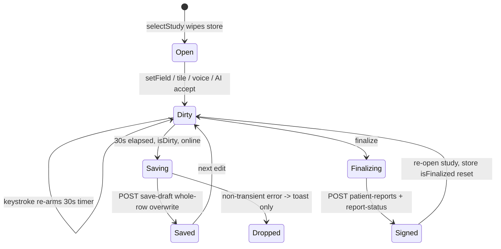
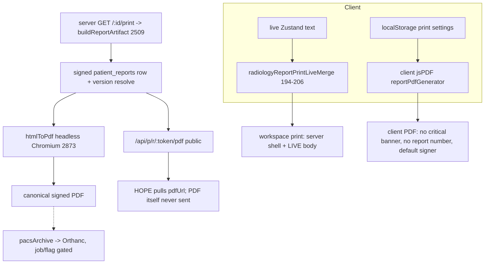

# Radiology Reporting Workspace — Deep Architecture and Clinical-Safety Audit

**Repository:** `DrAbinash/care-on-synology1` (Care Diagnostics radiology ERP)
**Audited tree:** commit `b112c22e`, branch `fix/erp-time-integrity-cutover-and-evidence`
**Equivalent published state:** `origin/main` = `8bb80a88`. The audited tree differs from `origin/main` only by the already-merged forward-only time-integrity work (`lib/db/src/schema/timeIntegrity.ts`, `migrations/add_time_integrity_cutover_and_events_20261001.sql`, `artifacts/api-server/src/lib/timeIntegrity.ts`) and audit markdown. None of that touches the reporting path, so **every finding below applies to `main` as it stands.**

**Re-checked at audit close:** `origin/main` had meanwhile advanced to `43398af1` (`Feat/per book bill numbering (#793)`), and `git diff --stat 8bb80a88..origin/main` is **empty** — the new tip changes no file content relative to the audited base, so nothing below needed re-verification.

**Claims that will need revision as open PRs merge** (this audit reads `main`; it does not read unmerged branches):

| Open PR | Which statement it supersedes |
|---|---|
| #794 `feat(erp): CARE X-ray Lumbosacral Spine Clinical Sub-Master V3 (re-landed on main)` | §3.4 / RR-52 — "the LS-spine library doc exists, no `xrayLsSpine*` sub-master module does, and X-ray LS Spine is bookable with no sub-master." Verified absent on both the audited tree and current `main` (`git ls-tree -r origin/main \| grep -i xrayLsSpine` → only the library doc, the task doc, and `structuredFormat/lsSpineFormat.ts`). Merging #794 closes that half of RR-52 but not the chest/cervical guard-test gap. |
| any PR adding a DB trigger on `patient_reports` | RR-01 / RR-02 and §3.10's immutability ledger ("the only protection in the product is an `if`"). |
| enabling `ff_radiology_structured_final` / `_core` in production | RR-17, RR-63, D-5/D-13 and most of U-3 — several findings flip from latent to live, or live to latent, purely on that flag. |

**Audit performed:** 2026-10-01. Filename carries `2026-09-30` because that was the requested deliverable name; the audit date is this line, not the filename.
**Mode:** READ-ONLY. No file in the application tree was created, edited, moved or deleted. No migration was run. No database was connected to. No branch was checked out, switched, stashed or pushed from the audited working tree. No production command was executed.
**This is a documentation-only PR.** It implements nothing, fixes nothing, and proposes no schema change. Remediation is deliberately not started; §12 stages it as management decisions and one-PR-per-stage work only.

---

## 0. How to read and how to distrust this document

### 0.1 Method

Nine parallel read-only traces each took one slice of the chain (reachability, study resolution, state/drafts, ledger/sub-masters, macros/undo, measurements/laterality, impression/validation, dictation/AI, delivery/PACS/HOPE, data model/performance/tests). Every claim below is a `path:line` citation into the audited tree. The lead reviewer then re-read **✓-marked** citations line-by-line (roughly 30 of them, including all P0/P1 evidence). The rest are single-source but reproducible with the commands in Appendix A.

### 0.2 Five separations this document refuses to collapse

| # | Concept A | Concept B | Why collapsing them is wrong |
|---|---|---|---|
| 1 | **Signed text of record** (`patient_reports.body` / hashed `structured_json`) | **Live client state** (Zustand `findingsText`, localStorage backup, drafts) | A rendered screen is not the record. Findings §RR-19 concerns a path where the screen, not the record, is printed. |
| 2 | **Server-recorded instant** (`created_at`/`updated_at`, DB-defaulted) | **Client-supplied business instant** (`finalizedAt`, `signedAt`, a typed clinic date) | Trustworthy `created_at` means a client-typed `finalizedAt` is a *controllability* gap, not a clock compromise. Several findings are of the first kind; none here alleges the second. |
| 3 | **Advisory** (banner, toast, warning string) | **Enforced** (server refuses the write) | Most of this workspace's clinical safety is advisory. §5 states which of the named failure modes are actually *blocked* in software. |
| 4 | **Provenance** (which mechanism produced a sentence) | **Authorship** (which human accepted it) | The workspace records sentence-level mechanism but not acceptance actor, and drops mechanism at finalization. Both are separate gaps (§RR-02, §RR-03). |
| 5 | **Exists in the tree** | **Reachable by a radiologist** | Roughly 6,000 lines of reporting UI and two whole report-writer engines are present but unreachable, or reachable only by an owner. Dead code is a `G` class, not a defect. |

### 0.3 Severity basis

Severities here are **proposals for management re-rating**, not conclusions. The basis used is the standing rule from the business-time audit: reserve **P0** for unaudited mutation of already-posted history, spoofable attribution, or a path that defeats forensic reconstruction. **P1** = a demonstrated deterministic path to a clinically wrong or untraceable record, requiring no unusual action. **P2** = a control that exists but does not bind, or a defect needing an uncommon sequence. **P3** = correctness/performance debt with a bounded blast radius. **P4** = hygiene, dead code, naming drift.

Nothing was called P1 because it *could* be misused. Each severity below names the mechanism that makes it reachable.

### 0.4 What is deliberately not judged

Medical content is not evaluated. No statement in this document says a sentence is clinically right or wrong; it says whether the software can produce, alter, or lose that sentence, and whether anyone can tell afterwards. Where a spec or guard test pins prose to a canonical library document, the audit checks that the check exists — not the prose.

---

## 1. Executive summary (plain language)

The reporting workspace is one coherent product with a serious split personality underneath. The **clinical authoring layer is genuinely good** — level-based spine logic, laterality slots, conflict groups, a sentence-level ledger, provenance at edit time, and identity guards on draft saves that several other products would not bother to write. That work is real and should not be rebuilt.

The problem is **what happens at and after sign-off**, and it is the same root cause everywhere:

1. **The report loses its own history the moment it becomes legal.** While drafting, CARE knows sentence by sentence whether a line came from a tile, a macro, dictation, AI, or your own typing. At finalization that map is not carried into the signed row, and the print/PDF paths strip it. **After signing, nobody can prove which sentences were the radiologist's.** One command in the palette inserts a fixed hard-coded clinical sentence labelled "Suggest with AI at cursor"; it is not AI at all, and it is not distinguishable afterwards either way.

2. **A signed report can be quietly rewritten.** `PATCH /api/patient-reports/:id` refuses content edits only on `verified`/`delivered` rows and only on hash-signed structured rows. A signed legacy row in `pending_verification` — which is what most ordinary reports are — has its body and impression overwritten **in place, with no audit row, no version chain, and no way to recover the issued text**. Worse: the critical-flag and its acknowledgement fall *outside* the guard's whitelist, so even a verified report can have `isCritical` cleared and `critical_acknowledged_at/by` nulled in the same call. There is no database trigger on any clinical table that prevents this; the only protection in the whole product is an `if` inside a route handler.

3. **People and timestamps at sign-off are supplied by the caller.** Three write paths accept the signing doctor's name and the finalization instant from the request body: `/api/patient-reports` (`createdBy`), the report-status internal route (`actor ?? "system"`), and the Reporting Studio route — which is authenticated by a **shared API key with no session at all**. The database's own recorded instant is untouched and trustworthy; what is spoofable is *who signed and when they say they signed*.

4. **The identity check that exists is not on the path that is used.** A strong server-side gate refusing finalize unless the DICOM↔billed match is `GREEN` or explicitly `APPROVED` lives on `/api/radiology/studies/:id/final`. The workspace does not call that route. The workspace calls `/api/patient-reports`, which *does* gate identity when the client sends a study/worklist id — and intentionally does not gate when it does not. Cross-patient auto-linking by **typed name similarity** is already writing real `patientId` values onto DICOM rows today, capped to "review in Match Center" but live meanwhile.

5. **Machine and spoken text can reach the page without you agreeing to it.** Voice command mode is the *default*, `confirmationPolicy: "standard"`, and appending findings is classed `REVERSIBLE_EDIT`, which needs confirmation only in `strict`. So a dictated sentence is normalized and committed live; the raw transcript is kept nowhere. Independently, the merge function can *delete or substitute* a sentence to avoid duplication, with no diff and no log. And after a format merge the entire undo stack and ledger are cleared — so the destruction is not recoverable.

6. **Nothing about Findings-vs-Impression is enforced where it matters.** Every consistency rule — laterality, sex/anatomy, modality contamination, level mismatch, "normal impression with abnormal findings" — is warn-only by design, and the finalize call feeds the validator so few inputs that about nine of its twenty rules can never fire at sign-off. There is no server-side findings↔impression check on the signing path at all. This is the honest headline: **a report whose impression contradicts its findings finalizes deterministically, and that is currently a product decision rather than a bug.**

7. **Print does not necessarily show what you signed.** The workspace's "print like final" fetches the *draft* endpoint, then replaces the server's body with the live editor HTML, then stamps demography client-side. A second, independent client jsPDF generator omits the critical banner and the report number entirely and defaults the signer to a **hard-coded name** in a settings file, with a rule that rewrites any stored name matching `/abinash/i` to that default. Which artifact a referring doctor or HOPE actually receives depends on which button was used.

Underneath all of it, the **substrate is weaker than the schema appears**: 455 declared tables, 0 `CHECK` constraints and 0 `REFERENCES` in the DDL-of-record reconciliation dump, 0 `GRANT`/`REVOKE` across 182 migrations, ~201 declared foreign keys against ~133 that exist anywhere in SQL, 363 DDL statements executed from boot code inside exception handlers that swallow failures, and the one true DICOM identifier (`study_instance_uid`) unique index created by no migration at all. And **19.6% of the test suite asserts the text of source files rather than behaviour**, so CI can stay green while all of the above regresses further.

What is *not* wrong, and should be said plainly: autosave is carefully engineered against cross-patient leakage (generation counters, study-id fencing, per-study backup keys, server `DRAFT_PATIENT_MISMATCH`/`DRAFT_WORKLIST_MISMATCH` refuses), dirty-study leave is genuinely guarded, append-only triggers do exist and are correct on the AI evidence tables, the amendment chain is real and DB-enforced, and the report-version resolver fails safe. The unsafe edges are concentrated at finalization, delivery, and the identity boundary — not across the board.

---

## 2. The chain, end to end

```mermaid
flowchart LR
    B["Bill / order_tests / tests.department"] -->|"generateStudiesForOrder radiology.ts:133"| S["radiology_studies + accession"]
    D["DICOM push / PACS"] --> W["radiology_worklist"]
    W -->|"worklistBillingLink 3 lanes incl name-referral"| L["study_id + patientId written on the DICOM row"]
    S --> L
    L -->|"GET /pacs-worklist radiology.ts:517"| Q["WorklistPanel queue"]
    Q -->|"selectStudy store.ts:847"| X["Reporting workspace"]
    X --> R["Study resolution: region + template + screening role"]
    R --> SM["Sub-masters / canvas / formats / baselines"]
    SM --> OL["Observation ledger + fieldProvenance"]
    OL --> FI["Findings + Impression text"]
    FI --> AD["Autosave 30s whole-row overwrite"]
    AD --> DR["radiology_report_drafts"]
    FI --> FN["useStudyFinalize"]
    FN --> PR["patient_reports signed row"]
    PR --> PD["server print/PDF artifact"]
    PD --> HO["HOPE outbox"]
    PR --> PA["patient portal / delivery"]
    PD -.->|Orthanc archive| PACS["pacsArchive"]
```



### 2.1 Hop-by-hop identity, with the key used at each hop

| Hop | Carried by | Key that decides identity | Stable? |
|---|---|---|---|
| bill → study | `radiology_studies` | `order_test_id` (idempotent) | ✓ stable |
| study → accession | `radiology.ts:117-129` | minted `ACC-YYYYMMDD-MOD-NNN` via `MAX(SPLIT_PART)` + up to 6 retries | ✗ race-prone, and **explicitly non-unique** in the worklist |
| DICOM → worklist | `radiology_worklist` | `study_instance_uid` — unique index exists only if boot code managed to create it | ✗ see RR-08 |
| worklist → bill | `lib/pacs/worklistBillingLink.ts` | lane 1 normalized accession; lane 2 patient-scoped fuzzy ≥45; **lane 3 cross-patient name/referral, floor 0.85 on a typed name** | ✗ lane 3 is a human string |
| worklist → workspace | `useRadiologyReportingWorkflow.ts:178-198` | `radiology_worklist.id` (internal PK) | ✓ |
| workspace → template | `reportingStudyContext.ts:220` → `pickStructuredTemplate.ts:92` | **`radiology_study_tabs.name`, a mutable display string** | ✗ |
| report → study | `S/patientReports.ts:26-28` | `patient_reports.study_id` holds `radiology_worklist.id`, **not** `radiology_studies.id` — a polymorphic int with no FK and no unique index | ✗ see RR-09 |
| report → images | OHIF launch | `studyInstanceUID`, or **accession** in some builders | mixed |
| report → HOPE | `emitReportToHope.ts` | `referral_item_id + care_report_id`, dedupe pre-check uses `(referralId, careReportId)` while the DB partial unique is on `(referral_item_id, care_report_id)` | ✗ mismatch, RR-26 |

**Reading of the table:** identity is stable where it uses integers the system owns, and unsafe wherever it degrades to a name, a typed string, or a display label. That is the single pattern worth memorising about this workspace.

---

## 3. Subsystem maps

### 3.1 Reachability and shell

Canonical workspace route `/radiology/report/:studyId` → `pages/RadiologyReportingWorkspace.tsx`, which is **19 lines** — a composition root only. The real orchestrator is `hooks/radiology-workspace/useWorkspaceClinicalUi.tsx`: **3,357 lines, 227 imports, 47 `useState`, 35 `useEffect`, 28 `useMemo`, 11 `useQuery`, 34 store selectors**, returning a `vm` bag of roughly 400 members (`:2946`, returned `:3356`) that every shell panel re-destructures. `WorkspaceShell.tsx:421-447` lays out Worklist | Viewer | {ReportCanvas + ReportingToolsRail} in a resizable group.

Every file under `components/radiology/workspace/` carries `// @ts-nocheck` (e.g. `WorkspaceShell.tsx:5`, `WorklistPanel.tsx:5`), even though `workspace/types.ts:16` derives `RadiologyWorkspaceVm` from the hook's own return type. So the shell is wired to a 400-key bag with the type checker switched off at the panel boundary.

**Live report writers, all reachable:** canonical workspace; `/report-hub` (`ReportHub.tsx`, PATCHes `/api/patient-reports` directly); `/report-generator`; `/usg/reporting`; `/radiology/legacy` (owner-gated, self-declared `@deprecated` at `RadiologyLegacy.tsx:226-235`, writes a *different* pipeline `POST /api/radiology/:id/report`); `/radiology/command-center` (owner-gated). Plus `/radiology/usg/:studyId` gated by `ff_radiology_usg_workspace`.

**Orphaned but bundled:** `RadiologyReportGenerator.tsx` (2,166 lines) is `lazy()`-imported at `App.tsx:142` with no route; `ReportingWorkspaceChrome.tsx` (522 lines) has zero JSX importers and is referenced only by a source-grep contract test (`canonicalWorkspaceRouting.test.ts:231`); `components/radiology/CommandPalette.tsx` (132 lines) has no importer. `noUnusedLocals: false` (`tsconfig.base.json:11`) is why typecheck never notices.

**Six separate nav definitions** declare the same radiology entries (`App.tsx:304-321`, `components/Layout.tsx:187-224`, `Radiology.tsx:23-130`, `RadiologyAdvancedTools.tsx:32+`, `lib/globalCommandCatalog.ts`, `hooks/useGlobalScanner.ts`) and permissions must be hand-synced against them: `staffSession.ts:212-213` `if (!PERMISSIONED_PATHS.has(required)) return true;` — a path absent from the list is **permitted by default**, and `/report-hub` is absent.

**Queue navigation** is safer than typical: Next/Previous re-peek a live server snapshot (`useReportingWorkflow.ts:127-140`, 30 s refetch) *after* the dirty-leave gate resolves (`useDraftPersistence.ts:559-568`), and `requestLeaveThen` → `canLeaveStudy` forces Save/Discard/Stay with a failed save keeping you on the study. Situational awareness is the gap: `workflow.position` ("study n of N") is read **only** by the orphaned `ReportingWorkspaceChrome.tsx:346,471`, so the live workspace shows no queue position at all.

### 3.2 Study resolution, billed mapping, screening vs dedicated

Five independent modality vocabularies and five region/body-part resolvers exist, each with its own unknown-input fallback. The fallbacks are the risk:

- `E/lib/zai-workspace/normalizeWorkspaceStudy.ts:26-33` ✓ — `CR`, `MG`, `NM`, `PET`, `BMD`, `OT` and anything unrecognised all become **`XR`**; `asStatus` (`:45-48`) ✓ lower-cases and maps `STUDY_RECEIVED`/`REPORT_FINAL` to **`received`**, erasing finalization state inside the workspace.
- `pickStructuredTemplate.ts:62,70,78,85` — description misses fall back to `BRAIN/PLAIN`, `ABDOMEN`, `CHEST`. `:166-169` documents the fork itself ("the old MRI default was Brain"). `inferStructuredTemplateMatch` (`:26`) has zero production callers yet silently defaults four body parts.
- Spelling variants that miss: `X-RAY L-S SPINE` → CHEST; `DL Spine` → null; `MRI LUMBAR SPINE SCREENING` (no protocol code) → **`ls: "primary-dedicated"`** (`mriSpineScreeningRoles.ts:237-245`); modality `DX`/`XA`/`RF` pass through unchanged, match an empty template pool, and yield **a null template with no error**.
- `:73` ✓ `uhid: … ?? r.patientId` — the internal integer PK is presented as the UHID, and displayed as such in `ReportDemographyCard.tsx:67`.

`mriProtocolSpecs.ts:12-13` states "Region/modality inference from the name string is intentionally NOT done" while `resolveScheduledStationAeTitle` (`radiology.ts:167`) and five client resolvers do exactly that. That is a documented decision contradicted by the shipped code — worth deciding once, deliberately.

**Screening vs dedicated is a name heuristic with no server assertion.** Roles persist into the draft (`useDraftPersistence.ts:407-411`) but `studyComposition` is store-only and reset on `selectStudy`; nothing ties the impression's breadth to the screening flag. The only enforcement is a sentence (`baselines/screeningLimitation.ts:4-5`), and `mriDorsoLumbarValidation.ts:377-381` counts only `limitationCount > 1` — **deleting the limitation sentence entirely is never detected.**

**Multi-study routing parses prose.** `multiStudyReport.ts:89-115` splits Findings by matching exact uppercased title lines; `:91` collapses two studies whose section titles are identical; `:203` silently routes a chip to `sections[0]` on a tie. Persisted accession/UID (`:244-245`) are never compared at finalize.

### 3.3 State, drafts, autosave, locks, versioning



Authoritative store is `E/lib/zai-workspace/store.ts` (2,771 lines, ~90 state fields, ~781 declared members, **in-memory only — no `persist`**). Content survives elsewhere too: a 300 ms mirror (`workspaceClinicalTexts.ts:62-93`), localStorage backup (`useLocalDraftBackup.ts:25,111`, 30 snapshots), the server draft row, `patient_reports.body`, `structured_json_d1`, and `report_finding_instances`. Save reads the store; reload restores the server draft. The **same fact has seven homes**, and `workspaceReportState.ts:63-81`'s "single definition of report content" (`serializeReportSnapshot`/`isReportDirty`) has **zero production callers** — the store's `isDirty` flag wins.

**Autosave is well-fenced and poorly retried.** ✓ `useDraftPersistence.ts:590-629`: 30 s *trailing* debounce, gated `if (!isDirty || !isOnline || isFinalized || isMobile)`, first-save suppressed unless the edit is clinically meaningful, `shouldCommitAutosave` generation+study fencing, transient-error retry with backoff. Gaps: the gate is **not** conditioned on `isFinalizing` or lock state, so it hammers 409 `LOCKED_BY_OTHER` that lands in a generic "Save failed" toast with no handler; non-transient failure **drops the write** (`:454-458`) with no queue; and there is no `If-Match`/expected-`updatedAt`, so two tabs of the same user are last-write-wins.

**Draft rows are structurally allowed to duplicate.** ✓ `radiology_report_drafts` has **no UNIQUE on `study_id`/`worklist_id`** in the DDL of record (`zz_schema_reconcile_20260709.sql:1886`), while `ai_shadow_drafts`/`study_snapshots` do have unique constraints plus UPDATE/TRUNCATE triggers. The client adopts `drafts[0]` ordered by `updatedAt DESC` (`useRadiologyDraftId.ts:34-36`). Separately, opening a spine study fires derivation effects that write `impressionText`/`techniqueText` (`useWorkspaceClinicalUi.tsx:2844-2860`), which pass the "meaningful" gate — so **a draft row can be created with zero radiologist action.**

**Two locking systems coexist:** `radiology_study_locks` (`radiology.ts:1362-1376`, hard-coded 30-minute staleness, keyed on study id) and worklist columns via `A/lib/studyLocks.ts:110-197` (`FOR UPDATE`, TTL from `pacs_settings`). Draft save is gated only by the latter.

**Versioning is real, and flag-conditional.** `patient_report_amendments` is a genuine DB-enforced chain (`S/patientReportAmendments.ts:19,42-44`), the version resolver is read-only and fails safe (`A/lib/radiologyReportVersion.ts:320`), and readers see `X-Report-Version` (`:423`), `-v1of2` filenames (`:476`) and a SUPERSEDED banner (`:2549-2566`). But `effectiveResolveMode` (`:409-416`) returns `"specific"` unless `ff_radiology_structured_final` is on — with the flag off, `/print` and `/pdf` serve exactly the requested row, superseded and unbannered. **UNKNOWN — RUNTIME TEST REQUIRED: U-4.**

**The undo stack is the sharpest state bug found.** ✓ `useDraftPersistence.ts:164-184` resets findings/impression/technique/recommendation/history, `fieldProvenance`, `isDirty`, `isFinalized`, ghost text, linked study and pattern markers on study change — **but not `patchUndoStack` and not `appliedPathologyPatches`.** `store.selectStudy` (`store.ts:847`) does clear them; worklist navigation does not go through `selectStudy` (the comment at `:162-163` says exactly that). So Patient A's snapshot survives into Patient B's session, and one `Ctrl+Shift+Z` — bound at `useWorkspaceCommands.ts:236`, also a palette item, also `ReportCanvas.tsx:648` — restores Patient A's report text into Patient B's open study. Depth is 5 (`clinicalUndo.ts:5`), the stack is never persisted, and the snapshot omits `measurements`, `structuredViewerMeasurements`, `canalApProvenance`, `sequencesAvailable`, `screening`, level numbering, `coverageMarks` and `impressionOrderFrozen` (`store.ts:280-296`), so undo of a tile can orphan its key image or measurement.

### 3.4 Observation ledger, sub-masters, formats, baselines

A `CanonicalObservation` (`observationSlot.ts:89-114`) carries `region, anatomicalSection, concept, conflictGroup, level, laterality, state, severity, measurement, slotKey, source, baselineReplaces, supportsLaterality, bundleId, sectionsOwned, role, specificity, anchor`. Slot identity is `region|concept|level|laterality` (`:263-275`). Two things are absent by design: **present/absent status** (`state` is free text, `:299`) and **any sequence field** — the anchor stores a free-text `seriesDescription` (`observationAnchor.ts:9-20`), and the header says plainly "Anchor ≠ proof of diagnostic review".

Storage is a JSON blob, not rows: `observationLedger.ts:3` "Operates on appliedPathologyPatches + narrative. No second store", serialized `care.observation_ledger.v1` (`:273-330`) into `radiology_report_drafts.structured_json` under `careObservationLedger`. `report_finding_instances` is **not** the ledger (`S/reportFindingInstances.ts:20-53`, deliberately FK-less at `:14`); it is populated only from Quick-Select `findings[]`, replace-not-append, with `source` hard-coded to `"quickselect"` (`radiology-report-generator.ts:1785-1800`), gated by `ff_radiology_structured_core` (`defaultValue: false`). The implementation guide calls that table "the sole source of truth". It cannot see tiles, presets, screening, vascular state or patterns.

**Provenance is sentence-text-keyed and evaporates at sign-off.** 17 `InsertSource` values (`reportFieldMerge.ts:14-31`) map `normalizeForDedupe(sentence) → sources[]`. It survives reload (embedded in the ledger, `:327`) and survives light edits (Jaccard ≥0.72 keeps the prior source and appends `manual`, `:180-198`). It is destroyed by `replaceProvenance` (`store.ts:856-862`), and it does **not** reach the signed row: `A/routes/patient-reports.ts` contains no reference to `observationLedger` or `fieldProvenance`, and the finalize payload carries only `body` (`radiologyReportLifecycle.ts:257`). The only provenance UI, `ownership-trace-panel.tsx`, is mounted inside `<div className="hidden" aria-hidden="true">` (`ReportCanvas.tsx:1553`).

**Sequence awareness exists and is not enforced.** `mriSpineSequences.ts:19-48` defines 12 keys, default **all false** (`:53-57`), auto-derived by regex from technique + study description + protocol name + report title + **the active format's own name** + clinical history (`:90-112`). `spineSequencesAllow` gates the *panels* (`mriLumbarSubMasters.ts:1148`, `mriDorsalSubMasters.ts:1709`, `mriDorsoLumbarSubMasters.ts:1989,2245`, `mriSpineScreening.ts:196`). It is **absent from `observationSlot.ts`, `observationLedger.ts`, `findingComposerModel.ts` and `store.applyPathologyOverlay`** — the Finding Composer, Quick Select, dictation (`observationInputFromVoice` has no sequences parameter, `observationLedger.ts:224-246`), AI accept and free typing all bypass it. `levelPrecisionAllowed` (`:212`) and `missingSpineSequenceLabels` (`:137`) have zero non-test consumers. The text-level backstop `SPINE_STATEMENT_RULES` is warning-only (`mriSpineContradictions.ts:179,340`).

**Levels default rather than derive.** `defaultDorsoLumbarState` hard-codes `superior: "T8-T9"` plus a full lumbar tail with no DICOM input (`mriDorsoLumbarCoverage.ts:136-151`); ledger canonical spelling is `D8-D9` relabelled to `T` for display only (`observationSlot.ts:44-49`). `CoverageCockpit.tsx:38` says "Advisory only — VIEWED ≠ REVIEWED · never blocks sign-off", and `observationLedger.ts:293` says the ledger is "Never used as a finalize hard gate".

**Sub-master engine:** one shared spine platform (`mriSpineAtoms.ts:1-11` "There is no second ledger", `mriSpineProse.ts` dialects) with per-region content (lumbar 1,554 / dorsal 2,396 / dorso-lumbar 2,458 / brain 1,281 / vascular 452 / xray-chest 2,063 / xray-cervical 1,987 lines), converging on `applyMacroBundle` through **three parallel atom compilers** (spine, brain, x-ray). The verbatim-to-canonical-library guard tests exist for lumbar, dorsal, dorso-lumbar and MRA/MRV only; chest and cervical cite their library docs **in comments only** (`xrayChestNormalAtoms.ts:5`), and MRI Brain parenchymal sub-masters have no library file at all. `docs/clinical-libraries/xray-ls-spine-clinical-content-library.md` is orphaned — the doc exists, no `xrayLsSpine*` module does, and X-ray LS Spine is bookable. MRI Cervical is selectable with a level canvas and no sub-master panel. **CT has no sub-master or canvas coverage at all — CT is prose-only in this workspace.**

Content sources in play (each can supply the same section's text): code sub-master atoms, library markdown, `radiology_quick_findings` (+ `BUILTIN_SPINE_ENTRIES` fallback when the DB is empty), `radiologyCatalog` finding_definitions/synonyms, `conceptCanon/contentPacks.ts`, baseline manifests, report formats (code default + DB + localStorage), `structured_report_templates`, `radiologyMasterTemplates.ts` (legacy, still routed), `radiology_normal_snippets`, `radiology_text_macros`, `presentationTemplates`, `ai_normal_report_templates`. `ReportCanvas.tsx:1015` `{false && (` disables an entire duplicate inline-assistance tree that is still compiled into a 2,056-line file.

### 3.5 Macros, quick-select, insertion, manual-text protection

Four independent text splicers, only one of which dedupes: (a) `mergeReportFieldContentWithProvenance` (`reportFieldMerge.ts:485-494`) via `store.mergeField` — has exact + word-subsequence dedupe (`:431-446`); (b) `store.setField` wholesale assign — no dedupe; (c) `insertTemplateText` pure `\n\n` concat (`personalReportTemplates.ts:166-171`) — no dedupe, contradicting its own file's "ONE shared entry point" header (`reportFieldMerge.ts:3-7`); (d) the ledger's `composeNarrative`.

| Path | Storage | Reachable | Semantics | Confirmation | Undo |
|---|---|---|---|---|---|
| Chocolate-box macros | LS `care-rad-chocolate-boxes-v1` + `radiology_chocolate_findings` | yes (`ReportingToolsRail.tsx:599`) | overlay/bundle | slot conflict only | yes |
| Snippet macros | code const + LS | yes (palette) | **raw `setField(findings, text.replace(...))`** `command-palette.tsx:74` | **none** | **no frame** |
| Quick Select tiles | code const + LS + `/api/radiology/content-pack-tiles` | yes | findings→ledger patch `qs-<id>`; **technique→`mergeField` only** `quick-select-strip.tsx:233` | slot conflict only | findings only |
| Personal templates | LS `care_personal_report_templates_v1` | yes | concat append, `setField` with **no source** (`:614`) | **none** | no |
| LegacyBox tabs | DB | yes (`ReportingToolsRail.tsx:1126`) | wholesale `setField`, **no source** (`:996,997,1154-1156`) | **none** | no |
| Report formats | code+DB+LS | yes | `setField(...,{source:"template",replaceProvenance:true})` `store.ts:1200-1204` | yes (`:1121-1145`) | yes |
| Format A/B merge | — | yes (`WorkspaceOverlays.tsx:667`) | wholesale | merge preview | **history destroyed** |

The confirmation dialogs exist and are opened from exactly three sites (`store.ts:1137`, `:1635`, `:1274`). The bypass list above is the finding: **five live insertion paths overwrite text with no confirmation and no undo frame.**

**The overwrite gate is defeatable, and this is deterministic.** `analyzeFormatOverwrite`/`classifyFormatSection` (`fullReportFormat.ts:221-233`) treat a section as manual only if its provenance set contains `"manual"`. ✓ `reconstructProvenanceFromLedger` assigns `map[key] = ["template"]` to **every sentence no patch owns** (`observationLedger.ts:444-451`). So when a draft restores a ledger whose `fieldProvenance` was not serialized (stored only when non-empty, `:327`), hand-typed prose classifies as *template*, `sectionRequiresOverwriteConfirmation` returns false, `store.ts:1146` applies silently, and `:1200-1204` replaces it and wipes provenance. Mitigating and worth stating: when ledger status is `"absent"` hydration early-returns (`store.ts:1924-1928`) and the blanket `"manual"` stamp survives — the bug needs the *restored-ledger-without-provenance* shape.

Also: `store.ts:1601` sets `protected: false` on a same-slot auto-update, dropping a prior manual-protection flag; and `radiology_chocolate_findings` has no owner column, with `POST`/`DELETE` role-free (`radiology.ts:2728,2773-2779`) — **any staff member can change everyone's macros with no attribution and no version.**

### 3.6 Measurements and laterality

Positive controls first: viewer ingest is study-scoped (`useOhifViewerBridge.ts:133`), hydration resets on UID change (`:144-148`), `selectStudy` wipes measurement state, and the OHIF inbound guard drops messages whose `studyInstanceUID` differs (`ohifViewerBridge.ts:252-256`).

Four gaps:
- **A** — the guard explicitly *exempts* deletes (`:253 msg.type !== "measurement-deleted"`), `removeStructuredMeasurementByAnnotation` filters on annotation id alone (`:221-231`), and the handler then PATCHes a DB row to `status:"ignored"` (`useOhifViewerBridge.ts:356-368`) — a cross-study, id-only, **persistent** mutation.
- **B** — prior lookup `:178-185` matches `rowId || annotationId` with **no `studyInstanceUID` predicate**, and `structuredFromViewerRow` pins `concept`/`spinalLevel` from that `prior` (`:438,447`). A repeated annotation id carries study A's level into study B.
- **C** — level is recovered by parsing **display strings** (`discLevelFromLabel([measurementId, measurementType].join(" "))`, `:350-353`), and `measurementType` is itself set from a level label at POST time — semantic identity in a free-text column.
- **D** — no physiologic validation exists at all. Client side only checks non-empty (`spineCanalAp.ts:328`); server side `canalAP` is `z.string().max(20)` (`radiology-report-generator.ts:3564`). Catalog range rules including midline-shift >5 mm and fetal FHR 110-160 are generated with `blockingEligibility: false` and are **shadow-tier only, never registered on the default engine** (`lib/report-quality/src/rules/measurements/index.ts:53`, `rules/structured/index.ts:26`). The FHR rule labelled `severity:"blocker"` therefore does not block — it surfaces as `unresolvedBlockers` in a dialog whose own copy says "does not block signing" (`reportQualityFinalize.ts:161`, `FinalizeSignDialog.tsx:200`).

**Units are defaulted, never inferred** (good) — but defaulted wrongly in the one place it matters: `unit: opts.row.unit || "mm"` (`structuredViewerMeasurements.ts:446`), `parseMeasurement` `defaultUnit ?? "mm"` (`usgFindingBuilder.ts:92,104`) where the USG/OB convention is cm. `applyCanalApValue` hard-codes `unit:"mm"` regardless of source (`spineCanalAp.ts:342,351,375`), and `SpineCanalApBox.tsx:204` strips everything but digits/`.`/`-`, so a typed "1.2cm" becomes 1.2 mm. Worst single line: ✓ `mriDorsalLevelDetail.ts:816` `Number(String(obs?.measurement ?? "").replace(/[^\d.]/g, ""))` assigned to `detail.apMm` (`:820,823`) and rendered as `${apMm} mm` (`:300`) — a cm value read back as mm (10× low), with the minus sign also stripped by that character class.

**Laterality can be asserted without being chosen.** Explicit selection is optional (`findingComposerModel.ts:210` default `""`). Defaults found: `mriBrainMeasures.ts:119` `… || "right"`, `mriBrainVascularThrombosis.ts:218` `|| "right"` (also written into the ledger as `laterality: side`), `mriDorsalSubMasters.ts:406,901,989,1014,1592` `ctx.side ?? "left"`, `mriBrainSubMasters.ts:1209` `?? "left"`, `findingComposerModel.ts:247 default:"left"`, and server-side `leftForaminal/rightForaminal ?? "normal"` (`radiology-report-generator.ts:3629-3630`). So yes — **a "to the right" midline-shift sentence can finalize with no side ever selected.** Prose rendering then has the opposite failure: `mriSpineProse.ts:292-294` emits the side only if it matches the dialect's alternatives, else `""`; `:339-341` renders a mixed group as `${side} ${vert}` **or nothing** — so a recorded level can silently vanish from the text.

Three mutex/conflict systems exist with no cross-talk: the ledger `slotKey`, `structuredFormat/mutex.ts` `MutexGroupDef`, and DB `conflict_group`. Named groups do exist (`screen-<region>-<section>`, `coverage_limitation`, `contrast_limitation`, `stir_limitation`, `canal_stenosis`) but they are **intra-source only**; nothing prevents a sub-master tile and a structured-format field from contradicting each other, and detection is a post-hoc warning whose own comment says "Never deletes the sentence" (`observationLedger.ts:489-516`).

### 3.7 Findings/Impression generators, staleness, validation

Fifteen distinct Findings/Impression producers were traced. Most propose; four write. Those that write: `store.applyReportFormat` (template text into all four fields, `:1201-1202`), `store.applyMergedResult` (`:2637-2658`), `conceptCanon/normalImpression.ts:130` via `seedSystemNormalImpression` (`store.ts:1846-1899`), `applyPathologyOverlay` (`:1658-1677`), and `impressionPriority.orderImpressionLines` (`:1834-1843`). **Precedence is not decided in one place** — it emerges from `setField`'s source branching (`store.ts:871-883`) plus 24 raw `set({impressionText})` sites. The near-single point `refreshImpressionFromLedger` (`store.ts:1803`) is bypassed by format-apply, format-merge, voice and template-insert. Two whole generators are dead: `radiologyReportAssembler.ts` (689 lines) and `smartFindings.ts` (178 lines), zero importers, with four settings flags reading nothing (`staffSession.ts:306,321,322,357`).

**Staleness is provenance-presence-based, not meaning-based.** ✓ Predicate at `observationLedger.ts:570-583`: stale iff a patch's `lastRendered.findings` is missing, or a non-protected contribution is absent from impressionText. A hand-written contradictory impression is *protected* (`:579`) and therefore **never stale** — and the banner is shown only when `impressionNeedsRefresh && impressionManuallyEdited` (`ReportCanvas.tsx:1775`), the very condition the predicate suppresses. Marking is asymmetric: `setField` marks stale (`store.ts:871`), `mergeField` (`:915-947`) and `setEditorContent` (`:957-997`) do not — so quick-select, voice and template merges leave the impression silently stale. And `useWorkspaceClinicalUi.tsx:2820-2840` **auto-rewrites** a stale non-manual impression via an effect with no user action, which then autosaves.

**Validation is three parallel engines and none of them blocks.** `E/lib/reportValidator.ts:4` header states "WARN ONLY … never blocks"; `lib/report-quality` Q001-007/Q101-115 is a 1:1 port, all `tier:"heuristic"`, `defaultSeverity:"warning"`; the only true linkage enforcement anywhere is `A/lib/structuredReport/validator.ts:406` rule `R2` (rejects an impression fragment whose `finding_ref` matches no finding) — gated behind `ff_radiology_structured_final`, `defaultValue: false`. Two rules are hard (`rules/structured/index.ts:35-41`) — study-modality consistency and fetal FHR range — and both are shadow-registered.

The validator is also **starved of its own inputs**: ✓ `useStudyFinalize.ts:129-133` passes only `findings`, `impression:[live.impressionText]` (one element), `technique`. Every sex/age/modality/contrast/laterality-vs-description rule gates on fields that are not passed (`reportValidator.ts:207-292`), so about nine of twenty rules can never fire at finalize, and the duplicate-impression-line rule can never fire. The server's `validate-draft` returns `{enabled:false}` with no `errors` key when flags are off (`radiology-report-generator.ts:2097-2104`), and the client `catch {}` swallows it (`useStudyFinalize.ts:145`).

**Gate order at finalize** (`useStudyFinalize.ts:82-353`): offline → session → AI-pending (client, needs the job loaded in *this* tab) → `saveDraft` (**failure does not abort**, `:115-118`) → PCPNDT Form F (client **and** server) → local validator (client, warn-only) → server validate-draft (no-op when flags off) → quality evaluation (client, advisory) → critical (client) → signatures (client, and `/sugandha/i` regex sorts the list, `:186-190`) → composition/staleness gate (client, overridable by one checkbox) → dialog → POST. **Everything from step 12 onward is client-only.** POST `/api/patient-reports` inserts body and impression verbatim with **no consistency check** (`patient-reports.ts:2076-2105` ✓), and `isCanonicalFinalize` (`internal-radiology.ts:1065`) is satisfied by a client-supplied `deliveryStatus` string.

Critical findings: three stores (`critical_findings`, `radiology_critical_findings`, `patient_reports.is_critical`) with **two divergent keyword lists** — ~110 phrases client-side (`criticalResults.ts:33-160`), 10 server-side (`criticalFindingsAlert.ts:124-135`). Durable notification with actor+instant exists only in `radiology_critical_findings`. `criticalAcknowledged`/`notifyReferring` are collected in `FinalizeSignDialog.tsx:299-300` and **never read** by `useStudyFinalize.ts`, so `critical_acknowledged_at/by` stay NULL; the SLA escalation action is `store.ts:1089 escalateCriticalSla: () => set({criticalSlaEscalated:true})` — cosmetic. Nothing blocks print, PDF, share, delivery or finalize on an unacknowledged critical.

### 3.8 Dictation and AI acceptance

Two disjoint voice paths; the retired `voice-bar.tsx:5-8` returns `null`, `FieldCareMic` re-arms the same session — so there is genuinely **one** mic pipeline, which is a strength.

**Dictation mode** is careful: transcript → normalize → **editable pending preview** (`VoiceCommandBar.tsx:240-243` shows raw STT when it differs) → confirm → `mergeField(..., "radiologist-voice")`. **Command mode is the default** ✓ (`voiceTranscription.ts:110-111` `defaultMode:"command"`, `confirmationPolicy:"standard"`) and "add findings <text>" classifies as `REVERSIBLE_EDIT` (`voiceSafetyPolicy.ts:69,84`), which requires confirmation **only under `strict`** (`:174-176`). So normalized speech is committed live with no preview and no raw shown.

Silent rewrites are extensive and mostly reasonable (`voiceDictationNormalize.ts:39-274`: spoken levels → `L4-L5`, numbers → `6.6 mm`, "dash" → em-dash, "t one" → `T1`, `hyper-echoic` → `hyperechoic`), plus auto-appended punctuation (`voiceCommandGrammar.ts:90-93`), live typing `. `→newline (`findings-editor.tsx:377-388`), and a server STT decoding bias prompt (`radiologyDictationVocab.ts:37-50`). The dangerous ones are in the merger: `reportFieldMerge.ts:459-469` lets an incoming supersequence **replace** the kept sentence; `:351-357` keeps the longer of two technique paraphrases and drops one; `:361-368` **discards an incoming sentence entirely** when a concept already covers it. None of these three produce a visible diff.

**No auditable spoken original exists on the workspace path.** `parse.rawTranscript` is transient React state; `voice_dictation_logs` stores `wordCount`/`durationSecs` only; `radiology-voice.ts:6-9` states "Never the transcript"; the table that *could* hold it (`aiVoiceTranscriptionsTable`: `rawTranscript`, `correctedText`, `confidenceScore`) is written only by a manual CRUD route (`aiReporting.ts:3078`), never by `useVoiceSession`.

Ghost text is handled correctly and should be credited: Ctrl+I **proposes**, accept is Tab only (`GhostLayer.tsx:36-43` → `mergeField(...,"ai-draft")` `store.ts:1037-1042`); Enter/typing cannot commit it. The Report Composer is the best-designed path in the product — a real job table with `inputSnapshotJson` and hashes, per-change accept, `appliedBy`/`appliedByStaffId`/`appliedAt` at job level (though per-change records only `acceptedAt`, **no actor**, `jobService.ts:581-589`).

Two honest degradations: (1) the palette's "Suggest with AI at cursor" inserts a **literal hard-coded string** `"Findings concerning for acute abnormality."` (`command-palette.tsx:51` ✓) and `findings-editor.tsx:214-224` `sg()` is regex, not AI — both then stamp `ai-draft` provenance, laundering non-AI text as AI while `setField` without a source (`ReportingToolsRail.tsx:996-997`, `copilot-rail.tsx:67`) stamps **AI/template output as radiologist-"manual."** Provenance is untrustworthy in both directions. (2) Ctrl+I posts `{field:"impression", findings}` but `aiReporting.ts:839-857` destructures `reportBody|impression|clinicalHistory` — **`findings` is never read**, so an impression labelled "Generate from findings" is generated from the study description alone.

Manual protection self-disarms: it is recomputed only when the write's source is manual/absent (`store.ts:885-905`), while a sourced write replaces the whole map (`:857-861`) — erasing the `"manual"` keys that `applyChangePlan.ts:47` `PROTECTED_SOURCES` depends on. So after any intervening template/AI write, a later AI/voice refresh can overwrite a hand edit. And `mergeField`'s finalized guard covers voice only: ✓ `store.ts:917` `if (isFinalized && source === "radiologist-voice") return;` — `ai-draft` and `companion` merges proceed on a signed report client-side.

Finally, **no AI attribution appears in the delivered artifact.** `radiologyReportPreviewHtml.ts:22-25,43-52` strips the provenance preview CSS; `reportPdfGenerator.ts` and `radiologyReportPdfExport.ts` contain zero `ai`/`assist`/`machine` tokens; only `fetalUsgLevel4.ts:736` carries a disclaimer. Whether that is acceptable is a management/compliance decision, not a defect — but it should be decided knowingly, and it interacts with U-9 below.

### 3.9 Finalization → artifact → PACS/OHIF → HOPE → history



**Verdict on the live-merge question: live wins.** ✓ `mergeLiveBodyIntoPrintHtml` replaces the entire `<div class="body">` (`:194-206`) and `finalizePrintPreviewHtml` client-patches demography (`:319`), so the printed body can be unsigned text while the letterhead, report number and critical banner come from the signed row (`lib/reportPresentation.ts:533,1033`) — a **mixed artifact**. Compounding it, the workspace's "print like final" always calls the **draft** preview endpoint even when `linkedReportId` exists (`useWorkspaceExportShare.ts:357-381`), stamped `PREVIEW-<draftId>` with the watermark suppressed (`radiology-report-generator.ts:2379,2422,2459`). The client jsPDF path independently signs a **hard-coded default name** `"Dr. Sugandha Priyadarshini"` (`reportPdfGenerator.ts:116` ✓) and rewrites any stored name matching `/abinash/i` to it (`:131` ✓) — a deterministic, localStorage-driven identity substitution in a patient-facing artifact, with no critical banner at all.

Only the server PDF is the record, and only Orthanc-archived revisions are stored copies (`A/lib/pacsArchive.ts:122`); the ordinary path stores **no hash-linked PDF**, hash existing only for structured docs (`structuredReport/hash.ts:6-16`, verified at `radiologyStructuredRead.ts:215`).

Six OHIF/PACS URL builders exist plus three template seeders. Encoding discipline varies: `pacsEnterprise.ts:611` is canonical (everything `encodeURIComponent`, UID regex-validated, worklist cross-check at `:666-675` — **but that cross-check is skipped when `wl.studyInstanceUID` is null**); `viewerDeepLinks.ts:32` is safest (`URLSearchParams`, adds `SeriesInstanceUID`+`initialSopInstanceUid`); `studyLaunchService.ts:545-556` and `viewerService.ts:357-368` splice `identifier.value` **un-encoded** into a `weasis://$dicom:get -r "…"` command string; `dicomConnectors.ts:125-126` ✓ and `fetalUsgLevel4.ts:799-801` ✓ hard-code the **public internet** `https://viewer.ohif.org` with the StudyInstanceUID embedded, reached from `routes/dicomStudyManager.ts:368`. `RadiologyOpenRedirect.tsx` is safe (server returns only relative paths built with `URLSearchParams`, `reportPath` numeric). The wrong-study vector is **accession**: `studyLaunchService.ts:508,526` supports `{accessionNumber}` while accession is explicitly non-unique (`radiologyWorklist.ts:90-96`, `index.ts:583` drops the unique index). `browserDicomWeb.ts:44-45` ✓ appends the staff **Bearer token into a `?staffToken=` query string** used in `` — scoped to ERP dicomweb URLs, so not third-party leakage, but a bearer credential in URLs is browser-history and server-log material.

HOPE sync (`services/integration/emitReportToHope.ts`) walks the amendment chain to the **latest** signed report (`:108-119`), so a superseded version cannot be pushed — good. But the payload carries a `pdfUrl` and **not the PDF** (HOPE pulls `/api/p/r/:token/pdf`), so a minted public token+expiry is an integration secret; the outbox's dedupe pre-check keys `(referralId, careReportId)` while the DB partial unique is `(referral_item_id, care_report_id)` (`hope_care_diagnostic_referral_integration.sql:321-326`); and ✓ the link insert `.catch(() => [undefined])` followed by `if (!link) return;` (`:228-229`) skips enqueuing while the outer function still returns `{ok:true, emitted:true}` (`:298`) — **a false success**. Actor is `"system"` (`:273`), not the radiologist. Inbound `routes/integration/inbound.ts:89/212/232` writes HOPE's acknowledgement onto `critical_ack_status/by/at` but never touches `patient_reports` or `radiology_critical_findings`.

Historical reading: the clinician viewer (`patient-reports.ts:1314-1332`) is chain-resolved and reads the signed artifact — correct. The patient portal lists every version as its own row (`patientPortal.ts:329-347`) but each link resolves correctly — cosmetic duplication. **The workspace's own prior-report panel does not**: `radiologyCopilot.ts:111-125` selects raw `body`/`impression` with **no status filter and no chain resolution**, joined across the wrong id namespace with unordered `limit(1)`; `priorStudies.ts:54-73 pickBestReport` is chain-blind; `ReportDiffViewer` labels `ai_reporting_drafts.draft_text` as `finalReport` (`aiReporting.ts:2276-2295`). So "compare with prior" can show a draft, or the superseded text, with nothing indicating which.

### 3.10 Data model, DDL truth, performance

| Measure | Value | Command (Appendix A) |
|---|---|---|
| Tables declared | **455** | `grep -rhoE "^export const [a-zA-Z]+ = pgTable\(" lib/db/src/schema/*.ts \| wc -l` |
| Schema files | 180 | `ls lib/db/src/schema/*.ts \| wc -l` |
| Tables in reporting-named schema files | **218** across ~40 files | per-file `grep -c 'pgTable('` |
| Migrations | 182 | `ls migrations/*.sql \| wc -l` |
| `CHECK` / `REFERENCES` in DDL-of-record dump | **0 / 0** | grep on `zz_schema_reconcile_20260709.sql` (27,342 lines) |
| `GRANT`/`REVOKE` across all migrations | **0** | `grep -rlE '\b(GRANT\|REVOKE)\b' migrations/*.sql \| wc -l` |
| Migrations creating `radiology_worklist_uid_uq` | **0** | `grep -rl radiology_worklist_uid_uq migrations/ \| wc -l` |
| DDL statements executed from boot code | **363** | `grep -cE 'ADD COLUMN\|CREATE INDEX\|CREATE UNIQUE INDEX' artifacts/api-server/src/index.ts` |
| DB-level append-only triggers, all migrations | **8**, of which 2 are `update_updated_at` | `grep -rn "CREATE TRIGGER" migrations/` |
| Test files / source-text-asserting files | 755 total; **148 (19.6%)** | E 68 files / 196 `readFileSync`, A 80 files / 265 |
| React render tests for the workspace | **0** | `find … -name '*.test.tsx' \| wc -l` → 0; root `vitest.config.ts:22` is `environment: "node"` |
| DB-gated test files / `.request.test.ts` | 44 / 25 | grep + find |

Only `ai_shadow_drafts`, `study_snapshots` (partially — 4 columns; `is_current`/`superseded_at` remain mutable) and the new `care_time_integrity_*` tables have DB protection. **`patient_reports`, `radiology_report_drafts`, `report_finding_instances`, `spinal_measurements`, `usg_measurements`, `radiology_critical_findings`, `patient_report_amendments`, `radiology_audit_log` and `radiology_report_lifecycle_log` are all in-place mutable**, and `patient_reports` has 14 UPDATE sites; the sole signed-report protection is the `if` at `patient-reports.ts:2152`/`:2164` ✓.

Typing hazards: `spinal_measurements.canalAP/cordAP/discHeight` are `text` (`S/radiologyReportGenerator.ts:331-339`), `usg_measurements.bpd text` (`S/usgMeasurements.ts:27`) vs `fetal_usg_measurements.bpd numeric(6,2)` (`S/fetalUsgLevel4.ts:62`) — the same quantity, two incompatible types; `radiology_dicom_measurements.value text`. Reverse drift: `radiology_report_drafts.ai_contribution_pct real` exists in DDL (`:1908`) and in **no** schema file. `ON DELETE CASCADE` at `add_radiology_smart_reporting.sql:43` means deleting a catalogue finding deletes linked report findings. `zzzz_schema_drift_fix_indexes.sql:80-87` explicitly declares timestamptz/type drift "safe to ignore", and `:26` **drops** the accession unique index the reconcile dump created at `:25553` — so shipped DB state depends on which files actually ran. `check-migration-order.cjs` exits 0 (it proves table existence, never index/constraint existence) and `grounding-check.cjs` exits 0 on **105 architecture claims**, all of which are source-text/table-name assertions with zero DB-state assertions.

Performance: `GET /pacs-worklist` (`radiology.ts:517`) does **7 LEFT JOINs** (`:655-661`), `.limit(500)`/`1000` with **no OFFSET** (page 2 unreachable), selects `dicomMetadata` and `aiDraftJson` full-text blobs, and runs five `ILIKE '%…%'` predicates (`:548-554`). `GET /worklist` (`:335`) has **no LIMIT at all** ✓ and does its search **in JavaScript after fetching the whole day** (`:445-457` ✓), with `hasPrelim/hasFinal` computed from `length(prelim_report)` — detoasting two unselected text columns per row — and `assigned=mine` on an unindexed column. N+1 sites: `radiology.ts:158` (`resolveScheduledStationAeTitle` per order test), `:311` (`generateStudiesForOrder` per missing row, nested with its own 6-attempt loop), `:117-129` (`nextAccessionNumber` = seq-scan `MAX(SPLIT_PART)` + `LIKE 'ACC-…%'`, retried up to 6× per study), `radiology-report-generator.ts:3390-3397` (serial `displayOrder` updates), `smartRadiology.ts:300-305,536`, `radiologyQuickFindings.ts:430-436`, `patient-reports.ts:1810-1820`. Good news, stated so it isn't re-litigated: USG counts avoid N+1 entirely via `fetchUsgAggregatesByWorklistIds` — three batched `IN` queries (`lib/pacsWorklistUsgAggregates.ts:26-60`).

Frontend: 110 `refetchInterval` sites across the ERP; **3 polls run simultaneously for one open study** — queue (`useReportingWorkflow.ts:138`, 30 s, *not* visibility-gated), PCPNDT (`:2478`), MRI-warm-cache (`:2501`, polled for **every** modality). The same worklist row is fetched twice on open via two different endpoints (`workspace-entry` `:911-912` and `pacs-worklist-detail` `:2277-2278`), and report preferences are fetched twice (`:813`, `:840`). Opening one study costs **≈13-16 requests**. `nextStudyReportPrefetch.ts:30-42` uses raw `api.get` and **discards the result** — no `queryClient.prefetchQuery`, so the cache is cold on arrival; worse, `useWorkspaceClinicalUi.tsx:2158` makes next-study prefetch **POST** `/api/ai-reporting/draft` for a study nobody opened. Zustand usage is disciplined in kind but not in shape: 114 bare `useWorkspace((s) => …)` selectors, all returning primitives or refs (0 object-literal selectors, so tearing risk is low) — but `useWorkspaceClinicalUi.tsx` alone subscribes to **34 slices**, making one giant subscriber whose re-render cascades the whole tree; next worst are the sub-master panels at 8/7/7/6. Autosave amplification: each save rewrites the whole ~18-field payload including the **unbounded** `observationLedger` (every patch with full `observation`, `templates`, `lastRendered`, `replacedBaseline` — `observationLedger.ts:305-320`, no cap) into a single 10-subtree `structured_json` jsonb column; only viewer measurements are bounded, silently, at 400 items (`useDraftPersistence.ts:401-402`), untested.

CI: one workflow, two jobs (`.github/workflows/ci.yml`, 110 lines). The static job runs `check-migration-order.cjs`, `grounding-check.cjs`, `pnpm typecheck`; the test job runs a real `postgres:16-alpine` with `db:smoke`, `db:bootstrap`, `vitest run --no-file-parallelism`, and `e2e:smoke` (login shell only). Reporting **is** exercised against Postgres (44 DB-gated + 25 request-level files run there). But `e2e:voice-composer` exists in `package.json` and is **not run in CI**, `api:route-coverage` is not a CI step, and the reporting workspace UI has **zero browser coverage**. Root `pnpm test` runs parallel where CI runs sequential, so a local green is not a CI green.

---

## 4. Duplicate sources of truth — consolidated register

| # | Fact | Number of homes | Which wins | Risk |
|---|---|---|---|---|
| D-1 | Report body text | store, 300 ms mirror, localStorage latest + `_history`, `radiology_report_drafts`, `patient_reports.body`, `structured_json_d1`, `report_finding_instances`, `formatted_report_*`, `raw_findings`/`findings_sections` | store on save; server draft on reload | any can diverge; only ledger+provenance is reconciled |
| D-2 | Dirty state | `store.isDirty` (live) vs `workspaceReportState.ts:63-81` snapshot rules | store | the "single definition" module is dead code |
| D-3 | Draft identity | `useRadiologyDraftId` useState + react-query cache + server `drafts[0]` ordered by `updatedAt DESC` | capture-on-save | duplicate draft rows, split content |
| D-4 | Study lock | `radiology_study_locks` table vs `radiology_worklist.lock_*` columns | draft save uses worklist columns only | two answers to "is someone in this report?" |
| D-5 | Finalized status | `store.isFinalized` vs `radiology_worklist.status` vs `draft.finalReportId` vs `patient_reports.status` | client flag, reset by `selectStudy` | signed study re-editable after re-open (RR-20) |
| D-6 | Modality vocabulary | 5 sets (`radiologyTemplateModality`, `ai/modalityNormalize`, `worklistModalityFilter`, `readingQueueModality`, `normalizeWorkspaceStudy`) + `MODALITY_LABEL` | none | each has its own unknown fallback |
| D-7 | Region/body part | 5 resolvers (`studyRegion`, `pickStructuredTemplate` ×2, `studyRegionToMeasurementType`, `mriSpineScreeningRoles`) | live two | `SPINE_WHOLE` exists in only one |
| D-8 | Worklist query | `/pacs-worklist` (PACS mirror) vs `/worklist` (`radiology_studies`) | both, different screens | different filters, different status vocabularies |
| D-9 | Finalize path | `radiologyReportLifecycle.finalizeRadiologyReport` vs `POST /studies/:id/final` (strictly stronger gate, unreached) | the weaker one | RR-04 |
| D-10 | Content sources | 12+ (atoms, library .md, quick_findings + builtin fallback, catalog, conceptPacks, baselines, formats code/DB/LS, structured templates, master templates, ledger blob, finding instances) | uncoordinated | text-of-record duplicated with no id binding |
| D-11 | Mutex logic | ledger `slotKey`, `structuredFormat/mutex.ts`, DB `conflict_group` | none sees the others | cross-source contradictions undetected |
| D-12 | Undo depth | `clinicalUndo.ts:5` vs `store.ts:278 CLINICAL_UNDO_MAX` | store | drift is invisible |
| D-13 | Validator | `E/lib/reportValidator.ts`, `lib/report-quality` Q-rules, `A/lib/structuredReport/validator.ts` R0-R18 | client for display; structured one is the only real gate and is flag-off | can disagree; parity harness is dev-logged only |
| D-14 | Staleness | `observationLedger.ts:570` derivation vs 4 direct `impressionNeedsRefresh` assignments | direct assignment on format/merge | force-cleared by template writes |
| D-15 | Critical keyword list | client ~110 phrases vs server 10 | each path | two answers to "is this critical?" |
| D-16 | Report artifact | server headless-Chromium PDF vs client jsPDF | whichever button was clicked | different content, different signer |
| D-17 | Viewer URL | 6 builders + 3 template seeders + 1 inline concat | template wins | encoding/identity discipline varies per builder |
| D-18 | Study id namespace | `radiology_studies.id` vs `radiology_worklist.id` in one polymorphic column | caller decides | cross-namespace `limit(1)` collisions |
| D-19 | Nav/permissions | 6 lists + `PERMISSIONED_PATHS`/`PERMISSION_ALIASES` default-allow | hand-sync | new route = permissionless by default |
| D-20 | Dictation normalization | 3 divergent rule tables (client, `ai/radiologyDictationVocab`, `voiceReportComposer/transcriptNormalize`) | per path | same words → different text |
| D-21 | Amendments | `patient_report_amendments` vs legacy `report_amendments` | flag decides | two chains |
| D-22 | Result emission | `emitReportToHope` vs `resultsEmitter.ts:107-122` | both, same idempotency keys | double-emit |

---

## 5. Clinical safety matrix

Each row is the question the brief asked. "Blocked" means the software refuses, in code that runs on the path used.

| Failure mode | Can current software produce it? | Mechanism | What actually stands in the way |
|---|---|---|---|
| **Wrong patient** | **Yes, narrowly** | Auto-link lane 3 writes real `patientId` from 0.85 name similarity (`worklistBillingLink.ts:125-132`); `canHydrateDraftForPatient` returns `true` when either id is null (`radiologyWorkspaceSafety.ts:23` ✓); `LinkStudyDialog.tsx:39` drops the same-patient filter under the same condition | Server `assertDraftWritable` refuses `DRAFT_PATIENT_MISMATCH` **on the bound path** (`radiologyIdentity.ts:277-313`); POST `/api/patient-reports` refuses `PATIENT_MISMATCH`/`MATCH_GATE_BLOCKED` **when the client sends a study/worklist id** (`:1895-1907`) and is designed to skip that when it does not (`:1889-1894`) |
| **Wrong study** | **Yes** | Accession is non-unique by explicit design (`index.ts:582-583`) and is accepted as a viewer launch key; `study_instance_uid` uniqueness depends on a boot block that skips on duplicates | `selectStudy` resets by `id`; OHIF inbound guard checks `studyInstanceUID` except for deletes |
| **Wrong laterality** | **Yes, silently** | Six hard defaults (`\|\| "right"`, `?? "left"`, `default:"left"`, server `?? "normal"`) then prose emission with no ledger↔prose contradiction rule | Optional explicit picker in the composer; warn-only laterality text rules that are starved of inputs at finalize |
| **Wrong vertebral level** | **Yes** | Coverage defaults (`mriDorsoLumbarCoverage.ts:136-151`) offer levels outside the actual field of view on open; levels are resolver-driven, never DICOM-derived | Dorso-lumbar *does* gate tiles on acquired bounds (`mriDorsoLumbarSubMasters.ts:2037`); `levelPrecisionAllowed` exists but has no non-test consumer |
| **Contradictory Findings/Impression** | **Yes, deterministically** | No server-side findings↔impression rule on the signed path; client rules are warn-only and starved; format apply/merge set staleness false | `R2` in `structuredReport/validator.ts:406` — the only real linkage check — behind `ff_radiology_structured_final`, default off |
| **Unsupported sequence-dependent statement** | **Yes** | `spineSequencesAllow` never called by composer, quick-select, dictation, AI accept or free typing; sequence availability itself is regex-derived from text including the format's own name | Panel-level tile filtering; non-blocking `SPINE_STATEMENT_RULES` warning |
| **Stale impression** | **Yes, and the warning suppresses itself** | Protected (manual) impressions are never stale, yet the banner shows only when the impression *is* manual; `mergeField`/`setEditorContent` don't mark stale | `refreshImpressionFromLedger` auto-heal effect, which itself rewrites text without a user action |
| **Overwrite of manual radiologist text** | **Yes** | Five live insertion paths with no confirmation and no undo frame; provenance default `["template"]` defeats the overwrite gate; manual protection erased by the next sourced write; format merge clears the ledger *and* the undo stack | The gate that exists (`analyzeFormatOverwrite`), slot-conflict confirm, merge preview — all conditioned on provenance the system itself corrupts |
| **AI text final without explicit acceptance** | **Partly yes** | Voice command mode commits normalized speech live by default; ghost text itself is Tab-gated; but acceptance is never recorded per change on the signed row and unstamped writes label machine text "manual" | Report Composer job with `appliedBy`/`acceptedChangeIds` (best-designed path); `mergeField` finalized guard covers voice only |
| **Finalize despite unresolved critical contradiction** | **Yes** | Critical is a client checkbox; `criticalMarked = isCritical \|\| criticalHits.length>0` makes the "critical-unflagged" rule unreachable; ack is only required if `checklistComm.phoned` is false; `acknowledge-critical` trusts client `acknowledgedBy` | PCPNDT Form F and soft-final-without-reportId are genuinely server-enforced |

**Additional record-integrity rows** (not in the brief's list, found on the path):

| Failure mode | Can current software produce it? | Mechanism |
|---|---|---|
| Signed text changed after issue, untraceably | **Yes** | `PATCH /:id` in-place for `pending_verification` legacy rows, no audit call in handler, no DB trigger |
| Critical flag removed on a verified/delivered report | **Yes** | ✓ `isCritical`/`criticalNote`/`criticalAcknowledgedAt/By` fall outside the PATCH whitelist check (`patient-reports.ts:2181-2188`) |
| Signing identity or instant typed by the caller | **Yes** | ✓ `radiologistName`/`finalizedAt` (Studio, shared key, no session), `createdBy`, `actor ?? "system"`, `signedByName`, `acknowledgedBy` |
| Printed artifact ≠ signed artifact | **Yes** | live-body merge over server HTML; draft endpoint used for "print like final"; client jsPDF defaults the signer |
| Another patient's text inserted via Undo | **Yes** | ✓ `patchUndoStack` survives the page-level study switch |
| Prior-report comparison showing the wrong version | **Yes** | chain-blind `radiologyCopilot.ts:111-125`, `pickBestReport`, draft labelled `finalReport` |
| Report bound to images it does not own | **Yes** | polymorphic `study_id`, no unique index, unordered cross-namespace `limit(1)` |

---

## 6. Findings register

Class key: **D** defect (code does the wrong thing), **R** risk (correct code, unsafe latitude), **G** gap (unwired, dead, or missing), **S** substrate (schema/DDL/CI). Severity is a **proposal** (§0.3).

| ID | Title | Class | Sev. | Mechanism and evidence |
|---|---|---|---|---|
| RR-01 | Signed report is in-place mutable with no audit row | D | **P0** | ✓ `patient-reports.ts:2139-2196`: guard covers content only for `verified`/`delivered` or hash-signed; legacy signed rows fall through; 14 UPDATE sites; no trigger on `patient_reports`. Meets the "unaudited mutation of posted history" test. |
| RR-02 | Critical flag + acknowledgement clearable on a verified report | D | **P0** | ✓ `:2181-2188` — `isCritical:false` nulls `criticalNote`/`criticalAcknowledgedAt`/`criticalAcknowledgedBy` on the same path the content guard protects. A statutory critical-result trail is the thing least able to be silently removed. |
| RR-03 | Signing identity and instant are caller-supplied on a key-authenticated route | D | **P0** | ✓ `internal-reporting-studio.ts:811-816` + auth at `:74-86` (shared `x-api-key`, no session). Also `patient-reports.ts:2090` `createdBy`, `internal-radiology.ts:1256` `actor ?? "system"`, `:2450-2467` `acknowledgedBy`. Spoofable attribution. Note precisely: server `created_at`/`updated_at` remain trustworthy — the defect is that *who signed* is not bound to a session. |
| RR-04 | The strong identity gate sits on an endpoint the workspace does not call | D | **P1** | ✓-adjacent: `radiology.ts:2222-2231` refuses non-GREEN/non-APPROVED; live path is `radiologyReportLifecycle.ts:194→:246,:299`. Bypass by design at `patient-reports.ts:1889-1894` for study-less creates. |
| RR-05 | Provenance does not survive finalization | D | **P1** | `patient-reports.ts` has no `observationLedger`/`fieldProvenance` reference; `radiologyReportLifecycle.ts:257` sends `body` only; print strips it (`radiologyReportPreviewHtml.ts:22-25,43-52`). Post-hoc "who wrote this sentence" is unanswerable. |
| RR-06 | Undo stack survives a study switch | D | **P1** | ✓ `useDraftPersistence.ts:164-184` omits `patchUndoStack`/`appliedPathologyPatches`; `store.ts:847` would have cleared them; bindings at `useWorkspaceCommands.ts:236`, `ReportCanvas.tsx:648`. Cross-patient text insertion. |
| RR-07 | Format A/B merge destroys the ledger and the only recovery path | D | **P1** | ✓ `store.ts:2655-2658` sets `appliedPathologyPatches: []`, `lastPatchSnapshot: null`, `patchUndoStack: []`, `impressionNeedsRefresh: false`, with no pre-merge snapshot pushed. |
| RR-08 | DICOM study-UID uniqueness is boot-time best-effort | S | **P1** | ✓ `index.ts:595-602` `EXCEPTION WHEN unique_violation THEN RAISE NOTICE 'skipped'`; 0 migrations create `radiology_worklist_uid_uq`. One true identifier is optionally enforced. |
| RR-09 | Report↔study binding is a polymorphic integer with no FK, no unique index, two namespaces | S | **P1** | ✓ `S/patientReports.ts:26-28`; `radiologyCopilot.ts:111-125` and `pacsArchive.ts:108-120` query both namespaces with unordered `limit(1)`. |
| RR-10 | Name-similarity auto-link writes identity before any human review | D | **P1** | `worklistBillingLink.ts:125-132` sets `studyId` **and** `patientId`; `:334-337` caps to YELLOW "review in Match Center"; `patient_match_status` untouched; `nameReferralLink.ts:19` floor 0.85. |
| RR-11 | Cross-patient link guard is disabled exactly when identity is unknown | D | **P1** | ✓ `radiologyWorkspaceSafety.ts:23` `return true`; `LinkStudyDialog.tsx:39` same condition; `normalizeWorkspaceStudy.ts:64` `patientId … ?? 0` → `undefined`. |
| RR-12 | Hand-typed text can be classified as machine text and overwritten | D | **P1** | ✓ `observationLedger.ts:444-451` default `["template"]` → `fullReportFormat.ts:221-233` → `store.ts:1146` silent apply → `:1200-1204` replace + `replaceProvenance`. |
| RR-13 | Five live insertion paths overwrite with no confirmation and no undo | D | **P1** | `ReportingToolsRail.tsx:996,997,1154-1156`; `command-palette.tsx:74`; `personal-template-rail.tsx:102`/`ReportingToolsRail.tsx:614`; dialogs opened from only 3 sites. |
| RR-14 | Voice command mode live-commits by default | D | **P1** | ✓ `voiceTranscription.ts:110-111` defaults; `voiceSafetyPolicy.ts:69,84` `REVERSIBLE_EDIT`; `:174-176` confirms only under `strict`; `useVoiceSession.ts:191` executes. |
| RR-15 | The merger can delete or substitute a sentence with no diff | D | **P1** | `reportFieldMerge.ts:459-469` supersequence replaces kept sentence; `:351-357` drops one paraphrase; `:361-368` discards covered incoming sentence entirely. |
| RR-16 | Invisible deletion in the voice change plan | D | **P1** | `applyChangePlan.ts:62` `if (obs.operation === "remove") continue`; `:92-96` strips; `replacedBaselines` only fed at `:228`; deleted lines appear in neither `removes` nor `untouched` (`:285-289`). |
| RR-17 | No findings↔impression consistency check on the signing path | R | **P1** | ✓ `patient-reports.ts:2076-2105` inserts verbatim; `reportValidator.ts:4` "WARN ONLY"; `FinalizeSignDialog.tsx:200` "does not block"; `canConfirm:148-151` omits `unresolvedBlockers`. Only real gate (`structuredReport/validator.ts:406`) is flag-off by default. **This is a policy gap, not a coding error — see D-R3.** |
| RR-18 | Validator is starved of its own inputs at finalize | R | **P1** | ✓ `useStudyFinalize.ts:129-133` passes 3 fields, impression as a 1-element array → ~9 of 20 rules unreachable. Contrast `ReportCanvas.tsx:1363` which splits properly. |
| RR-19 | Print output is a live-body overlay on a signed shell | D | **P1** | ✓ `radiologyReportPrintLiveMerge.ts:194-206,319` + `useWorkspaceExportShare.ts:357-381` (draft endpoint, watermark suppressed at `radiology-report-generator.ts:2379,2422,2459`) + mixed provenance from `reportPresentation.ts:533,1033`. |
| RR-20 | Finalized state is session-only; a re-opened signed study is editable and re-printable as final | R | **P1** | `store.ts:1084` is the only writer of `isFinalized:true`; `selectStudy:847` resets it; nothing rehydrates from server status. |
| RR-21 | Client PDF path substitutes a default signer name | D | **P1** | ✓ `reportPdfGenerator.ts:116` default `"Dr. Sugandha Priyadarshini"`; `:131` rewrites any stored name matching `/abinash/i`; `radiologyReportPdfExport.ts:261` passes no signer; no critical banner. |
| RR-22 | Sequence gating is enforced only at the tile panel | R | **P2** | `spineSequencesAllow` absent from `observationSlot`/`observationLedger`/`findingComposerModel`/`applyPathologyOverlay`; `mriSpineSequences.ts:94-112` derives availability from text including `activeFormatName`; `useWorkspaceClinicalUi.tsx:2876-2882` silently re-applies. |
| RR-23 | Level defaults offer unimaged levels; coverage is never a gate | R | **P2** | ✓ `mriDorsoLumbarCoverage.ts:136-151`; `CoverageCockpit.tsx:38`; `observationLedger.ts:293`; `mriSpineContradictions.ts:179,340` warn-only. |
| RR-24 | Laterality emitted without selection; prose can drop a recorded level | R | **P2** | six `|| "right"` / `?? "left"` defaults; `mriSpineProse.ts:292-294,339-341`. |
| RR-25 | Canal AP measurement re-parsed with units stripped and read as mm | D | **P2** | ✓ `mriDorsalLevelDetail.ts:816` (`/[^\d.]/g`, minus also lost) → `:820,823` → rendered `mm` at `:300`; `spineCanalAp.ts:342,351,375`; `SpineCanalApBox.tsx:204`; `structuredViewerMeasurements.ts:446` default `mm` against a cm USG convention. |
| RR-26 | Viewer-measurement ingest exempts deletes and matches without study UID | R | **P2** | ✓ `ohifViewerBridge.ts:252-256` exemption; `useOhifViewerBridge.ts:178-185` no UID predicate; `:350-353` level parsed from a display label; `:356-368` persistent `status:"ignored"` PATCH. |
| RR-27 | Measurement truncation is silent and untested | G | **P2** | `useDraftPersistence.ts:401-402` `.slice(-400)`; 0 tests reference `MAX_CARE_VIEWER_MEASUREMENT_ITEMS`. |
| RR-28 | Autosave ignores finalizing/lock state and drops non-transient failures | R | **P2** | ✓ `useDraftPersistence.ts:593` gate; `:454-458` toast-only; no `LOCKED_BY_OTHER` handler; no `If-Match`/CAS. |
| RR-29 | Opening a study can create a server draft with zero radiologist action | G | **P2** | `useWorkspaceClinicalUi.tsx:2844-2860` writes impression/technique on derivation → passes `isMeaningfulReportEdit` (`ensureDraftOnce.ts:43-50`). |
| RR-30 | `radiology_report_drafts` has no UNIQUE(study/worklist) | S | **P2** | ✓ DDL of record `:1886`; AI shadow tables have it, report drafts do not; client adopts `drafts[0]`. |
| RR-31 | Screening limitation sentence deletable, and deleting it is undetectable | R | **P2** | `mriDorsoLumbarValidation.ts:377-381` counts `>1`; `screeningLimitation.ts:25-35` preserves it in technique but not findings. |
| RR-32 | Screening vs dedicated decided by a name substring, unasserted at sign-off | R | **P2** | `mriSpineScreeningRoles.ts:194,237-245`; roles persist in draft, `studyComposition` store-only. |
| RR-33 | Prose-matched multi-study routing lands a chip in the wrong study on a tie | R | **P2** | `multiStudyReport.ts:91` title collision; `:203` `sections[0]`. |
| RR-34 | Silent modality/status defaults inside the workspace | R | **P2** | ✓ `normalizeWorkspaceStudy.ts:32` `return "XR"`; `:45-48` any unknown status → `received`; `:73` `uhid ?? patientId`. |
| RR-35 | Non-AI text is labelled `ai-draft`; AI text is labelled `manual` | D | **P2** | ✓ `command-palette.tsx:51` fixed string; `findings-editor.tsx:214-224` regex-as-AI; `store.ts:857-884` unstamped writes stamp `manual` and freeze impression ordering. |
| RR-36 | Ctrl+I sends findings the server never reads | S | **P2** | ✓ `useTriggerAiImpression.ts:26-31` posts `findings`; `aiReporting.ts:839-857` destructures `reportBody\|impression\|clinicalHistory`. |
| RR-37 | AI-pending gate is client-only and depends on this tab's query cache | R | **P2** | ✓ `useStudyFinalize.ts:94-109`; no server consult (`grep aiReportComposeJobs` in the two sign routes → 0). |
| RR-38 | `mergeField` finalized guard covers voice only | R | **P2** | ✓ `store.ts:917`. |
| RR-39 | No auditable dictation original is retained | D | **P2** | ✓ `radiology-voice.ts:6-9` documents the omission; `voice_dictation_logs` stores counts only; `aiVoiceTranscriptionsTable` unused by the session. |
| RR-40 | Critical ack/notif never persisted from finalize; SLA escalation cosmetic | D | **P2** | `FinalizeSignDialog.tsx:299-300` values unread; `store.ts:1089`; `useStudyFinalize.ts:173` makes `finalizeSafety.ts:56-63` unreachable. |
| RR-41 | Two divergent critical keyword lists | R | **P2** | ~110 client phrases vs 10 server (`criticalFindingsAlert.ts:124-135`); server list is used only by the unreached route. |
| RR-42 | `GET /worklist` unbounded with post-fetch JS search | S | **P3** | ✓ `radiology.ts:335-457`, no LIMIT, `hasPrelim/hasFinal` detoast, unindexed `assigned_radiologist_id`. |
| RR-43 | `nextAccessionNumber` is a retrying seq-scan `MAX+1` with zero tests | S | **P3** | `radiology.ts:117-129`. |
| RR-44 | Autosave rewrites a 10-subtree jsonb envelope; ledger is the unbounded member | S | **P3** | `structuredJsonColumn.ts:22-50`; `observationLedger.ts:305-320`. |
| RR-45 | Next-study "prefetch" discards its result and POSTs an AI draft | G | **P3** | `nextStudyReportPrefetch.ts:30-42`; `useWorkspaceClinicalUi.tsx:2158`. |
| RR-46 | Worklist row fetched twice per open; prefs fetched twice; 3 concurrent polls | G | **P3** | `useWorkspaceClinicalUi.tsx:911-912` vs `:2277-2278`; `:813`/`:840`; `useReportingWorkflow.ts:138` not visibility-gated; MRI-warm poll for every modality. |
| RR-47 | `/report-hub` is permission-invisible and bypasses the radiology choke point | D | **P2** | ✓ `staffSession.ts:212-213` default-allow; `:64-98` omits `/report-hub`; `ReportHub.tsx:730` PATCHes directly. |
| RR-48 | 201 declared FKs vs 133 in SQL; 0 CHECK/0 GRANT in the DDL of record | S | **P3** | ✓ greps; `ON DELETE CASCADE` at `add_radiology_smart_reporting.sql:43`; app role is bootstrap superuser. |
| RR-49 | Drizzle↔DDL drift in both directions, drift "safe to ignore" by comment | S | **P3** | ✓ `:1856` vs `S/radiologyWorklist.ts:24`; `:25553` created then dropped at `zzzz_schema_drift_fix_indexes.sql:26`; `ai_contribution_pct` schema-invisible; numeric clinical values as `text`. |
| RR-50 | Gates validate naming, not behaviour; 19.6% of tests assert source text | S | **P3** | ✓ 148/755 files, 461 `readFileSync` occurrences; `grounding-check` 105 claims; `check-migration-order` proves table existence only; `schemaDriftAccessionIndex.test.ts:12` asserts a file's text. |
| RR-51 | Zero React render tests while the orchestrator is 3,357 lines | G | **P3** | ✓ 0 `.test.tsx`; `vitest.config.ts:22 environment:"node"`; 5 files mention testing-library. |
| RR-52 | Guard-test asymmetry across regions | G | **P3** | library-verbatim tests for lumbar/dorsal/dorso-lumbar/MRA-MRV only; chest/cervical cite docs in comments (`xrayChestNormalAtoms.ts:5`); MRI Brain has no library file. |
| RR-53 | Orphaned surfaces and ~6,000 dead lines still bundled | G | **P4** | `RadiologyReportGenerator.tsx` (2,166 L), `ReportingWorkspaceChrome.tsx` (522 L, test-only consumer), `CommandPalette.tsx`, `ReportCanvas.tsx:1015` and `:1408` `{false &&`, `radiologyReportAssembler.ts`, `smartFindings.ts`, `workspaceReportState.ts` dead exports, `voiceDictationLexicon.ts` alias. |
| RR-54 | Six nav lists, three shortcut definitions, two undo-depth constants | G | **P4** | `App.tsx:304-321`, `Layout.tsx:187-224`, `Radiology.tsx:23-130`, `RadiologyAdvancedTools.tsx`, `globalCommandCatalog.ts`, `useGlobalScanner.ts`; `workspaceCommands.ts:17-43` vs `workspaceReportState.ts:330` vs `workspaceShortcutResolve.ts:6-9`. |
| RR-55 | `@ts-nocheck` on every workspace shell panel while deriving the VM type | G | **P4** | ✓ `WorkspaceShell.tsx:5`, `WorklistPanel.tsx:5`, 8 files; `types.ts:16`. |
| RR-56 | Queue position "n of N" computed but displayed nowhere live | G | **P4** | `workflow.position` read only at `ReportingWorkspaceChrome.tsx:346,471`. |
| RR-57 | Global macro tables role-free and unattributed | R | **P3** | `radiology_chocolate_findings` has no owner column; `radiology.ts:2728,2773-2779`. |
| RR-58 | Provenance UI hidden from users | G | **P4** | `ReportCanvas.tsx:1553` `aria-hidden` mount of `ownership-trace-panel.tsx`. |
| RR-59 | Hard-coded signer preference via regex in the finalize path | R | **P3** | ✓ `useStudyFinalize.ts:186-190` and `radiologyReportLifecycle.ts:163-166` `/sugandha/i`. |
| RR-60 | Un-encoded identifiers spliced into `weasis://` command strings; StudyUID sent to public viewer.ohif.org | R | **P3** | `studyLaunchService.ts:545-556`, `viewerService.ts:357-368`, ✓ `dicomConnectors.ts:125-126`, ✓ `fetalUsgLevel4.ts:799-801`. |
| RR-61 | Bearer staff token placed in a URL query parameter for image loads | R | **P3** | ✓ `browserDicomWeb.ts:44-45` (ERP-scoped). |
| RR-62 | HOPE emit can report success while enqueuing nothing | D | **P3** | ✓ `emitReportToHope.ts:228-229,298`; dedupe key mismatch vs `hope_care_diagnostic_referral_integration.sql:321-326`; actor `"system"` at `:273`. |
| RR-63 | Amendment/version behaviour is flag-conditional; flag-off serves superseded rows unbannered | R | **P2** | `radiologyReportVersion.ts:409-416`; legacy rows carry no chain. |
| RR-64 | Workspace prior-report panel is chain-blind and cross-namespace | R | **P2** | `radiologyCopilot.ts:111-125`, `priorStudies.ts:54-73`, `aiReporting.ts:2276-2295`. |

**Register totals:** 64 findings — **3 P0, 19 P1, 20 P2, 17 P3, 5 P4**. Classes: D 25, R 21, G 11, S 7. These are proposals; §0.3 states the basis so management can re-rate without re-deriving the mechanisms.

---

## 7. Revisions and self-corrections

Stated explicitly rather than quietly edited away, per the standing audit rule.

| # | Claim made during the audit | Revised to | Why |
|---|---|---|---|
| C-1 | "There is no server-side identity check on the finalize path; a wrong-patient report can be created and signed with only a client toast." | The signing route **does** gate identity (`patient-reports.ts:1895-1907` → `MATCH_GATE_BLOCKED`/`PATIENT_MISMATCH`/`TEST_MISMATCH`/`ORDER_CANCELLED`) whenever the client supplies a study/worklist id. The real gap is the study-less create path (`:1889-1894`, bypass by design) and the absence of any guard on `PATCH`, `acknowledge-critical`, `print`/`pdf`/`share` and the internal routes. | A first-pass trace concluded "unreached route ⇒ no gate" without reading the POST handler. A second trace caught it and explicitly refuted the first. The finding stands in narrower, more defensible form as RR-04. |
| C-2 | "The AI-pending finalize gate is bypassable by a ref, so unreviewed AI text signs silently." | `WorkspaceOverlays.tsx:573-577` awaits `rejectAllPending()` before setting the bypass. The genuine weaknesses are narrower: `rejectAllPending` ignores per-change failures (`useReportComposer.ts:323-328`), the bypass is then set unconditionally, and the whole check depends on the job being loaded in that tab. | "Bypassable" was true of the ref, not of the intent. The behaviour is "pending work is force-rejected, not ignored" — less alarming and differently fixed. |
| C-3 | "Radiology-chain tables: 169 of 460." | **455** declared tables (`grep -rhoE "^export const [a-zA-Z]+ = pgTable\(" lib/db/src/schema/*.ts \| wc -l`); **218** tables live in the ~40 schema files named for reporting/AI/catalog/fetal concerns. The "169" figure is withdrawn. | The 460/169 pair came from a name-extraction pattern that silently matched only 196 of the 455 tables (multi-line `pgTable(` forms are missed). Republished figures use whole-line counts only. **No severity moved as a result.** |
| C-4 | "DB-gated test files: 42." | **44**, measured with `grep -rlE 'hasDatabaseUrl\|skipIf' <A> --include='*.test.ts' \| wc -l`. | Counting method (files vs suite registrations). No finding depends on the difference. |
| C-5 | "Legacy signed reports can be edited in place." | Correct, and **sharpened**: the *same* handler lets `isCritical:false` clear the critical note and both acknowledgement fields even on `verified`/`delivered` rows, because the whitelist test at `:2148-2156` does not include them. | The content-edit framing under-described the statutory part. This upgrade is why RR-02 is P0 rather than folded into RR-01. |
| C-6 | "Undo is implemented but not persisted." | Also **not cleared on page-level study change** — a distinct and more dangerous property than non-persistence. | The reset list at `useDraftPersistence.ts:164-184` was read line-by-line after the general claim was written. |

---

## 8. UNKNOWN — RUNTIME TEST REQUIRED

Nothing below was answered by inference. All are answerable with **read-only** commands against the NAS database (or a copy of it); none require a write, a deploy or a production-changing command. The NAS stack (`care-db`/`care-api`) is not reachable from this workstation, so every one of these is genuinely open.

| ID | Question | Read-only test | Blocks which finding |
|---|---|---|---|
| U-1 | Does `radiology_worklist_uid_uq` physically exist, and are there live duplicate UIDs or accessions? | `psql "$DATABASE_URL" -c "SELECT (SELECT indexdef FROM pg_indexes WHERE indexname='radiology_worklist_uid_uq') AS uid_uq, (SELECT count(*) FROM (SELECT study_instance_uid FROM radiology_worklist WHERE study_instance_uid IS NOT NULL GROUP BY 1 HAVING count(*)>1) d) AS dup_uids, (SELECT count(*) FROM (SELECT accession_number FROM radiology_worklist WHERE accession_number<>'' GROUP BY 1 HAVING count(*)>1) a) AS dup_accessions;"` | RR-08, RR-09, RR-10 |
| U-2 | Are there worklist rows auto-linked to a study with a non-GREEN match, and any of them already signed? | `psql "$DATABASE_URL" -Atc "SELECT match_score, match_decision, count(*) FROM radiology_worklist WHERE study_id IS NOT NULL GROUP BY 1,2;"` then `… "SELECT count(*) FROM radiology_worklist WHERE match_score<>'GREEN' AND status='REPORT_FINAL';"` | RR-04, RR-10 |
| U-3 | How many `ff_radiology*` flags are enabled in production? (`structured_final`, `structured_core`, `usg_workspace` all default OFF, so they decide whether several findings are live or latent.) | `psql "$DATABASE_URL" -Atc "SELECT key,enabled FROM feature_flags WHERE key LIKE 'ff_radiology%';"` | RR-09, RR-17, RR-63, and the latent half of RR-05 |
| U-4 | Do live drafts carry the observation ledger, and does `fieldProvenance` survive inside it? | `psql "$DATABASE_URL" -Atc "SELECT id, jsonb_object_keys(structured_json) FROM radiology_report_drafts ORDER BY id DESC LIMIT 25;"` | RR-05, RR-12 |
| U-5 | Is `report_finding_instances` — the table called "the sole source of truth" — actually populated? | `psql "$DATABASE_URL" -Atc "SELECT count(*) FROM report_finding_instances;"` | D-1, D-10 |
| U-6 | Do duplicate live drafts exist per study? | `psql "$DATABASE_URL" -Atc "SELECT study_id, count(*) c FROM radiology_report_drafts WHERE status='DRAFT' GROUP BY study_id HAVING count(*)>1 ORDER BY c DESC LIMIT 20;"` | RR-30 |
| U-7 | Has any signed report already lost its critical acknowledgement? | `psql "$DATABASE_URL" -Atc "SELECT count(*) FILTER (WHERE is_critical AND critical_acknowledged_at IS NULL AND signed_at IS NOT NULL) AS ack_missing, count(*) FROM patient_reports WHERE type='radiology';"` | RR-02, RR-40 |
| U-8 | Is the app role superuser (privilege separation vs application convention)? | `psql "$DATABASE_URL" -Atc "SELECT rolname, rolsuper FROM pg_roles WHERE rolname NOT LIKE 'pg_%';"` | RR-48 |
| U-9 | Which endpoint does a real referring doctor's print come from — server `/pdf`, portal token, or a client PDF? | Read-only: inspect the last N rows of `report_delivery_tracking`/`report_shares` for the artifact kind, plus a one-session DevTools capture of `/api/patient-reports/*/print` vs client jsPDF. | RR-19, RR-21 |
| U-10 | Do OHIF annotation ids collide across studies? | `psql "$DATABASE_URL" -Atc "SELECT image_coordinates FROM viewer_measurements LIMIT 5;"` plus `grep -rn annotationId` (no writes) | RR-26 |
| U-11 | Does the impression→autosave derivation effect converge, or ping-pong? | Not a `psql` question: open a dorso-lumbar study in a browser and watch for repeated `POST …/save-draft` with no typing. Read-only observation, no clinical data touched (per the standing rule, use the isolated Vite harness rather than a live study). | RR-29, RR-44 |
| U-12 | Is `/studies/:id/final` genuinely unreached by any client, including desktop/bridge scripts? | `git grep -n "studies/[^\"'\`]*final" -- artifacts desktop scripts` (read-only) | RR-04 |
| U-13 | Are Studio/`internal` shared-key routes reachable from outside the NAS network? | Read-only: `grep -rn "REPORTING_STUDIO_API_KEY" deploy docker` and inspect `docker-compose.yml` port exposure. No firewall change. | RR-03 |
| U-14 | Do guard tests currently pass for chest/cervical (the regions with no verbatim test)? | `cd artifacts/diagnostic-erp && npx vitest run src/lib/mriLumbarLibrary.test.ts src/lib/mriDorsalLibrary.test.ts src/lib/mriDorsoLumbarLibrary.test.ts` | RR-52 |

---

## 9. Performance — what to fix first, in order of user-visible effect

1. **`GET /worklist` fetches the whole day and filters in JavaScript** (`radiology.ts:445-457`) with no LIMIT. This is the single largest avoidable cost, and `hasPrelim/hasFinal` force PostgreSQL to detoast two large text columns per row that the response never uses.
2. **Two worklist endpoints with different vocabularies** (D-8) means the same screen can show a row that the other screen filters out.
3. **`pacs-worklist` selects `dicomMetadata` and `aiDraftJson` on every row** (`:587,:600`) and has no OFFSET, so the queue cannot page.
4. **~13-16 requests per study open**, two of them for the identical worklist row and two for the same preferences; the "next study prefetch" throws its result away and posts an AI draft instead.
5. **Autosave write amplification**: a whole-row overwrite plus a full 10-subtree jsonb rewrite every 30 s per open study, with one unbounded member (the ledger). `inference:` TOAST/bloat pressure at clinic scale; confirm with `pg_stat_user_tables` before acting (U-6 style query in Appendix A.4).
6. **Render surface**: a 3,357-line hook subscribing to 34 store slices re-renders the whole tree. The bare-selector discipline is actually good (0 object-literal selectors); the concentration is the problem.
7. `nextAccessionNumber`'s seq-scan-and-retry is cheap per call and wrong under concurrency; it is currently correct only because of an index it does not check for.

---

## 10. Tests — coverage, gaps, and the tests that would resist a fix

**Coverage present (measured by `it(`/`test(` counts in the relevant files):** state/store/workspace 388 across 38 files; sub-master prose 351 across 7 (mostly `readFileSync`); OHIF/PACS/DICOM 391 across 49; validation/quality 247 across 17; impression/staleness 203 across 14; ledger/observation 148 across 8; PDF/print 145 across 15 (golden + Playwright); AI acceptance 100 across 19; identity/mismatch 75 across 10; measurements/laterality 42 across 7; **finalize/sign only 36 across 7**; **HOPE sync only 7 across 1 file**.

**Missing high-risk tests** (each is a place where a regression today would be silent): `nextAccessionNumber` (0 files); `radiology_worklist_uid_uq` existence (0 — only a mocked `23505`); duplicate live drafts per study; `PATCH /patient-reports/:id` bypass on a legacy signed row; the 400-item measurement truncation; `/worklist` unbounded fetch; autosave re-trigger convergence; **any render test of the workspace at all**; `check-migration-order.cjs` itself.

**Tests that currently pin unsafe behaviour — fix these deliberately, in the same PR as the fix, and say so in the PR body:**
1. `A/lib/schemaDriftAccessionIndex.test.ts:12` asserts `expect(mig).not.toMatch(/CREATE\s+UNIQUE\s+INDEX … accession_uq/)` — it pins a *file's text*, passes while the live index state is unknown, and would fail any attempt to re-materialise the constraint. It also gives false comfort about `uid_uq`.
2. `A/lib/pacsWorklistListFields.test.ts` / `pacsWorklistUsgAggregates.test.ts` assert `src.toMatch(/fetchUsgAggregatesByWorklistIds/)` — a rename refactor flips them with no query-cost change.
3. The Stage-0 business-time characterization suites pin today's degraded responses (`expect(…).toContain("Not authenticated")`). These are *intentional* mechanical guards for the forward-only rule and must not be "fixed" by editing application code — but they do freeze soft-failure surfaces in the reporting path.
4. `grounding-check.cjs` "All 105 architecture claims hold" is a green gate over naming only; it will keep passing after RR-08, RR-30, RR-48 and RR-49 regress further.

---

## 11. Explicitly out of scope for this document

- **No implementation, no migration, no deploy.** Nothing in §6 or §12 has been written into application code.
- **No medical judgment.** Whether a sentence is clinically appropriate is not assessed anywhere here.
- **No product-semantics decisions made.** Requiring findings↔impression agreement, making AI contribution disclosure mandatory in the artifact, blocking finalize on an unacknowledged critical, or refusing in-place edits to any signed row are all *policy* choices with workflow cost (a statutorily required critical acknowledgement path may be phone-based, and a blocking gate can delay a relief report). They are recorded as D-R1…D-R6 below rather than implemented.
- **The `usg-reports` studio is a separate repository** with its own two renderers; only the handoff *into* CARE (measurements, companion panel, PACS return) is in scope here.
- **Runtime state of the NAS deployment is entirely UNKNOWN** (§8). Nothing in §6 asserts a production data census.

---

## 12. Suggested remediation staging — documentation only

One PR per stage, each independently revertable, **no stage merged without the management decision it depends on.** Ordering is by clinical exposure per unit of change, not by ease.

| Stage | Scope | Depends on | Touches |
|---|---|---|---|
| S0 | Characterization tests, no behaviour change: pin the current finalize gate order, the `PATCH /:id` fall-through, the undo-stack reset list, and the print-source selection. Written to fail on the *fix* until the fix is deliberate. | none | tests only |
| S1 | **Record integrity, additive:** bind signing identity and sign instant to `req.staffSession`/server clock on `patient-reports` create/sign/ack and the two internal routes; keep client values as separately-named *claimed* columns so nothing historical is rewritten; add an audit row for every signed-row mutation. | D-R1 | additive columns + write paths |
| S2 | **RR-02 specifically:** stop `isCritical:false` from nulling acknowledgement fields on `verified`/`delivered` rows; route all critical changes through an append-only acknowledgement table. | D-R1 | one route + one table |
| S3 | **Undo/draft safety:** clear `patchUndoStack` + `appliedPathologyPatches` in the page-level reset; push a snapshot before `applyMergedResult`; make the finalized guard source-agnostic. | none | 3 client files |
| S4 | **Provenance across the boundary:** carry the ledger + `fieldProvenance` into the signed row (additively) so sentence-level mechanism survives finalization; make `reconstructProvenanceFromLedger` fail to `"unknown"` instead of `"template"`. | D-R2 | ledger + draft-save + insert path |
| S5 | **Insertion-path consolidation:** one canonical inserter with dedupe + confirmation + undo frame; close the five bypassers; make technique quick-select emit a ledger entry. | D-R2 | rail + palette + templates |
| S6 | **Identity at the boundary:** decide whether the study-less create path is legitimate; if not, make `patient-reports` POST require a bound worklist; delete or fully re-wire the unreached `/studies/:id/final` gate; add the DB unique index via a migration with a pre-flight duplicate census on a **copy of production data**. | D-R4 | routes + one migration |
| S7 | **Artifact integrity:** make workspace print read the signed artifact when a report id exists; align or retire the client jsPDF path; remove the default-signer substitution and the `/abinash/i` rewrite. | D-R5 | client export paths |
| S8 | **Gate policy:** findings↔impression enforcement level, critical-unacknowledged behaviour, screening-limitation enforcement, sequence gating moved from panels into the ledger. | D-R3, D-R6 | policy + validation |
| S9 | **Substrate:** FK/CHECK reconciliation, boot-code DDL moved into migrations, text→numeric for measurement columns, unbounded `/worklist` and jsonb write amplification, source-text tests converted to behaviour tests. | D-R7 | schema + CI |

**Management decisions this audit is not entitled to make:**
- **D-R1** — may a signed row ever be edited in place, and if so with what authorization, reason capture and immutability evidence? (Mirrors the already-decided D-4/D-8 pattern from the business-time programme; forward-only applies.)
- **D-R2** — is sentence-level provenance a compliance requirement or a productivity convenience? S4/S5 cost a column and a payload; nothing else changes clinically.
- **D-R3** — must Findings↔Impression agreement *block*, or is warn-and-record the intended product behaviour? Today it is warn-only by explicit comment, which may be deliberate.
- **D-R4** — is a study-less radiology report a legitimate record (e.g. outside/outsourced reads) or an accident?
- **D-R5** — which artifact is the legal one, and may any client-side renderer produce it at all?
- **D-R6** — must AI/dictation contribution be disclosed in the delivered report?
- **D-R7** — is FK/CHECK enforcement a requirement, given ~⅓ of declared keys do not exist and 0 `CHECK` constraints are in the DDL of record?

---

## Appendix A — commands used (all read-only)

### A.1 Numbers published in this document
```bash
# 0.10 / §3.10 table counts
grep -rhoE "^export const [a-zA-Z]+ = pgTable\(" lib/db/src/schema/*.ts | wc -l         # 455
ls lib/db/src/schema/*.ts | wc -l                                                        # 180
ls migrations/*.sql | wc -l                                                              # 182
grep -rlE '\b(GRANT|REVOKE)\b' migrations/*.sql | wc -l                                  # 0
grep -rl 'radiology_worklist_uid_uq' migrations/ | wc -l                                 # 0
grep -cE 'ADD CONSTRAINT|CHECK *\(' migrations/zz_schema_reconcile_20260709.sql          # 0
grep -c 'REFERENCES' migrations/zz_schema_reconcile_20260709.sql                          # 0
grep -cE 'ADD COLUMN|CREATE INDEX|CREATE UNIQUE INDEX' artifacts/api-server/src/index.ts  # 363
grep -rn "CREATE TRIGGER" migrations/ | wc -l                                             # 8

# §3.10 test figures
find artifacts/diagnostic-erp/src -name '*.test.ts' -o -name '*.test.tsx' | wc -l         # 334
find artifacts/api-server/src -name '*.test.ts' | wc -l                                   # 421
find artifacts/diagnostic-erp/src -name '*.test.tsx' | wc -l                               # 0
grep -rl 'readFileSync' artifacts/diagnostic-erp/src --include='*.test.ts*' | wc -l       # 68
grep -rl 'readFileSync' artifacts/api-server/src --include='*.test.ts' | wc -l            # 80
grep -rlE 'hasDatabaseUrl|skipIf' artifacts/api-server/src --include='*.test.ts' | wc -l  # 44
find artifacts/api-server/src -name '*.request.test.ts' | wc -l                           # 25

# §3.3 file sizes
wc -l artifacts/diagnostic-erp/src/lib/zai-workspace/store.ts \
      artifacts/diagnostic-erp/src/hooks/radiology-workspace/useWorkspaceClinicalUi.tsx \
      artifacts/diagnostic-erp/src/components/radiology/workspace/ReportCanvas.tsx \
      artifacts/diagnostic-erp/src/components/radiology/workspace/ReportingToolsRail.tsx \
      artifacts/diagnostic-erp/src/pages/RadiologyWorklist.tsx \
      artifacts/api-server/src/routes/radiology.ts \
      artifacts/api-server/src/routes/patient-reports.ts artifacts/api-server/src/index.ts
```

### A.2 Spot-verification of ✓-marked citations
```bash
grep -n 'return "XR"' artifacts/diagnostic-erp/src/lib/zai-workspace/normalizeWorkspaceStudy.ts
grep -n 'map\[key\] = \["template"\]' artifacts/diagnostic-erp/src/lib/observationLedger.ts
grep -n 'patchUndoStack' artifacts/diagnostic-erp/src/lib/zai-workspace/store.ts
grep -n 'appliedPatternMarkers' artifacts/diagnostic-erp/src/hooks/radiology-workspace/useDraftPersistence.ts
grep -n '30_000' artifacts/diagnostic-erp/src/hooks/radiology-workspace/useDraftPersistence.ts
grep -n 'Sugandha\|abinash' artifacts/diagnostic-erp/src/lib/reportPdfGenerator.ts
grep -n 'defaultMode\|confirmationPolicy' artifacts/diagnostic-erp/src/lib/voiceTranscription.ts
grep -n 'REVERSIBLE_EDIT' artifacts/diagnostic-erp/src/lib/voiceSafetyPolicy.ts
grep -n 'viewer.ohif.org' -r artifacts/api-server/src artifacts/diagnostic-erp/src
grep -n 'staffToken' artifacts/diagnostic-erp/src/lib/browserDicomWeb.ts
grep -n 'isCritical' artifacts/api-server/src/routes/patient-reports.ts
```

### A.3 Repository gates (safe, read-only)
```bash
node scripts/check-migration-order.cjs     # exit 0 — table existence only
node scripts/grounding-check.cjs           # exit 0 — 105 architecture claims, all naming
```

### A.4 Read-only Postgres health checks for §9 (not run here; NAS unreachable)
```sql
SELECT relname, n_tup_upd, n_tup_hot_upd, pg_size_pretty(pg_total_relation_size(relid))
  FROM pg_stat_user_tables
 WHERE relname IN ('radiology_report_drafts','patient_reports','radiology_worklist');
```

## Appendix B — highest-value file index

| Area | Files |
|---|---|
| Composition and state | `E/hooks/radiology-workspace/useWorkspaceClinicalUi.tsx`, `E/lib/zai-workspace/store.ts`, `E/App.tsx`, `E/lib/staffSession.ts` |
| Drafts and persistence | `E/hooks/radiology-workspace/useDraftPersistence.ts`, `E/hooks/useLocalDraftBackup.ts`, `E/hooks/useRadiologyDraftId.ts`, `E/lib/workspaceReportState.ts`, `A/lib/radiologyIdentity.ts`, `A/lib/studyLocks.ts` |
| Study resolution | `A/lib/pacs/worklistBillingLink.ts`, `A/lib/pacs/nameReferralLink.ts`, `E/lib/studyRegion.ts`, `E/lib/pickStructuredTemplate.ts`, `E/lib/reportingStudyContext.ts`, `E/lib/zai-workspace/normalizeWorkspaceStudy.ts`, `E/lib/mriSpineScreeningRoles.ts` |
| Clinical authoring | `E/lib/observationSlot.ts`, `E/lib/observationLedger.ts`, `E/lib/reportFieldMerge.ts`, `E/lib/mriSpineAtoms.ts`, `E/lib/mriSpineSequences.ts`, `E/lib/mriSpineProse.ts`, `E/lib/mri*SubMasters.ts`, `E/components/radiology/workspace/ReportingToolsRail.tsx` |
| Impression and quality | `E/lib/generateLocalImpression.ts`, `E/lib/conceptCanon/normalImpression.ts`, `E/lib/impressionPriority.ts`, `E/lib/reportValidator.ts`, `lib/report-quality/src/**`, `A/lib/structuredReport/validator.ts` |
| Voice and AI | `E/hooks/useVoiceSession.ts`, `E/lib/voiceSafetyPolicy.ts`, `E/lib/voiceReportComposer/applyChangePlan.ts`, `A/routes/aiReporting.ts`, `A/lib/reportComposer/jobService.ts`, `A/lib/ai/{draftService,shadowPipeline,worklistAiDraftViewer}.ts` |
| Sign-off and delivery | `E/hooks/radiology-workspace/useStudyFinalize.ts`, `E/lib/radiologyReportLifecycle.ts`, `A/routes/patient-reports.ts`, `A/lib/radiologyReportVersion.ts`, `A/lib/reportPresentation.ts`, `A/lib/pacsArchive.ts` |
| Artifacts | `E/lib/radiologyReportPrintLiveMerge.ts`, `E/lib/reportPdfGenerator.ts`, `E/lib/radiologyReportPdfExport.ts`, `E/hooks/radiology-workspace/useWorkspaceExportShare.ts` |
| Images and integrations | `E/lib/ohifViewerBridge.ts`, `E/hooks/radiology-workspace/useOhifViewerBridge.ts`, `E/lib/studyLaunchService.ts`, `A/routes/pacsEnterprise.ts`, `A/lib/ai/interop/viewerDeepLinks.ts`, `A/services/integration/emitReportToHope.ts` |
| Schema | `S/radiologyWorklist.ts`, `S/patientReports.ts`, `S/radiologyReportGenerator.ts`, `S/reportFindingInstances.ts`, `S/patientReportAmendments.ts`, `M/zz_schema_reconcile_20260709.sql`, `M/zzzz_schema_drift_fix_indexes.sql`, `A/index.ts` |

---

*End of audit. No application code was modified to produce it.*
